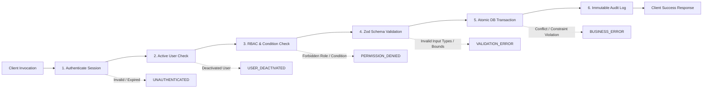

# Masaar Clinic System — Server Actions & Query Catalog (Task 1.18)

> **Specification Reference:** [docs/FEATURES-v2.2.md](file:///F:/Claude%20CRM/docs/FEATURES-v2.2.md)  
> **Screens Reference:** [docs/design/screens.md](file:///F:/Claude%20CRM/docs/design/screens.md)  
> **Permissions Reference:** [docs/design/permissions.md](file:///F:/Claude%20CRM/docs/design/permissions.md) & [`src/domain/permissions.ts`](file:///F:/Claude%20CRM/src/domain/permissions.ts)  
> **Constraints & Rule ID Reference:** [docs/design/constraints.md](file:///F:/Claude%20CRM/docs/design/constraints.md) & [docs/design/rules-index.md](file:///F:/Claude%20CRM/docs/design/rules-index.md)  
> **Status Machines Reference:** [docs/design/state-machines.md](file:///F:/Claude%20CRM/docs/design/state-machines.md)  
> **Calculations Reference:** [docs/design/calculations.md](file:///F:/Claude%20CRM/docs/design/calculations.md)  
> **Status:** Stage 1 Design Deliverable (Task 1.18)

---

## 1. Architectural Pattern: The `defineAction()` Pipeline

In strict compliance with **Rule R-0-2**, every state-mutating server action in the Masaar Clinic System executes through the uniform `defineAction()` pipeline wrapper:



### 1.1 Pipeline Standard Invariants
1. **Authentication (`auth`):** Verifies the cryptographically signed `user_sessions` bearer cookie. Rejects unauthenticated requests with HTTP 401 / `UNAUTHENTICATED`.
2. **Active User (`user.isActive`):** Verifies that `user.is_active = true`. Deactivated accounts (`R-3-5`) are blocked immediately with `USER_DEACTIVATED`.
3. **Permission Check (`hasPermission`):** Matches the user's role against `PERMISSIONS_MATRIX` in [`src/domain/permissions.ts`](file:///F:/Claude%20CRM/src/domain/permissions.ts). Checks dynamic conditions:
   - `COVERING_ACCESS_WITH_REASON`: Verified against active session covering grant in `covering_access_logs` (`R-1.1-21`).
   - `NOTE_AUTHOR_ONLY`: Confirms `note.clinician_id === user.id` within 24h window (`R-9.2-1`).
   - `OWN_SAME_DAY_UNCLOSED_SHIFT_ONLY`: Confirms expense author and unclosed cash shift (`R-1.1-16`, DEC-020).
4. **Zod Validation:** Validates all client inputs against strict Zod schemas before touching the database. Coerces integer piasters and UTC timestamps.
5. **Database Transaction (`prisma.$transaction`):** All multi-table updates execute inside an atomic PostgreSQL transaction with `ReadCommitted` or `Serializable` isolation.
6. **Audit Event Dispatch (`audit_logs`):** Automatically emits an immutable audit event (`R-13-1`) containing `user_id`, `action_name`, `entity_table`, `record_id`, `before_json`, `after_json`, client `ip_address`, and `user_agent`.
7. **Idempotency & Double-Click Safety:** All critical payment, booking, closing, and completion forms accept a client-generated UUID `idempotency_key` or leverage unique database constraints to prevent duplicate execution on double-click.

---

## 2. Server Actions Master Catalog

### Module A: Authentication & User Session Management

#### 1. `auth.loginWithCredentials`
- **Route & Trigger:** `/auth/login` (`SCR-A01`) — Form submission `SUBMIT_LOGIN`.
- **Permission Action:** `auth.login` (Action `#43` — Public / System).
- **Enforced Rule IDs:** `R-3-4`, `R-3-5`, `R-15.1-1`, `R-15.1-2`.
- **Input Zod Schema:**
  ```typescript
  z.object({
    email: z.string().trim().email().toLowerCase(),
    password: z.string().min(8).max(128),
    rememberDevice: z.boolean().default(false),
  })
  ```
- **Tables Written:** `login_attempts` (Create), `users` (Update `last_login_at`).
- **Transaction:** No.
- **Audit Event:** `AUTH_LOGIN_SUCCESS` or `AUTH_LOGIN_FAILED`.
- **Idempotency:** Rate-limited to max 5 failed attempts per IP/Email per 15 minutes (`R-15.1-2`).
- **Possible Errors:**
  - `INVALID_CREDENTIALS` (AR: "البريد الإلكتروني أو كلمة المرور غير صحيحة" / EN: "Invalid email or password").
  - `ACCOUNT_DEACTIVATED` (AR: "هذا الحساب معطل، يرجى التواصل مع إدارة العيادة" / EN: "Account is deactivated. Contact management").
  - `RATE_LIMIT_EXCEEDED` (AR: "تم تجاوز الحد الأقصى للمحاولات. يرجى الانتظار 15 دقيقة" / EN: "Too many failed attempts. Try again in 15 minutes").

#### 2. `auth.setupTotp`
- **Route & Trigger:** `/auth/setup-totp` (`SCR-A02`) — First login `CONFIRM_TOTP_SETUP`.
- **Permission Action:** `auth.totp.enroll` (Action `#41`, `#43`).
- **Enforced Rule IDs:** `R-15.2-1`, `R-15.2-2`.
- **Input Zod Schema:**
  ```typescript
  z.object({
    totpCode: z.string().trim().regex(/^\d{6}$/),
    confirmedBackupSaved: z.literal(true),
  })
  ```
- **Tables Written:** `otp_secrets` (Create encrypted base32 secret), `otp_backup_codes` (Create 8 bcrypt-hashed codes), `users` (Update `totp_enrolled = true`).
- **Transaction:** Yes (`$transaction`).
- **Audit Event:** `AUTH_TOTP_ENROLLED`.
- **Idempotency:** One active secret per user (`UNIQUE (user_id)`).
- **Possible Errors:**
  - `INVALID_TOTP_CODE` (AR: "رمز التحقق غير صحيح، يرجى المحاولة مرة أخرى" / EN: "Invalid 6-digit verification code").
  - `BACKUP_CONFIRMATION_REQUIRED` (AR: "يجب تأكيد حفظ الرموز الاحتياطية للمتابعة" / EN: "Must confirm backup codes are safely stored").

#### 3. `auth.verifyTotpChallenge`
- **Route & Trigger:** `/auth/verify-totp` (`SCR-A03`) — 2FA challenge `VERIFY_TOTP_CODE`.
- **Permission Action:** `auth.totp.verify` (Action `#43`).
- **Enforced Rule IDs:** `R-15.2-1`, `R-15.2-2`, `R-15.2-4`.
- **Input Zod Schema:**
  ```typescript
  z.object({
    codeOrBackup: z.string().trim().min(6).max(12),
    isBackupCode: z.boolean().default(false),
    trustDevice30Days: z.boolean().default(false),
  })
  ```
- **Tables Written:** `user_sessions` (Create session token hash), `trusted_devices` (Create 30-day token hash if checked), `otp_backup_codes` (Update `is_used = true, used_at = now()` if backup code).
- **Transaction:** Yes (`$transaction`).
- **Audit Event:** `AUTH_SESSION_ESTABLISHED`.
- **Idempotency:** Token generation uses CSPRNG UUIDv4.
- **Possible Errors:**
  - `INVALID_TOTP_CODE` (AR: "رمز التحقق غير صحيح أو منتهي الصلاحية" / EN: "Incorrect or expired TOTP code").
  - `BACKUP_CODE_USED` (AR: "هذا الرمز الاحتياطي تم استخدامه مسبقاً" / EN: "Backup code already used").
  - `BACKUP_CODES_EXHAUSTED` (AR: "تم استنفاذ جميع الرموز الاحتياطية. يرجى مراجعة المالك" / EN: "Backup codes exhausted. Contact Owner").

#### 4. `auth.requestPasswordReset`
- **Route & Trigger:** `/auth/forgot-password` (`SCR-A04`) — `REQUEST_PASSWORD_RESET`.
- **Permission Action:** `auth.password.reset` (Action `#40`).
- **Enforced Rule IDs:** `R-3-4`, `R-15.1-3`.
- **Input Zod Schema:**
  ```typescript
  z.object({
    email: z.string().trim().email().toLowerCase(),
  })
  ```
- **Tables Written:** `password_reset_codes` (Create 6-digit code, 10 min expiry).
- **Transaction:** No.
- **Audit Event:** `AUTH_PASSWORD_RESET_REQUESTED`.
- **Idempotency:** Rate-limited to 3 requests per hour. Always returns success to prevent email enumeration.
- **Possible Errors:**
  - Generic non-leaking response (AR: "إذا كان البريد مسجلاً، فسيتم إرسال تعليمات إعادة التعيين" / EN: "If the email is registered, instructions have been sent").

#### 5. `auth.confirmPasswordReset`
- **Route & Trigger:** `/auth/reset-password` — Link submission.
- **Permission Action:** `auth.password.reset` (Action `#40`).
- **Enforced Rule IDs:** `R-3-4`, `R-15.1-3`.
- **Input Zod Schema:**
  ```typescript
  z.object({
    token: z.string().trim(),
    newPassword: z.string().min(8).max(128),
  })
  ```
- **Tables Written:** `users` (Update password hash), `password_reset_codes` (Update `used = true`), `user_sessions` (Delete all active sessions).
- **Transaction:** Yes (`$transaction`).
- **Audit Event:** `AUTH_PASSWORD_RESET_COMPLETED`.
- **Idempotency:** One-time token use.
- **Possible Errors:**
  - `RESET_TOKEN_EXPIRED` (AR: "رمز إعادة التعيين منتهي الصلاحية أو غير صالح" / EN: "Reset token expired or invalid").
  - `WEAK_PASSWORD` (AR: "كلمة المرور يجب أن تتكون من 8 أحرف على الأقل" / EN: "Password must be at least 8 characters").

#### 6. `auth.quickUnlockSession`
- **Route & Trigger:** `MDL-A05` (Idle Timeout Modal) — `UNLOCK_SESSION`.
- **Permission Action:** `auth.login` (Action `#43`).
- **Enforced Rule IDs:** `R-15.3-1` (15-min idle lock), DEC-011.
- **Input Zod Schema:**
  ```typescript
  z.object({
    password: z.string().min(8),
  })
  ```
- **Tables Written:** `user_sessions` (Update `last_activity_at = now()`).
- **Transaction:** No.
- **Audit Event:** `AUTH_SESSION_UNLOCKED`.
- **Idempotency:** Safe on repeat.
- **Possible Errors:**
  - `INVALID_PASSWORD` (AR: "كلمة المرور غير صحيحة" / EN: "Password incorrect").

#### 7. `auth.logout`
- **Route & Trigger:** Global top navigation / `PROCEED_SWITCH_USER` in `MDL-A05`.
- **Permission Action:** `auth.login` (Action `#43`).
- **Enforced Rule IDs:** `R-15.3-2`.
- **Input Zod Schema:**
  ```typescript
  z.object({})
  ```
- **Tables Written:** `user_sessions` (Delete active session).
- **Transaction:** No.
- **Audit Event:** `AUTH_LOGOUT`.
- **Idempotency:** Safe on repeat.
- **Possible Errors:** None (silent clear).

---

### Module B: Patient Administration & Documents

#### 8. `patient.createPatient`
- **Route & Trigger:** `/reception/patients/new` (`SCR-C02`) — `SUBMIT_PATIENT_REGISTRATION`.
- **Permission Action:** `patient.admin.create_edit` (Action `#1` — Owner, Manager, Receptionist).
- **Enforced Rule IDs:** `R-1.1-1`, `R-4.1-1` to `R-4.1-16`, `R-4.1-22`, DEC-014, DEC-022.
- **Input Zod Schema:**
  ```typescript
  z.object({
    fullName: z.string().trim().min(3).max(120),
    dateOfBirth: z.string().regex(/^\d{4}-\d{2}-\d{2}$/), // YYYY-MM-DD
    gender: z.enum(['MALE', 'FEMALE']),
    nationalId: z.string().trim().regex(/^\d{14}$/).optional().nullable(),
    isDependent: z.boolean().default(false),
    mobilePhone: z.string().trim().regex(/^01[0125]\d{8}$/).optional().nullable(),
    guardianName: z.string().trim().min(3).max(120).optional().nullable(),
    guardianRelationship: z.string().trim().min(2).max(50).optional().nullable(),
    guardianPhone: z.string().trim().regex(/^01[0125]\d{8}$/).optional().nullable(),
    address: z.string().trim().max(255).optional().nullable(),
    emergencyContactName: z.string().trim().max(120).optional().nullable(),
    emergencyContactPhone: z.string().trim().max(20).optional().nullable(),
    preferredLanguage: z.enum(['AR', 'EN']).default('AR'),
    referralSource: z.enum(['DOCTOR', 'SOCIAL_MEDIA', 'FRIEND_FAMILY', 'WALK_IN', 'OTHER']),
    referringDoctor: z.string().trim().max(120).optional().nullable(),
    assignedPhysiotherapistId: z.string().uuid().optional().nullable(),
    assignedNutritionistId: z.string().uuid().optional().nullable(),
    medicalAlerts: z.array(z.string()).default([]),
    generalAlertNote: z.string().trim().max(255).optional().nullable(),
    dataProcessingConsent: z.literal(true), // Mandatory R-4.1-15
    whatsappConsent: z.boolean().default(true), // Optional toggle DEC-022
  }).refine((data) => {
    if (data.isDependent) {
      return !data.mobilePhone && data.guardianName && data.guardianRelationship && data.guardianPhone;
    }
    return !!data.mobilePhone && !data.guardianName && !data.guardianPhone;
  }, { message: "Invalid dependent / mobile phone integrity" })
  ```
- **Tables Written:** `patients` (Create with sequential `file_number` like `MAS-00104`).
- **Transaction:** Yes (`$transaction`).
- **Audit Event:** `PATIENT_CREATED`.
- **Idempotency:** Unique partial index `idx_patients_mobile_phone_unique` on `mobile_phone` blocks concurrent duplicate creation.
- **Possible Errors:**
  - `DUPLICATE_MOBILE_PHONE` (AR: "رقم الهاتف مسجل بالفعل لمريض آخر" / EN: "Mobile phone already registered to another patient").
  - `INVALID_DEPENDENT_DATA` (AR: "بيانات ولي الأمر إلزامية للمريض التابع" / EN: "Guardian details are required for dependents").
  - `DATA_CONSENT_REQUIRED` (AR: "موافقة معالجة البيانات إلزامية لإنشاء الملف" / EN: "Data processing consent is required").

#### 9. `patient.updatePatientDemographics`
- **Route & Trigger:** `/reception/patients/[id]` (`SCR-C03`) — `EDIT_DEMOGRAPHICS`.
- **Permission Action:** `patient.admin.create_edit` (Action `#1` — Owner, Manager, Receptionist).
- **Enforced Rule IDs:** `R-1.1-1`, `R-4.1-1` to `R-4.1-14`.
- **Input Zod Schema:**
  ```typescript
  z.object({
    patientId: z.string().uuid(),
    fullName: z.string().trim().min(3).max(120),
    address: z.string().trim().max(255).optional().nullable(),
    emergencyContactName: z.string().trim().max(120).optional().nullable(),
    emergencyContactPhone: z.string().trim().max(20).optional().nullable(),
    preferredLanguage: z.enum(['AR', 'EN']),
    referralSource: z.enum(['DOCTOR', 'SOCIAL_MEDIA', 'FRIEND_FAMILY', 'WALK_IN', 'OTHER']),
    referringDoctor: z.string().trim().max(120).optional().nullable(),
    whatsappConsent: z.boolean(),
  })
  ```
- **Tables Written:** `patients` (Update).
- **Transaction:** Yes.
- **Audit Event:** `PATIENT_DEMOGRAPHICS_UPDATED`.
- **Idempotency:** Safe on repeat.
- **Possible Errors:**
  - `PATIENT_NOT_FOUND` (AR: "ملف المريض غير موجود" / EN: "Patient file not found").

#### 10. `patient.dischargePatient`
- **Route & Trigger:** `MDL-E05` (Patient Discharge Modal) — `SUBMIT_DISCHARGE`.
- **Permission Action:** `patient.discharge` (Action `#13` — Owner, Physiotherapist, Nutritionist).
- **Enforced Rule IDs:** `R-4.1-19`, `R-9.5-1`.
- **Input Zod Schema:**
  ```typescript
  z.object({
    patientId: z.string().uuid(),
    dischargeReason: z.enum(['GOALS_ACHIEVED', 'MAX_IMPROVEMENT', 'PATIENT_DISCONTINUED', 'REFERRED_SURGERY_SPECIALIST']),
    finalPainScore: z.number().int().min(0).max(10),
    outcomeSummary: z.string().trim().min(10).max(1000),
    postDischargeRecommendations: z.string().trim().max(1000).optional().nullable(),
  })
  ```
- **Tables Written:** `patients` (Update `status = DISCHARGED, discharged_at = now(), discharged_by_user_id = user.id`).
- **Transaction:** Yes.
- **Audit Event:** `PATIENT_DISCHARGED`.
- **Idempotency:** Transitions patient state machine to `DISCHARGED`.
- **Possible Errors:**
  - `PATIENT_ALREADY_DISCHARGED` (AR: "المريض تم إنهاء علاجه بالفعل" / EN: "Patient is already discharged").

#### 11. `patient.uploadDocument`
- **Route & Trigger:** `/reception/patients/[id]` (`SCR-C03`) / `/clinical/patients/[id]` (`SCR-E02`) — `UPLOAD_DOCUMENT`.
- **Permission Action:** `patient.document.upload` (Action `#4` — Owner, Manager, Receptionist for ADMIN docs; Clinician for CLINICAL docs `R-1.1-3`).
- **Enforced Rule IDs:** `R-1.1-3`, `R-4.1-17`, `R-4.1-18`.
- **Input Zod Schema:**
  ```typescript
  z.object({
    patientId: z.string().uuid(),
    title: z.string().trim().min(2).max(120),
    category: z.enum(['NATIONAL_ID', 'INSURANCE', 'PAYMENT_PROOF', 'XRAY', 'MRI', 'LAB_REPORT', 'CLINICAL_REPORT']),
    mimeType: z.enum(['application/pdf', 'image/jpeg', 'image/png']),
    fileSizeBytes: z.number().int().max(10 * 1024 * 1024), // Max 10MB
    storageKey: z.string().trim(),
  })
  ```
- **Tables Written:** `patient_documents` (Create).
- **Transaction:** No.
- **Audit Event:** `PATIENT_DOCUMENT_UPLOADED`.
- **Idempotency:** Document upload creates unique storage record.
- **Possible Errors:**
  - `RECEPTIONIST_CLINICAL_DOC_FORBIDDEN` (AR: "موظف الاستقبال غير مصرح له برفع مستندات طبية سريرية" / EN: "Receptionist cannot upload clinical documents").
  - `FILE_TOO_LARGE` (AR: "حجم الملف يتجاوز الحد الأقصى المسموح به (10 ميجابايت)" / EN: "File size exceeds maximum limit of 10MB").
  - `UNSUPPORTED_FILE_TYPE` (AR: "نوع الملف غير مدعوم، يُسمح فقط بملفات PDF والصور" / EN: "Unsupported file type. Only PDF and images allowed").

#### 12. `patient.requestCoveringAccess`
- **Route & Trigger:** `MDL-C04` (Covering Access Modal) — `SUBMIT_COVERING_ACCESS`.
- **Permission Action:** `patient.covering_access.request` (Action `#3` — Physiotherapist, Nutritionist).
- **Enforced Rule IDs:** `R-1.1-21`, `R-13-1`, DEC-013.
- **Input Zod Schema:**
  ```typescript
  z.object({
    patientId: z.string().uuid(),
    reason: z.string().trim().min(10).max(500),
    sessionId: z.string().uuid().optional().nullable(),
  })
  ```
- **Tables Written:** `covering_access_logs` (Create immutable record, expires at session end or max 12h).
- **Transaction:** Yes.
- **Audit Event:** `COVERING_ACCESS_GRANTED`.
- **Idempotency:** Active grant valid for 12 hours.
- **Possible Errors:**
  - `EMPTY_COVERING_REASON` (AR: "يجب توضيح سبب فتح الملف الطبي بالتفصيل" / EN: "Detailed covering reason is required").

---

### Module C: Appointments & Calendar Scheduling

#### 13. `appointment.bookAppointment`
- **Route & Trigger:** `MDL-B03` (Appointment Booking Modal) — `SUBMIT_BOOKING`.
- **Permission Action:** `appointment.book_reschedule_cancel` (Action `#5` — Owner, Manager, Receptionist).
- **Enforced Rule IDs:** `R-1.1-4`, `R-5.1-1` to `R-5.1-6`, `R-5.2-1` to `R-5.2-12`, `R-7-3`, DEC-012.
- **Input Zod Schema:**
  ```typescript
  z.object({
    idempotencyKey: z.string().uuid(),
    patientId: z.string().uuid(),
    sessionTypeId: z.string().uuid(),
    clinicianId: z.string().uuid(),
    roomId: z.string().uuid(),
    bedId: z.string().uuid(),
    startsAt: z.string().datetime(), // ISO UTC
    durationMinutes: z.number().int().min(15).max(180).refine(m => m % 15 === 0),
    pricePiasters: z.number().int().positive(),
    priceAdjustmentReason: z.string().trim().max(255).optional().nullable(),
    packageId: z.string().uuid().optional().nullable(),
  })
  ```
- **Tables Written:** `appointments` (Create `SCHEDULED`), `charges` (Create service charge linked to appointment, or link to package), `price_change_history` (Create if price adjusted from catalog default DEC-012).
- **Transaction:** Yes (`$transaction`).
- **Audit Event:** `APPOINTMENT_BOOKED`.
- **Idempotency:** Client `idempotencyKey` + PostgreSQL exclusion constraints (`btree_gist`) reject duplicate overlapping inserts.
- **Possible Errors:**
  - `CLINICIAN_DOUBLE_BOOKED` (AR: "الأخصائي لديه موعد آخر متعارض في هذا التوقيت" / EN: "Clinician has an overlapping booking").
  - `BED_DOUBLE_BOOKED` (AR: "السرير محجوز لمريض آخر في هذا الوقت" / EN: "Treatment bed is already booked").
  - `PATIENT_DOUBLE_BOOKED` (AR: "المريض لديه موعد آخر مسجل في نفس التوقيت" / EN: "Patient already has an appointment at this time").
  - `CLINIC_CLOSED` (AR: "التوقيت المحدد يقع خارج ساعات العمل الرسمية أو في يوم عطلة" / EN: "Clinic is closed at selected time").
  - `STAFF_ON_LEAVE` (AR: "الأخصائي في إجازة مسجلة في هذا التاريخ" / EN: "Clinician is on approved leave").
  - `PACKAGE_NO_SESSIONS` (AR: "الباقة لا تحتوي على جلسات متاحة للحجز" / EN: "Package has no remaining available sessions").
  - `PACKAGE_EXPIRED` (AR: "الباقة منتهية الصلاحية ولا يمكن الحجز بها" / EN: "Package validity has expired").

#### 14. `appointment.bookRecurringSeries`
- **Route & Trigger:** `MDL-B04` (Recurring Series Preview Modal) — `CONFIRM_SERIES_BOOKING`.
- **Permission Action:** `appointment.book_reschedule_cancel` (Action `#5`).
- **Enforced Rule IDs:** `R-5.1-5`, `R-7-3`.
- **Input Zod Schema:**
  ```typescript
  z.object({
    idempotencyKey: z.string().uuid(),
    patientId: z.string().uuid(),
    sessionTypeId: z.string().uuid(),
    clinicianId: z.string().uuid(),
    roomId: z.string().uuid(),
    packageId: z.string().uuid().optional().nullable(),
    seriesName: z.string().trim().max(120),
    slots: z.array(z.object({
      bedId: z.string().uuid(),
      startsAt: z.string().datetime(),
      durationMinutes: z.number().int().min(15).max(180),
      pricePiasters: z.number().int().positive(),
    })).min(2).max(48),
  })
  ```
- **Tables Written:** `appointment_series` (Create master series), `appointments` (Create multiple appointments linked to series), `charges`.
- **Transaction:** Yes (`$transaction` with atomic all-or-nothing rollback).
- **Audit Event:** `APPOINTMENT_SERIES_BOOKED`.
- **Idempotency:** Validated inside transaction; all slots must satisfy exclusion constraints.
- **Possible Errors:**
  - `SERIES_CONFLICT_EXISTS` (AR: "توجد تعارضات في بعض مواعيد السلسلة لم يتم حلها" / EN: "Unresolved scheduling conflicts in series").
  - `PACKAGE_SESSIONS_EXCEEDED` (AR: "عدد مواعيد السلسلة يتجاوز الجلسات المتاحة في الباقة" / EN: "Series count exceeds available package sessions").

#### 15. `appointment.checkInPatient`
- **Route & Trigger:** `/reception/today` (`SCR-B01`) / `DRW-B05` — `CHECK_IN_PATIENT`.
- **Permission Action:** `appointment.check_in` (Action `#6` — Owner, Manager, Receptionist).
- **Enforced Rule IDs:** `R-1.1-5`, `R-5.3-1`, calculations.md §3.2.
- **Input Zod Schema:**
  ```typescript
  z.object({
    appointmentId: z.string().uuid(),
    notes: z.string().trim().max(255).optional().nullable(),
  })
  ```
- **Tables Written:** `appointments` (Update `status = ARRIVED, check_in_at = now(), late_minutes = max(0, (now() - starts_at)/60)`), `appointment_status_history` (Create transition log).
- **Transaction:** Yes.
- **Audit Event:** `PATIENT_CHECKED_IN`.
- **Idempotency:** Guarded by appointment state machine (`SCHEDULED -> ARRIVED`).
- **Possible Errors:**
  - `INVALID_STATUS_TRANSITION` (AR: "لا يمكن تسجيل حضور لموعد ليس في حالة مجدول" / EN: "Cannot check in appointment not in SCHEDULED status").

#### 16. `appointment.undoCheckIn`
- **Route & Trigger:** `/reception/today` (`SCR-B01`) / `DRW-B05` — `UNDO_CHECK_IN`.
- **Permission Action:** `appointment.undo_check_in` (Action `#7` — Owner, Manager, Receptionist same-day).
- **Enforced Rule IDs:** `R-1.1-6`, `R-5.3-2`.
- **Input Zod Schema:**
  ```typescript
  z.object({
    appointmentId: z.string().uuid(),
    reason: z.string().trim().min(3).max(255),
  })
  ```
- **Tables Written:** `appointments` (Update `status = SCHEDULED, check_in_at = null, late_minutes = 0`), `appointment_status_history` (Create).
- **Transaction:** Yes.
- **Audit Event:** `PATIENT_CHECK_IN_UNDONE`.
- **Idempotency:** State machine transition `ARRIVED -> SCHEDULED`.
- **Possible Errors:**
  - `NOT_SAME_DAY` (AR: "لا يمكن التراجع عن تسجيل الحضور إلا في نفس اليوم" / EN: "Check-in can only be undone on the same day").
  - `SESSION_ALREADY_COMPLETED` (AR: "لا يمكن التراجع عن الحضور بعد اكتمال الجلسة السريرية" / EN: "Cannot undo check-in for completed session").

#### 17. `appointment.rescheduleAppointment`
- **Route & Trigger:** `DRW-B05` / Drag-and-drop on `/reception/calendar` (`SCR-B02`) — `RESCHEDULE_APPOINTMENT`.
- **Permission Action:** `appointment.book_reschedule_cancel` (Action `#5`).
- **Enforced Rule IDs:** `R-5.4-1`, `R-5.2-1` to `R-5.2-12`.
- **Input Zod Schema:**
  ```typescript
  z.object({
    appointmentId: z.string().uuid(),
    newStartsAt: z.string().datetime(),
    newBedId: z.string().uuid(),
    newClinicianId: z.string().uuid().optional(),
    rescheduleReason: z.string().trim().max(255).optional(),
  })
  ```
- **Tables Written:** `appointments` (Update `starts_at, ends_at, bed_id, clinician_id`), `appointment_status_history` (Create `RESCHEDULED` record).
- **Transaction:** Yes.
- **Audit Event:** `APPOINTMENT_RESCHEDULED`.
- **Idempotency:** PostgreSQL `btree_gist` exclusion constraints block collision.
- **Possible Errors:**
  - `NEW_SLOT_COLLISION` (AR: "الموعد الجديد يتعارض مع حجز قائم للسرير أو الأخصائي" / EN: "New time slot conflicts with an existing booking").
  - `CANNOT_RESCHEDULE_COMPLETED` (AR: "لا يمكن تعديل موعد مكتمل" / EN: "Cannot reschedule completed appointment").

#### 18. `appointment.cancelAppointment`
- **Route & Trigger:** `DRW-B05` — `CANCEL_APPOINTMENT`.
- **Permission Action:** `appointment.book_reschedule_cancel` (Action `#5`).
- **Enforced Rule IDs:** `R-5.4-2`, `R-7-5`.
- **Input Zod Schema:**
  ```typescript
  z.object({
    appointmentId: z.string().uuid(),
    cancellationReason: z.enum(['PATIENT_ILLNESS', 'PATIENT_TRAVEL', 'PERSONAL_EMERGENCY', 'NO_RESPONSE', 'CLINIC_CANCELLED', 'OTHER']),
    cancellationNotes: z.string().trim().max(255).optional().nullable(),
  })
  ```
- **Tables Written:** `appointments` (Update `status = CANCELLED, cancelled_at = now(), cancelled_by_user_id = user.id`), `appointment_status_history` (Create), `charges` (Void charge if unbilled).
- **Transaction:** Yes.
- **Audit Event:** `APPOINTMENT_CANCELLED`.
- **Idempotency:** State machine transition (`SCHEDULED -> CANCELLED`). Package session is held available for rebooking.
- **Possible Errors:**
  - `CANNOT_CANCEL_COMPLETED` (AR: "لا يمكن إلغاء موعد تم استكماله سريرياً" / EN: "Cannot cancel a clinically completed appointment").

#### 19. `appointment.markNoShow`
- **Route & Trigger:** `/reception/today` (`SCR-B01`) / `/clinical/queue` (`SCR-E01`) — `MARK_NO_SHOW`.
- **Permission Action:** `appointment.mark_undo_noshow` (Action `#8` — Front desk, Clinician).
- **Enforced Rule IDs:** `R-1.1-6`, `R-5.3-3`.
- **Input Zod Schema:**
  ```typescript
  z.object({
    appointmentId: z.string().uuid(),
    notes: z.string().trim().max(255).optional().nullable(),
  })
  ```
- **Tables Written:** `appointments` (Update `status = NO_SHOW`), `appointment_status_history` (Create).
- **Transaction:** Yes.
- **Audit Event:** `APPOINTMENT_MARKED_NO_SHOW`.
- **Idempotency:** State machine transition (`SCHEDULED / ARRIVED -> NO_SHOW`).
- **Possible Errors:**
  - `NOT_PAST_START_TIME` (AR: "لا يمكن تسجيل عدم الحضور قبل حلول وقت بدء الموعد" / EN: "Cannot mark no-show before appointment start time").

#### 20. `appointment.undoNoShow`
- **Route & Trigger:** `/reception/today` (`SCR-B01`) — `UNDO_NO_SHOW`.
- **Permission Action:** `appointment.mark_undo_noshow` (Action `#8`).
- **Enforced Rule IDs:** `R-1.1-6`, `R-5.3-4`.
- **Input Zod Schema:**
  ```typescript
  z.object({
    appointmentId: z.string().uuid(),
    reason: z.string().trim().min(3).max(255),
  })
  ```
- **Tables Written:** `appointments` (Update `status = SCHEDULED` or `ARRIVED`), `appointment_status_history` (Create).
- **Transaction:** Yes.
- **Audit Event:** `APPOINTMENT_NO_SHOW_UNDONE`.
- **Idempotency:** State machine transition (`NO_SHOW -> SCHEDULED / ARRIVED`).
- **Possible Errors:**
  - `NOT_SAME_DAY` (AR: "لا يمكن التراجع عن تسجيل الغياب إلا في نفس اليوم" / EN: "No-show can only be undone on the same day").

#### 21. `appointment.moveToWaitlist`
- **Route & Trigger:** `DRW-B05` — `MOVE_TO_WAITLIST`.
- **Permission Action:** `appointment.book_reschedule_cancel` (Action `#5`).
- **Enforced Rule IDs:** `R-5.5-1`, DEC-008.
- **Input Zod Schema:**
  ```typescript
  z.object({
    appointmentId: z.string().uuid(),
    waitlistNotes: z.string().trim().max(255).optional().nullable(),
  })
  ```
- **Tables Written:** `appointments` (Update `status = WAITLISTED, bed_id = null`), `appointment_status_history` (Create).
- **Transaction:** Yes.
- **Audit Event:** `APPOINTMENT_MOVED_TO_WAITLIST`.
- **Idempotency:** Frees bed from exclusion constraints while keeping package session consumed (`R-5.5-1`).
- **Possible Errors:**
  - `CANNOT_WAITLIST_COMPLETED` (AR: "لا يمكن تحويل موعد مكتمل إلى قائمة الانتظار" / EN: "Cannot move completed appointment to waitlist").

#### 22. `appointment.scheduleFromWaitlist`
- **Route & Trigger:** `MDL-B03` — `SCHEDULE_FROM_WAITLIST`.
- **Permission Action:** `appointment.book_reschedule_cancel` (Action `#5`).
- **Enforced Rule IDs:** `R-5.5-2`.
- **Input Zod Schema:**
  ```typescript
  z.object({
    appointmentId: z.string().uuid(),
    targetStartsAt: z.string().datetime(),
    targetBedId: z.string().uuid(),
    targetClinicianId: z.string().uuid(),
  })
  ```
- **Tables Written:** `appointments` (Update `status = SCHEDULED, starts_at, ends_at, bed_id, clinician_id`), `appointment_status_history` (Create).
- **Transaction:** Yes.
- **Audit Event:** `APPOINTMENT_SCHEDULED_FROM_WAITLIST`.
- **Idempotency:** Exclusion constraints validate chosen slot.
- **Possible Errors:**
  - `SLOT_CONFLICT` (AR: "الموعد المحدد يتعارض مع حجز آخر" / EN: "Selected slot has a booking conflict").

#### 23. `appointment.logWhatsAppReminderSent`
- **Route & Trigger:** `/reception/today` (`SCR-B01`) / `DRW-B05` — `WHATSAPP_REMINDER`.
- **Permission Action:** `communication.whatsapp.send` (Action `#38` — Owner, Manager, Receptionist).
- **Enforced Rule IDs:** `R-6-1`, `R-6-2`.
- **Input Zod Schema:**
  ```typescript
  z.object({
    appointmentId: z.string().uuid(),
    templateKey: z.string().trim(),
    recipientPhone: z.string().trim(),
  })
  ```
- **Tables Written:** `appointment_reminders` (Create record with timestamp).
- **Transaction:** No.
- **Audit Event:** `WHATSAPP_REMINDER_LOGGED`.
- **Idempotency:** Safe on repeat.
- **Possible Errors:**
  - `PATIENT_WHATSAPP_OPTED_OUT` (AR: "المريض غير موافق على تلقي رسائل واتساب" / EN: "Patient opted out of WhatsApp reminders").

---

### Module D: Clinical Documentation & Notes

#### 24. `clinical.completeSession`
- **Route & Trigger:** `/clinical/sessions/[id]/complete` (`SCR-E03`) — `SUBMIT_SESSION_COMPLETION`.
- **Permission Action:** `clinical.session.complete` (Action `#9` — Owner, Treating Physiotherapist `R-1.1-7`).
- **Enforced Rule IDs:** `R-1.1-7`, `R-9.1-1` to `R-9.1-7`, `R-9.2-1`, `R-11-1`.
- **Input Zod Schema:**
  ```typescript
  z.object({
    appointmentId: z.string().uuid(),
    painScoreBefore: z.number().int().min(0).max(10),
    painScoreAfter: z.number().int().min(0).max(10),
    subjective: z.string().trim().min(5).max(2000),
    objective: z.string().trim().min(5).max(2000),
    assessment: z.string().trim().min(5).max(2000),
    plan: z.string().trim().min(5).max(2000),
    treatmentModalities: z.array(z.string().trim()).min(1),
    homeExercises: z.string().trim().max(1000).optional().nullable(),
  })
  ```
- **Tables Written:** `clinical_notes` (Create signed note), `clinical_note_versions` (Create initial Version 1 snapshot), `appointments` (Update `status = COMPLETED`), `appointment_status_history` (Create).
- **Transaction:** Yes (`$transaction`).
- **Audit Event:** `CLINICAL_SESSION_COMPLETED`.
- **Idempotency:** Guarded by `UNIQUE (appointment_id)` on `clinical_notes`. Cannot complete the same appointment twice.
- **Possible Errors:**
  - `NOT_TREATING_CLINICIAN` (AR: "لا يمكن توثيق الجلسة إلا بواسطة المعالج المتابع أو المالك" / EN: "Only treating clinician or Owner can complete session").
  - `APPOINTMENT_ALREADY_COMPLETED` (AR: "الجلسة مسجلة كمكتملة بالفعل ولها تقرير طبي معتمد" / EN: "Session already completed with signed clinical note").
  - `MISSING_TREATMENTS` (AR: "يجب اختيار إجراء علاجي واحد على الأقل" / EN: "Must select at least one treatment modality").

#### 25. `clinical.completeNutritionConsultation`
- **Route & Trigger:** `/nutrition/consultations/[id]/complete` (`SCR-E06`) — `SUBMIT_NUTRITION_CONSULTATION`.
- **Permission Action:** `clinical.session.complete` (Action `#9` — Owner, Treating Nutritionist).
- **Enforced Rule IDs:** `R-9.4-1`, `R-9.4-2`, `R-11-1`, DEC-019.
- **Input Zod Schema:**
  ```typescript
  z.object({
    appointmentId: z.string().uuid(),
    heightCm: z.number().min(50).max(250),
    weightKg: z.number().min(20).max(300),
    bodyFatPercentage: z.number().min(3).max(60).optional().nullable(),
    skeletalMuscleMassKg: z.number().min(10).max(150).optional().nullable(),
    visceralFatLevel: z.number().int().min(1).max(20).optional().nullable(),
    totalBodyWaterLiters: z.number().min(10).max(100).optional().nullable(),
    bmrDeviceOverrideKcal: z.number().int().positive().optional().nullable(),
    nutritionNotes: z.string().trim().min(5).max(2000),
    calorieTargetKcal: z.number().int().min(800).max(6000),
    proteinGrams: z.number().min(0).max(500),
    carbsGrams: z.number().min(0).max(800),
    fatGrams: z.number().min(0).max(300),
    dietProtocol: z.string().trim().max(100),
    dietPlanText: z.string().trim().min(5).max(4000),
  })
  ```
- **Tables Written:** `inbody_records` (Create), `clinical_notes` (Create linked note), `appointments` (Update `status = COMPLETED`), `appointment_status_history` (Create).
- **Transaction:** Yes (`$transaction`).
- **Audit Event:** `NUTRITION_CONSULTATION_COMPLETED`.
- **Idempotency:** Guarded by `UNIQUE (appointment_id)` on `inbody_records`.
- **Possible Errors:**
  - `MACRO_CALORIE_MISMATCH_WARNING` (Logged if macros deviate >10% from calories).
  - `APPOINTMENT_ALREADY_COMPLETED` (AR: "الاستشارة مسجلة كمكتملة بالفعل" / EN: "Consultation already completed").

#### 26. `clinical.editClinicalNote`
- **Route & Trigger:** `MDL-E04` — `EDIT_RECENT_NOTE`.
- **Permission Action:** `clinical.note.edit_within_window` (Action `#10` — Author only within 24h `R-9.2-1`).
- **Enforced Rule IDs:** `R-9.2-1`, Trigger `trg_clinical_notes_edit_window`.
- **Input Zod Schema:**
  ```typescript
  z.object({
    noteId: z.string().uuid(),
    painScoreBefore: z.number().int().min(0).max(10),
    painScoreAfter: z.number().int().min(0).max(10),
    subjective: z.string().trim().min(5).max(2000),
    objective: z.string().trim().min(5).max(2000),
    assessment: z.string().trim().min(5).max(2000),
    plan: z.string().trim().min(5).max(2000),
    treatmentModalities: z.array(z.string().trim()).min(1),
    homeExercises: z.string().trim().max(1000).optional().nullable(),
    editReason: z.string().trim().min(3).max(255),
  })
  ```
- **Tables Written:** `clinical_notes` (Update text), `clinical_note_versions` (Create new version row with diff snapshot).
- **Transaction:** Yes (`$transaction`).
- **Audit Event:** `CLINICAL_NOTE_EDITED`.
- **Idempotency:** Increments `version_number`.
- **Possible Errors:**
  - `NOTE_EDIT_WINDOW_EXPIRED` (AR: "انتهت مهلة الـ 24 ساعة المسموحة لتعديل التقرير. يمكنك إضافة ملحق فقط" / EN: "24-hour edit window expired. You may only add an addendum").
  - `NOT_NOTE_AUTHOR` (AR: "لا يمكن تعديل التقرير إلا بواسطة الطبيب كاتب التقرير نفسه" / EN: "Only original author can edit note within 24 hours").

#### 27. `clinical.reopenClinicalNote`
- **Route & Trigger:** `MDL-E04` — `OWNER_REOPEN_NOTE`.
- **Permission Action:** `clinical.note.reopen_locked` (Action `#11` — Owner strictly `R-1.1-8`).
- **Enforced Rule IDs:** `R-1.1-8`, `R-9.2-3`.
- **Input Zod Schema:**
  ```typescript
  z.object({
    noteId: z.string().uuid(),
    justification: z.string().trim().min(10).max(500),
  })
  ```
- **Tables Written:** `clinical_notes` (Update `is_locked = false, unlock_reason = justification, unlocked_by_user_id = user.id`).
- **Transaction:** Yes.
- **Audit Event:** `CLINICAL_NOTE_REOPENED_BY_OWNER`.
- **Idempotency:** State transition (`LOCKED -> UNLOCKED`).
- **Possible Errors:**
  - `OWNER_ONLY` (AR: "إعادة فتح التقارير المغلقة صلاحية حصرية لمالك العيادة" / EN: "Re-opening locked notes is strictly restricted to Owner").

#### 28. `clinical.addClinicalNoteAddendum`
- **Route & Trigger:** `MDL-E04` — `SUBMIT_ADDENDUM`.
- **Permission Action:** `clinical.note.add_addendum` (Action `#12` — Owner, Physiotherapist, Nutritionist).
- **Enforced Rule IDs:** `R-9.2-2`.
- **Input Zod Schema:**
  ```typescript
  z.object({
    noteId: z.string().uuid(),
    addendumText: z.string().trim().min(10).max(2000),
  })
  ```
- **Tables Written:** `clinical_note_addenda` (Create immutable timestamped addendum).
- **Transaction:** Yes.
- **Audit Event:** `CLINICAL_NOTE_ADDENDUM_ADDED`.
- **Idempotency:** Appends new addendum with author ID and UTC timestamp.
- **Possible Errors:**
  - `EMPTY_ADDENDUM` (AR: "نص الملحق الطبي لا يمكن أن يكون فارغاً" / EN: "Addendum text cannot be empty").

---

### Module E: Packages & Financial Operations

#### 29. `billing.createPackage`
- **Route & Trigger:** `MDL-D01` (Create Package Modal) — `SUBMIT_CREATE_PACKAGE`.
- **Permission Action:** `package.create` (Action `#14` — Owner, Manager, Receptionist).
- **Enforced Rule IDs:** `R-1.1-9`, `R-7-1` to `R-7-5`, calculations.md §4.
- **Input Zod Schema:**
  ```typescript
  z.object({
    idempotencyKey: z.string().uuid(),
    patientId: z.string().uuid(),
    sessionTypeId: z.string().uuid(),
    name: z.string().trim().min(2).max(120),
    totalSessions: z.number().int().min(1).max(100),
    validityDays: z.number().int().min(1).max(365).default(60), // R-2-6
    totalPricePiasters: z.number().int().positive(),
  })
  ```
- **Tables Written:** `packages` (Create `ACTIVE`), `charges` (Create billing charge for package).
- **Transaction:** Yes (`$transaction`).
- **Audit Event:** `PACKAGE_CREATED`.
- **Idempotency:** Guarded by client `idempotencyKey`.
- **Possible Errors:**
  - `INVALID_SESSIONS_COUNT` (AR: "عدد الجلسات يجب أن يكون أكبر من صفر" / EN: "Total sessions must be greater than zero").
  - `INVALID_PRICE` (AR: "سعر الباقة يجب أن يكون قيمة موجبة" / EN: "Total price must be a positive integer").

#### 30. `billing.extendPackageValidity`
- **Route & Trigger:** `/reception/patients/[id]` (`SCR-C03`) Tab 2 — `EXTEND_PACKAGE_VALIDITY`.
- **Permission Action:** `package.extend_validity` (Action `#15` — Owner, Manager `R-1.1-10`).
- **Enforced Rule IDs:** `R-1.1-10`, `R-7-4`.
- **Input Zod Schema:**
  ```typescript
  z.object({
    packageId: z.string().uuid(),
    daysAdded: z.number().int().min(1).max(365),
    reason: z.string().trim().min(3).max(255),
  })
  ```
- **Tables Written:** `packages` (Update `expiry_date = expiry_date + daysAdded`), `package_extensions` (Create audit entry).
- **Transaction:** Yes (`$transaction`).
- **Audit Event:** `PACKAGE_VALIDITY_EXTENDED`.
- **Idempotency:** Appends extension row.
- **Possible Errors:**
  - `INVALID_DAYS_ADDED` (AR: "أيام التمديد يجب أن تكون بين 1 و 365 يوماً" / EN: "Days added must be between 1 and 365").

#### 31. `billing.cancelPackage`
- **Route & Trigger:** `/reception/patients/[id]` (`SCR-C03`) Tab 2 — `CANCEL_PACKAGE`.
- **Permission Action:** `package.create` (Action `#14` — Owner, Manager).
- **Enforced Rule IDs:** `R-7-5`.
- **Input Zod Schema:**
  ```typescript
  z.object({
    packageId: z.string().uuid(),
    cancellationReason: z.string().trim().min(5).max(255),
  })
  ```
- **Tables Written:** `packages` (Update `cancelled_at = now(), cancellation_reason = reason`).
- **Transaction:** Yes.
- **Audit Event:** `PACKAGE_CANCELLED`.
- **Idempotency:** State transition to `CANCELLED`.
- **Possible Errors:**
  - `PACKAGE_ALREADY_CANCELLED` (AR: "الباقة ملغاة بالفعل" / EN: "Package is already cancelled").

#### 32. `billing.adjustChargePrice`
- **Route & Trigger:** `MDL-B03` / `DRW-B05` — `ADJUST_PRICE`.
- **Permission Action:** `billing.price_change.before_payment` (Action `#18` — Front desk before payment `R-1.1-13`) or `billing.price_change.after_payment` (Action `#19` — Owner/Manager only if payment exists `R-1.1-14`).
- **Enforced Rule IDs:** `R-1.1-13`, `R-1.1-14`, `R-8.1-4`, DEC-012.
- **Input Zod Schema:**
  ```typescript
  z.object({
    chargeId: z.string().uuid(),
    newPricePiasters: z.number().int().positive(),
    reason: z.string().trim().min(3).max(255),
  })
  ```
- **Tables Written:** `charges` (Update `amount_piasters`), `price_change_history` (Create immutable audit record).
- **Transaction:** Yes (`$transaction`).
- **Audit Event:** `CHARGE_PRICE_ADJUSTED`.
- **Idempotency:** Validated against existing payments.
- **Possible Errors:**
  - `RECEPTIONIST_CANNOT_CHANGE_PAID_PRICE` (AR: "لا يمكن تعديل السعر بعد سداد دفعة إلا بواسطة المدير أو المالك" / EN: "Price cannot be altered after payment exists without Manager/Owner role").
  - `NEW_PRICE_LESS_THAN_PAID` (AR: "لا يمكن خفض السعر لمبلغ أقل من المدفوعات المسجلة بالفعل" / EN: "New price cannot be less than total non-voided payments already received").

#### 33. `billing.collectPayment`
- **Route & Trigger:** `MDL-D02` (Collect Payment Modal) — `SUBMIT_PAYMENT`.
- **Permission Action:** `billing.payment.record` (Action `#17` — Owner, Manager, Receptionist `R-1.1-11`).
- **Enforced Rule IDs:** `R-1.1-11`, `R-8.1-1` to `R-8.2-3`, `R-8.4-1`, calculations.md §5.
- **Input Zod Schema:**
  ```typescript
  z.object({
    idempotencyKey: z.string().uuid(),
    chargeId: z.string().uuid(),
    amountPiasters: z.number().int().positive(),
    paymentMethod: z.enum(['CASH', 'VISA_CARD', 'INSTAPAY', 'VODAFONE_CASH']),
    transactionReference: z.string().trim().max(100).optional().nullable(),
    notes: z.string().trim().max(255).optional().nullable(),
  }).refine((data) => {
    if (data.paymentMethod === 'INSTAPAY' || data.paymentMethod === 'VODAFONE_CASH') {
      return !!data.transactionReference && data.transactionReference.length >= 4;
    }
    return true;
  }, { message: "Transaction reference is required for digital payments" })
  ```
- **Tables Written:** `payments` (Create with sequential receipt `INV-YYYY-XXXXX`), `receipt_counters` (Increment atomic annual counter), `charges` (Links payment). Attributed to active `cash_closings` shift if method is `CASH`.
- **Transaction:** Yes (`$transaction` with `Serializable` lock on `receipt_counters`).
- **Audit Event:** `PAYMENT_COLLECTED`.
- **Idempotency:** Client `idempotencyKey` + `UNIQUE (receipt_number)` guarantee single receipt issue.
- **Possible Errors:**
  - `PAYMENT_EXCEEDS_BALANCE` (AR: "المبلغ المدخل يتجاوز الرصيد المتبقي على الفاتورة" / EN: "Payment amount exceeds outstanding charge balance").
  - `MISSING_DIGITAL_REFERENCE` (AR: "رقم المرجع أو المعاملة إلزامي لمدفوعات إنستاباي وفودافون كاش" / EN: "Transaction reference is required for InstaPay and Vodafone Cash").
  - `NO_OPEN_CASH_SHIFT` (AR: "يجب فتح وردية نقدية بالدرج أولاً قبل تحصيل مبالغ نقدية" / EN: "Active cash shift must be opened before accepting cash payments").

#### 34. `billing.voidPaymentReceipt`
- **Route & Trigger:** `MDL-D04` (Void Receipt Dialog) — `SUBMIT_VOID_RECEIPT`.
- **Permission Action:** `billing.payment.void` (Action `#20` — Owner, Manager strictly `R-1.1-12`).
- **Enforced Rule IDs:** `R-1.1-12`, `R-8.3-1`, Trigger `trg_lock_closed_shift_payments`.
- **Input Zod Schema:**
  ```typescript
  z.object({
    paymentId: z.string().uuid(),
    voidReason: z.string().trim().min(5).max(255),
  })
  ```
- **Tables Written:** `payments` (Update `is_voided = true, voided_at = now(), voided_by_user_id = user.id, void_reason = voidReason`).
- **Transaction:** Yes.
- **Audit Event:** `PAYMENT_RECEIPT_VOIDED`.
- **Idempotency:** State transition (`is_voided = false -> true`). Never hard deleted.
- **Possible Errors:**
  - `PAYMENT_ALREADY_VOIDED` (AR: "هذا الإيصال تم إلغاؤه بالفعل" / EN: "Payment receipt is already voided").
  - `CLOSED_SHIFT_LOCKED` (AR: "لا يمكن إلغاء دفعة نقدية مسجلة في وردية تم إغلاقها وتجميدها" / EN: "Cannot void cash payment in a closed, locked cash shift").

#### 35. `billing.issueRefund`
- **Route & Trigger:** `MDL-D05` (Refund Dialog) — `SUBMIT_REFUND`.
- **Permission Action:** `billing.refund.issue` (Action `#21` — Owner, Manager strictly `R-1.1-12`).
- **Enforced Rule IDs:** `R-1.1-12`, `R-8.3-2`, calculations.md §5.2, DEC-015.
- **Input Zod Schema:**
  ```typescript
  z.object({
    chargeId: z.string().uuid(),
    paymentId: z.string().uuid().optional().nullable(),
    amountPiasters: z.number().int().positive(),
    payoutMethod: z.enum(['CASH', 'BANK_TRANSFER', 'INSTAPAY_WALLET']),
    refundReason: z.string().trim().min(5).max(500),
  })
  ```
- **Tables Written:** `refunds` (Create record with `handed_out_by_user_id = user.id, approved_by_user_id = user.id`), attributed to current open cash shift if `CASH`.
- **Transaction:** Yes (`$transaction`).
- **Audit Event:** `PATIENT_REFUND_ISSUED`.
- **Idempotency:** Bounded by dynamic calculation: `maxRefund = netPayments - completedSessionValue`.
- **Possible Errors:**
  - `REFUND_EXCEEDS_CEILING` (AR: "مبلغ الاسترداد يتجاوز الحد الأقصى المسموح به بعد خصم الجلسات المستهلكة" / EN: "Refund amount exceeds allowable ceiling after deducting completed sessions").
  - `NO_OPEN_CASH_DRAWER_FOR_REFUND` (AR: "لا توجد وردية نقدية مفتوحة لصرف الاسترداد النقدي" / EN: "No open cash shift found to disburse cash refund").

#### 36. `billing.writeOffDebt`
- **Route & Trigger:** `/reception/patients/[id]` (`SCR-C03`) Tab 3 — `WRITE_OFF_DEBT`.
- **Permission Action:** `billing.debt.write_off` (Action `#22` — Owner, Manager strictly `R-1.1-10`).
- **Enforced Rule IDs:** `R-1.1-10`, `R-8.3-3`.
- **Input Zod Schema:**
  ```typescript
  z.object({
    chargeId: z.string().uuid(),
    amountPiasters: z.number().int().positive(),
    reason: z.string().trim().min(5).max(255),
  })
  ```
- **Tables Written:** `write_offs` (Create).
- **Transaction:** Yes.
- **Audit Event:** `DEBT_WRITTEN_OFF`.
- **Idempotency:** Bounded by `remainingBalance`.
- **Possible Errors:**
  - `AMOUNT_EXCEEDS_REMAINING_DEBT` (AR: "مبلغ الإسقاط أكبر من الرصيد المتبقي على الفاتورة" / EN: "Write-off amount exceeds remaining balance").

---

### Module F: Cash Shift Drawer Management

#### 37. `cash.openShift`
- **Route & Trigger:** `/reception/cash-closing` (`SCR-D06`) — `OPEN_SHIFT`.
- **Permission Action:** `cash.shift.close` (Action `#23` — Owner, Manager, Receptionist).
- **Enforced Rule IDs:** `R-8.4-1`, DEC-011.
- **Input Zod Schema:**
  ```typescript
  z.object({
    openingCashPiasters: z.number().int().min(0).default(0),
    openingNotes: z.string().trim().max(255).optional().nullable(),
  })
  ```
- **Tables Written:** `cash_closings` (Create `status = OPEN, opened_at = now(), cashier_user_id = user.id`).
- **Transaction:** Yes.
- **Audit Event:** `CASH_SHIFT_OPENED`.
- **Idempotency:** User cannot have two concurrent `OPEN` shifts (`idx_one_open_shift_per_user`).
- **Possible Errors:**
  - `ACTIVE_SHIFT_EXISTS` (AR: "لديك بالفعل وردية نقدية مفتوحة حالياً" / EN: "You already have an active open cash shift").

#### 38. `cash.closeShift`
- **Route & Trigger:** `/reception/cash-closing` (`SCR-D06`) — `SUBMIT_CASH_CLOSING`.
- **Permission Action:** `cash.shift.close` (Action `#23` — Owner, Manager, Receptionist `R-1.1-18`).
- **Enforced Rule IDs:** `R-1.1-18`, `R-8.4-1` to `R-8.4-4`, calculations.md §5.4, DEC-011, DEC-020.
- **Input Zod Schema:**
  ```typescript
  z.object({
    shiftId: z.string().uuid(),
    countedCashPiasters: z.number().int().min(0),
    closingNotes: z.string().trim().max(500).optional().nullable(),
    witnessUserId: z.string().uuid().optional().nullable(),
  })
  ```
- **Tables Written:** `cash_closings` (Update `status = CLOSED, closed_at = now(), counted_cash_piasters, expected_cash_piasters (frozen snapshot), difference_piasters (frozen snapshot), included_transaction_ids (frozen snapshot)`).
- **Transaction:** Yes (`$transaction`). Locks all same-day cash payments and expenses via DB triggers (`trg_lock_closed_shift_payments`, `trg_lock_closed_shift_expenses`).
- **Audit Event:** `CASH_SHIFT_CLOSED`.
- **Idempotency:** State machine transition (`OPEN -> CLOSED`). Immutable once closed.
- **Possible Errors:**
  - `SHIFT_ALREADY_CLOSED` (AR: "هذه الوردية النقدية مغلقة بالفعل" / EN: "Cash shift is already closed").
  - `SHIFT_NOT_OWNER` (AR: "لا يمكنك إغلاق وردية مستخدم آخر (استخدم الإغلاق الإداري)" / EN: "Cannot close another user's shift without force-close action").

#### 39. `cash.forceCloseShift`
- **Route & Trigger:** `/reception/cash-closing` (`SCR-D06`) — `FORCE_CLOSE_ANOTHER_USER`.
- **Permission Action:** `cash.shift.force_close_other` (Action `#24` — Owner, Manager strictly).
- **Enforced Rule IDs:** `R-8.4-5`.
- **Input Zod Schema:**
  ```typescript
  z.object({
    shiftId: z.string().uuid(),
    countedCashPiasters: z.number().int().min(0),
    managerJustification: z.string().trim().min(10).max(500),
  })
  ```
- **Tables Written:** `cash_closings` (Update `status = CLOSED, force_closed_by_user_id = user.id, manager_notes = justification`).
- **Transaction:** Yes (`$transaction`).
- **Audit Event:** `CASH_SHIFT_FORCE_CLOSED_BY_MANAGER`.
- **Idempotency:** Immutable once closed.
- **Possible Errors:**
  - `EMPTY_MANAGER_JUSTIFICATION` (AR: "يجب توضيح سبب الإغلاق الإداري الإجباري لوردية الموظف" / EN: "Detailed justification is required for manager force-close").

---

### Module G: Operational Expenses & Doctor Commissions

#### 40. `finance.createExpense`
- **Route & Trigger:** `MDL-F02` (Add Expense Modal) — `SUBMIT_EXPENSE`.
- **Permission Action:** `expense.create` (Action `#26` — Receptionist today only; Owner/Manager anytime `R-1.1-15`).
- **Enforced Rule IDs:** `R-1.1-15`, `R-10-1`, `R-10-2`.
- **Input Zod Schema:**
  ```typescript
  z.object({
    category: z.enum(['MEDICAL_SUPPLIES', 'BUFFET_CLEANING', 'MAINTENANCE', 'UTILITIES_BILLS', 'DOCTOR_COMMISSION', 'OTHER']),
    amountPiasters: z.number().int().positive(),
    paymentMethod: z.enum(['CASH_DRAWER', 'BANK_TRANSFER', 'CREDIT_CARD']),
    supplierBeneficiary: z.string().trim().min(2).max(120),
    description: z.string().trim().min(3).max(255),
    receiptAttachmentUrl: z.string().trim().optional().nullable(),
  })
  ```
- **Tables Written:** `expenses` (Create), attributed to open `cash_closings` shift if method is `CASH_DRAWER`.
- **Transaction:** Yes.
- **Audit Event:** `EXPENSE_CREATED`.
- **Idempotency:** Standard insert.
- **Possible Errors:**
  - `RECEPTIONIST_FUTURE_OR_PAST_EXPENSE` (AR: "موظف الاستقبال مصرح له بتسجيل مصروفات اليوم الحالي فقط" / EN: "Receptionist can only log same-day expenses").
  - `NO_OPEN_CASH_DRAWER_FOR_EXPENSE` (AR: "لا توجد وردية نقدية مفتوحة لصرف المصروف من الدرج" / EN: "No active cash shift found to disburse drawer cash").

#### 41. `finance.updateExpense`
- **Route & Trigger:** `MDL-F02` — `EDIT_EXPENSE`.
- **Permission Action:** `expense.edit_void` (Action `#27` — Receptionist own same-day before closing; Owner/Manager all `R-1.1-16`).
- **Enforced Rule IDs:** `R-1.1-16`, `R-10-3`, Trigger `trg_lock_closed_shift_expenses`, DEC-020.
- **Input Zod Schema:**
  ```typescript
  z.object({
    expenseId: z.string().uuid(),
    category: z.enum(['MEDICAL_SUPPLIES', 'BUFFET_CLEANING', 'MAINTENANCE', 'UTILITIES_BILLS', 'DOCTOR_COMMISSION', 'OTHER']),
    amountPiasters: z.number().int().positive(),
    supplierBeneficiary: z.string().trim().min(2).max(120),
    description: z.string().trim().min(3).max(255),
    editReason: z.string().trim().min(3).max(255),
  })
  ```
- **Tables Written:** `expenses` (Update), `expense_edit_history` (Create audit trail).
- **Transaction:** Yes (`$transaction`).
- **Audit Event:** `EXPENSE_UPDATED`.
- **Idempotency:** Edit history record created.
- **Possible Errors:**
  - `EXPENSE_SHIFT_CLOSED_LOCKED` (AR: "لا يمكن تعديل مصروف مسجل في وردية نقدية تم إغلاقها بالفعل" / EN: "Cannot modify expense in an already closed cash shift").
  - `RECEPTIONIST_NOT_EXPENSE_AUTHOR` (AR: "لا يمكنك تعديل مصروف مسجل بواسطة موظف آخر" / EN: "Cannot edit expense logged by another user").

#### 42. `finance.voidExpense`
- **Route & Trigger:** `/management/expenses` (`SCR-F01`) — `VOID_EXPENSE`.
- **Permission Action:** `expense.edit_void` (Action `#27`).
- **Enforced Rule IDs:** `R-1.1-16`, `R-10-4`, Trigger `trg_lock_closed_shift_expenses`.
- **Input Zod Schema:**
  ```typescript
  z.object({
    expenseId: z.string().uuid(),
    voidReason: z.string().trim().min(5).max(255),
  })
  ```
- **Tables Written:** `expenses` (Update `is_voided = true, voided_at = now(), voided_by_user_id = user.id, void_reason = voidReason`).
- **Transaction:** Yes.
- **Audit Event:** `EXPENSE_VOIDED`.
- **Idempotency:** State transition (`is_voided = false -> true`).
- **Possible Errors:**
  - `EXPENSE_ALREADY_VOIDED` (AR: "المصروف ملغي بالفعل" / EN: "Expense is already voided").
  - `EXPENSE_SHIFT_CLOSED_LOCKED` (AR: "لا يمكن إلغاء مصروف مسجل في وردية تم إغلاقها" / EN: "Cannot void expense in a closed cash shift").

#### 43. `finance.generateCommissionPayout`
- **Route & Trigger:** `MDL-F04` (Confirm Commission Payout Modal) — `SUBMIT_CONFIRM_PAYOUT`.
- **Permission Action:** `commission.payout.confirm` (Action `#30` — Owner, Manager `R-11-2`).
- **Enforced Rule IDs:** `R-11-1` to `R-11-3`, calculations.md §7, DEC-026.
- **Input Zod Schema:**
  ```typescript
  z.object({
    idempotencyKey: z.string().uuid(),
    clinicianId: z.string().uuid(),
    periodStartDate: z.string().regex(/^\d{4}-\d{2}-\d{2}$/),
    periodEndDate: z.string().regex(/^\d{4}-\d{2}-\d{2}$/),
    appointmentIds: z.array(z.string().uuid()).min(1),
    payoutMethod: z.enum(['CASH', 'BANK_TRANSFER', 'CHEQUE']),
    chequeReferenceNumber: z.string().trim().max(100).optional().nullable(),
    payoutNotes: z.string().trim().max(255).optional().nullable(),
  })
  ```
- **Tables Written:** `commission_payouts` (Create master voucher), `commission_payout_sessions` (Create links for all appointments), `expenses` (Create linked expense category `DOCTOR_COMMISSION`).
- **Transaction:** Yes (`$transaction`).
- **Audit Event:** `COMMISSION_PAYOUT_CONFIRMED`.
- **Idempotency:** Guaranteed by partial unique index `idx_unique_active_paid_session` on `(appointment_id) WHERE is_voided = false`. Rejects double payment of any session.
- **Possible Errors:**
  - `SESSION_ALREADY_PAID` (AR: "إحدى الجلسات المحددة تم صرف عمولتها بالفعل في كشف آخر" / EN: "One or more selected sessions have already been paid in another payout voucher").
  - `INVALID_PAYOUT_PERIOD` (AR: "تاريخ بداية الفترة يجب أن يسبق تاريخ النهاية" / EN: "Period start date must precede end date").

#### 44. `finance.voidCommissionPayout`
- **Route & Trigger:** `/management/commissions` (`SCR-F03`) — `VOID_PAYOUT_VOUCHER`.
- **Permission Action:** `commission.payout.confirm` (Action `#30` — Owner, Manager strictly).
- **Enforced Rule IDs:** `R-11-3`, DEC-026.
- **Input Zod Schema:**
  ```typescript
  z.object({
    payoutId: z.string().uuid(),
    voidReason: z.string().trim().min(5).max(255),
  })
  ```
- **Tables Written:** `commission_payouts` (Update `is_voided = true`), `commission_payout_sessions` (Update `is_voided = true`), `expenses` (Update linked expense `is_voided = true`).
- **Transaction:** Yes (`$transaction`).
- **Audit Event:** `COMMISSION_PAYOUT_VOIDED`.
- **Idempotency:** State transition. Releases sessions back to unpaid pool.
- **Possible Errors:**
  - `PAYOUT_ALREADY_VOIDED` (AR: "سند صرف العمولات ملغي بالفعل" / EN: "Commission payout voucher is already voided").

---

### Module H: Administration, Staff & Clinic Configuration

#### 45. `admin.createStaffUser`
- **Route & Trigger:** `/admin/staff` (`SCR-H01`) — `CREATE_STAFF_ACCOUNT`.
- **Permission Action:** `admin.staff.manage_accounts` (Action `#35` — Owner strictly `R-1.1-19`).
- **Enforced Rule IDs:** `R-1.1-19`, `R-3-1`, `R-3-4`.
- **Input Zod Schema:**
  ```typescript
  z.object({
    fullName: z.string().trim().min(3).max(120),
    email: z.string().trim().email().toLowerCase(),
    mobilePhone: z.string().trim().regex(/^01[0125]\d{8}$/),
    role: z.enum(['OWNER', 'MANAGER', 'RECEPTIONIST', 'PHYSIOTHERAPIST', 'NUTRITIONIST']),
    commissionType: z.enum(['NONE', 'PERCENTAGE', 'FIXED_PER_SESSION']).default('NONE'),
    commissionRateBasisPoints: z.number().int().min(0).max(10000).default(0), // 20.00% = 2000
    commissionFixedPiasters: z.number().int().min(0).default(0),
    temporaryPassword: z.string().min(8).max(128),
  })
  ```
- **Tables Written:** `users` (Create with `must_change_password = true, is_active = true`).
- **Transaction:** Yes.
- **Audit Event:** `STAFF_USER_CREATED`.
- **Idempotency:** `UNIQUE (email)`.
- **Possible Errors:**
  - `EMAIL_ALREADY_EXISTS` (AR: "البريد الإلكتروني مسجل بالفعل لموظف آخر" / EN: "Email address already registered to another user").

#### 46. `admin.updateStaffUser`
- **Route & Trigger:** `/admin/staff` (`SCR-H01`) — `EDIT_STAFF_ROLE` / `DEACTIVATE_STAFF`.
- **Permission Action:** `admin.staff.manage_accounts` (Action `#35` — Owner strictly).
- **Enforced Rule IDs:** `R-3-1`, `R-3-5`.
- **Input Zod Schema:**
  ```typescript
  z.object({
    userId: z.string().uuid(),
    fullName: z.string().trim().min(3).max(120),
    mobilePhone: z.string().trim().regex(/^01[0125]\d{8}$/),
    role: z.enum(['OWNER', 'MANAGER', 'RECEPTIONIST', 'PHYSIOTHERAPIST', 'NUTRITIONIST']),
    commissionType: z.enum(['NONE', 'PERCENTAGE', 'FIXED_PER_SESSION']),
    commissionRateBasisPoints: z.number().int().min(0).max(10000),
    commissionFixedPiasters: z.number().int().min(0),
    isActive: z.boolean(),
  })
  ```
- **Tables Written:** `users` (Update).
- **Transaction:** Yes.
- **Audit Event:** `STAFF_USER_UPDATED`.
- **Idempotency:** Safe on repeat. Accounts are deactivated (`isActive = false`), never hard-deleted (`R-0-3`, `R-3-5`).
- **Possible Errors:**
  - `CANNOT_DEACTIVATE_SELF` (AR: "لا يمكن لمالك العيادة تعطيل حسابه الشخصي" / EN: "Owner cannot deactivate their own account").

#### 47. `admin.resetStaffPasswordByOwner`
- **Route & Trigger:** `/admin/staff` (`SCR-H01`) — `RESET_STAFF_PASSWORD`.
- **Permission Action:** `auth.password.reset` (Action `#40` — Owner strictly `R-3-4`).
- **Enforced Rule IDs:** `R-3-4`.
- **Input Zod Schema:**
  ```typescript
  z.object({
    userId: z.string().uuid(),
    temporaryPassword: z.string().min(8).max(128),
  })
  ```
- **Tables Written:** `users` (Update password hash, set `must_change_password = true`), `user_sessions` (Delete all active sessions).
- **Transaction:** Yes.
- **Audit Event:** `STAFF_PASSWORD_RESET_BY_OWNER`.
- **Idempotency:** Safe on repeat.
- **Possible Errors:** None.

#### 48. `admin.resetStaffTotpByOwner`
- **Route & Trigger:** `/admin/staff` (`SCR-H01`) — `RESET_STAFF_2FA`.
- **Permission Action:** `auth.totp.reset_by_owner` (Action `#41` — Owner strictly `R-15.2-3`).
- **Enforced Rule IDs:** `R-15.2-3`.
- **Input Zod Schema:**
  ```typescript
  z.object({
    userId: z.string().uuid(),
    reason: z.string().trim().min(5).max(255),
  })
  ```
- **Tables Written:** `users` (Update `totp_enrolled = false`), `otp_secrets` (Delete), `otp_backup_codes` (Delete), `user_sessions` (Delete).
- **Transaction:** Yes (`$transaction`).
- **Audit Event:** `STAFF_TOTP_RESET_BY_OWNER`.
- **Idempotency:** User forced to re-enroll TOTP on next login.
- **Possible Errors:** None.

#### 49. `admin.revokeAllUserSessions`
- **Route & Trigger:** `/admin/staff` (`SCR-H01`) — `REVOKE_ALL_SESSIONS`.
- **Permission Action:** `auth.session.force_logout_all` (Action `#42` — Owner strictly `R-15.2-4`).
- **Enforced Rule IDs:** `R-15.2-4`.
- **Input Zod Schema:**
  ```typescript
  z.object({
    userId: z.string().uuid(),
  })
  ```
- **Tables Written:** `user_sessions` (Delete all for user), `trusted_devices` (Delete all for user).
- **Transaction:** Yes.
- **Audit Event:** `STAFF_ALL_SESSIONS_REVOKED`.
- **Idempotency:** Safe on repeat.
- **Possible Errors:** None.

#### 50. `admin.updateStaffSchedule`
- **Route & Trigger:** `/management/staff-schedules` (`SCR-H02`) — `SAVE_STAFF_SCHEDULE`.
- **Permission Action:** `admin.clinic.manage_schedules_resources` (Action `#36` — Owner, Manager `R-3-2`).
- **Enforced Rule IDs:** `R-3-2`, Trigger `trg_staff_schedules_shift_order`.
- **Input Zod Schema:**
  ```typescript
  z.object({
    userId: z.string().uuid(),
    schedules: z.array(z.object({
      dayOfWeek: z.number().int().min(0).max(6), // 0=Sunday..6=Saturday
      shiftNumber: z.number().int().min(1).max(2),
      startTime: z.string().regex(/^\d{2}:\d{2}$/), // HH:mm
      endTime: z.string().regex(/^\d{2}:\d{2}$/),
      isActive: z.boolean().default(true),
    })),
  })
  ```
- **Tables Written:** `staff_schedules` (Upsert rows).
- **Transaction:** Yes (`$transaction`).
- **Audit Event:** `STAFF_SCHEDULE_UPDATED`.
- **Idempotency:** Enforced by `UNIQUE (user_id, day_of_week, shift_number)`.
- **Possible Errors:**
  - `SHIFT_ORDER_INVALID` (AR: "وقت بداية الوردية الأولى يجب أن يسبق الوردية الثانية" / EN: "Shift 1 must precede Shift 2").

#### 51. `admin.recordStaffLeave`
- **Route & Trigger:** `/management/staff-schedules` (`SCR-H02`) — `RECORD_STAFF_LEAVE`.
- **Permission Action:** `admin.clinic.manage_schedules_resources` (Action `#36` — Owner, Manager `R-3-3`).
- **Enforced Rule IDs:** `R-3-3`.
- **Input Zod Schema:**
  ```typescript
  z.object({
    userId: z.string().uuid(),
    startDate: z.string().regex(/^\d{4}-\d{2}-\d{2}$/),
    endDate: z.string().regex(/^\d{4}-\d{2}-\d{2}$/),
    leaveType: z.enum(['ANNUAL', 'SICK', 'UNPAID', 'EMERGENCY']),
    notes: z.string().trim().max(255).optional().nullable(),
  })
  ```
- **Tables Written:** `staff_leaves` (Create with `approved_by_user_id = user.id`).
- **Transaction:** Yes.
- **Audit Event:** `STAFF_LEAVE_RECORDED`.
- **Idempotency:** Rejects inverted date range (`start_date <= end_date`).
- **Possible Errors:**
  - `INVALID_DATE_RANGE` (AR: "تاريخ بداية الإجازة يجب أن يسبق أو يساوي تاريخ النهاية" / EN: "Leave start date must precede or equal end date").

#### 52. `admin.configureRoomsAndBeds`
- **Route & Trigger:** `/management/resources` — `SAVE_BED_CONFIG`.
- **Permission Action:** `admin.clinic.manage_schedules_resources` (Action `#36` — Owner, Manager `R-2-4`).
- **Enforced Rule IDs:** `R-2-4`.
- **Input Zod Schema:**
  ```typescript
  z.object({
    roomId: z.string().uuid(),
    bedName: z.string().trim().min(1).max(50),
    isActive: z.boolean().default(true),
  })
  ```
- **Tables Written:** `beds` (Upsert).
- **Transaction:** Yes.
- **Audit Event:** `BED_CONFIGURATION_UPDATED`.
- **Idempotency:** `UNIQUE (room_id, name)`.
- **Possible Errors:**
  - `DUPLICATE_BED_NAME` (AR: "اسم السرير مكرر في نفس الغرفة" / EN: "Bed name already exists in this room").

#### 53. `admin.updateClinicSettings`
- **Route & Trigger:** `/admin/settings` (`SCR-H03`) — `UPDATE_CLINIC_SETTINGS`.
- **Permission Action:** `admin.clinic.manage_core_settings` (Action `#37` — Owner strictly `R-2-1` to `R-2-8`).
- **Enforced Rule IDs:** `R-2-1` to `R-2-8`.
- **Input Zod Schema:**
  ```typescript
  z.object({
    clinicNameAr: z.string().trim().min(3).max(120),
    clinicNameEn: z.string().trim().min(3).max(120),
    address: z.string().trim().max(255),
    officialPhone: z.string().trim().max(20),
    taxNumber: z.string().trim().max(50).optional().nullable(),
    commercialRegistry: z.string().trim().max(50).optional().nullable(),
    clinicalNoteLockHours: z.number().int().min(1).max(168).default(24), // R-2-8
    openingHours: z.array(z.object({
      dayOfWeek: z.number().int().min(0).max(6),
      isOpen: z.boolean(),
      openTime: z.string().regex(/^\d{2}:\d{2}$/),
      closeTime: z.string().regex(/^\d{2}:\d{2}$/),
    })),
  })
  ```
- **Tables Written:** `clinic_settings` (Update singleton), `clinic_opening_hours` (Upsert days 0..6).
- **Transaction:** Yes (`$transaction`).
- **Audit Event:** `CLINIC_SETTINGS_UPDATED`.
- **Idempotency:** Singleton update.
- **Possible Errors:** None.

#### 54. `admin.updateWhatsAppTemplate`
- **Route & Trigger:** `/admin/templates` (`SCR-H04`) — `SAVE_TEMPLATE`.
- **Permission Action:** `admin.clinic.manage_templates` (Action `#39` — Owner strictly `R-2-7`, `R-6-1`).
- **Enforced Rule IDs:** `R-2-7`, `R-6-1`.
- **Input Zod Schema:**
  ```typescript
  z.object({
    templateKey: z.enum(['WELCOME_PATIENT', 'APPOINTMENT_REMINDER', 'APPOINTMENT_RESCHEDULED', 'PACKAGE_LOW_SESSIONS', 'BALANCE_DUE', 'PACKAGE_EXPIRING']),
    language: z.enum(['AR', 'EN']),
    templateText: z.string().trim().min(10).max(1000),
  }).refine((data) => {
    // Check mandatory tokens per template
    if (data.templateKey === 'APPOINTMENT_RESCHEDULED') {
      return data.templateText.includes('{old_date}') && data.templateText.includes('{new_date}');
    }
    return data.templateText.includes('{patient_name}');
  }, { message: "Mandatory template placeholders missing" })
  ```
- **Tables Written:** `message_templates` (Upsert row).
- **Transaction:** Yes.
- **Audit Event:** `WHATSAPP_TEMPLATE_UPDATED`.
- **Idempotency:** `UNIQUE (key, language)`.
- **Possible Errors:**
  - `MISSING_TEMPLATE_TOKENS` (AR: "قالب الرسالة يفتقر إلى المتغيرات الإلزامية المطلوبة" / EN: "Mandatory template placeholders are missing").

---

### Module I: Reporting & Data Exports

#### 55. `report.generateReport`
- **Route & Trigger:** `/management/reports` (`SCR-G01`) — `FILTER_REPORTS`.
- **Permission Action:** `report.view.operational_financial` (Action `#31` — Owner, Manager `R-12-1` to `R-12-7`).
- **Enforced Rule IDs:** `R-12-1` to `R-12-7`, `R-1.1-20`.
- **Input Zod Schema:**
  ```typescript
  z.object({
    reportType: z.enum(['DAILY_REVENUE', 'DOCTOR_PRODUCTIVITY', 'PACKAGE_UTILIZATION', 'ATTENDANCE_RATES', 'DEBTORS_AGING', 'PROFIT_LOSS']),
    startDate: z.string().regex(/^\d{4}-\d{2}-\d{2}$/),
    endDate: z.string().regex(/^\d{4}-\d{2}-\d{2}$/),
    clinicianId: z.string().uuid().optional().nullable(),
    paymentMethod: z.enum(['ALL', 'CASH', 'VISA_CARD', 'INSTAPAY', 'VODAFONE_CASH']).default('ALL'),
  })
  ```
- **Tables Read:** `payments`, `charges`, `appointments`, `packages`, `expenses`, `commission_payouts`.
- **Transaction:** No.
- **Audit Event:** `REPORT_GENERATED`.
- **Role-Based Privacy Masking:** In compliance with **R-1.1-20**, debtor reports strictly omit medical diagnoses and clinical notes.

#### 56. `report.exportReportToCsv`
- **Route & Trigger:** `/management/reports` (`SCR-G01`) — `EXPORT_TO_CSV`.
- **Permission Action:** `report.export.csv` (Action `#32` — Owner, Manager strictly `R-12-8`).
- **Enforced Rule IDs:** `R-1.1-20`, `R-12-8`.
- **Input Zod Schema:**
  ```typescript
  z.object({
    reportType: z.enum(['DAILY_REVENUE', 'DOCTOR_PRODUCTIVITY', 'PACKAGE_UTILIZATION', 'ATTENDANCE_RATES', 'DEBTORS_AGING', 'PROFIT_LOSS']),
    startDate: z.string().regex(/^\d{4}-\d{2}-\d{2}$/),
    endDate: z.string().regex(/^\d{4}-\d{2}-\d{2}$/),
  })
  ```
- **Tables Read:** Aggregated data matching report.
- **Transaction:** No.
- **Audit Event:** `REPORT_EXPORTED_CSV`.
- **Role-Based Privacy Masking:** Diagnosis columns are strictly excluded from CSV schema definitions.

---

## 3. Read Queries Master Catalog & Field-Level Redaction Matrix

The following table lists every read query backing the application screens in [screens.md](file:///F:/Claude%20CRM/docs/design/screens.md), detailing query filters and role-based privacy redaction rules:

| Screen Route | Query Function Name | Applied Filters & Sorting | Role-Based Privacy Masking & Redactions |
|---|---|---|---|
| `/reception/today` (`SCR-B01`) | `getTodayReceptionFeed` | Date = today (Africa/Cairo), sorted by `starts_at ASC` | **Receptionist:** Diagnoses & clinical notes are completely excluded from SELECT projection. Shows own shift cash, not total clinic revenue. |
| `/reception/calendar` (`SCR-B02`) | `getCalendarAppointments` | Date range (view window), optional room/bed filter, clinician filter | **Receptionist/Manager:** Card displays patient name, service, and payment badge. Clinical diagnoses strictly omitted. |
| `/reception/patients` (`SCR-C01`) | `searchPatientsDirectory` | Search query (name, code, phone, guardian phone), active status filter | **Receptionist/Manager:** Demographics, active packages, balance due. Diagnoses strictly omitted from search results. |
| `/reception/patients/[id]` (`SCR-C03`) | `getPatientAdminProfile` | `patientId = id` | **Receptionist/Manager:** Demographics, past visits, packages, billing, admin docs. Clinical tabs, diagnoses, SOAP notes, and InBody metrics strictly omitted. |
| `/clinical/queue` (`SCR-E01`) | `getClinicianTodayQueue` | Date = today, `clinician_id = current_user.id`, sorted by queue split | **Clinician:** Shows only assigned patients. Financial charge balances, prices, cash closing, and clinic revenues completely omitted. |
| `/clinical/patients/[id]` (`SCR-E02`) | `getPatientClinicalChart` | `patientId = id`, assigned clinician or active covering grant check | **Clinician:** Past visits, diagnoses, SOAP notes, pain timeline, InBody, medical docs. Billing receipts and financial balances strictly omitted. |
| `/clinical/my-commissions` (`SCR-F05`) | `getMyCommissionSummary` | `clinician_id = current_user.id`, month date range | **Clinician:** Sees only own earned sessions. Other clinicians' earnings, commission rates, and clinic profitability strictly omitted. Patient names masked to code. |
| `/management/cash-closing` (`SCR-D06`) | `getCashClosingDetails` | `shiftId = id` | **Receptionist:** Sees own shift expected cash and counted cash. Cannot view other cashiers' unclosed shifts. |
| `/management/expenses` (`SCR-F01`) | `getExpensesList` | Date range, category filter | **Receptionist:** Scoped to today's date only. Closed shift expenses are read-only. **Manager/Owner:** Full range. |
| `/management/commissions` (`SCR-F03`) | `getCommissionAuditOverview` | Period date range, doctor filter | **Manager/Owner Only:** Full overview across all doctors. Blocked for receptionist and clinicians. |
| `/admin/audit-log` (`SCR-H05`) | `getSystemAuditTrail` | User, action, entity table, date range | **Manager:** Any audit event touching clinical tables displays `[CLINICAL DATA REDACTED]`. **Owner:** Full unmasked audit trail. |
| `/admin/audit-log/covering` (`SCR-H06`)| `getCoveringAccessLogs` | Date range, sorted by `created_at DESC` | **Owner Only:** Strictly forbidden to Manager, Receptionist, and Clinicians. |

---

## 4. Verification & Traceability Checklist

- [x] Every action from `screens.md` mapped to an explicit server action function.
- [x] Every server action follows the `defineAction()` security pipeline (Auth -> Active User -> Permission check -> Zod validation -> Transaction -> Audit log).
- [x] Every rule ID enforced by 'server action' or 'both' in [constraints.md §7](file:///F:/Claude%20CRM/docs/design/constraints.md#7-master-rule-id-traceability-matrix-all-194-rules) is explicitly referenced.
- [x] All 43 permission action keys from [`src/domain/permissions.ts`](file:///F:/Claude%20CRM/src/domain/permissions.ts) are fully accounted for.
- [x] Every error condition has an explicit code and bilingual message (Arabic & English).
- [x] Idempotency and double-click safety are documented for all state-mutating actions.
- [x] Read queries catalog lists all screens with role-based privacy field redaction.
