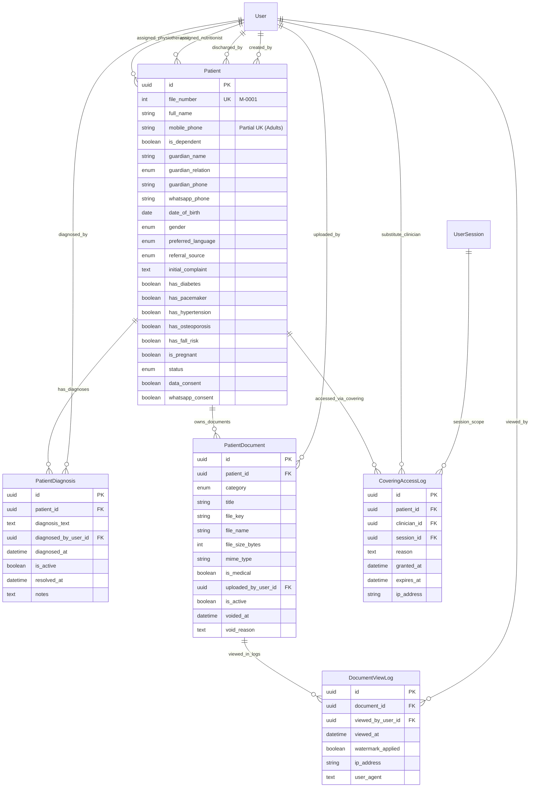
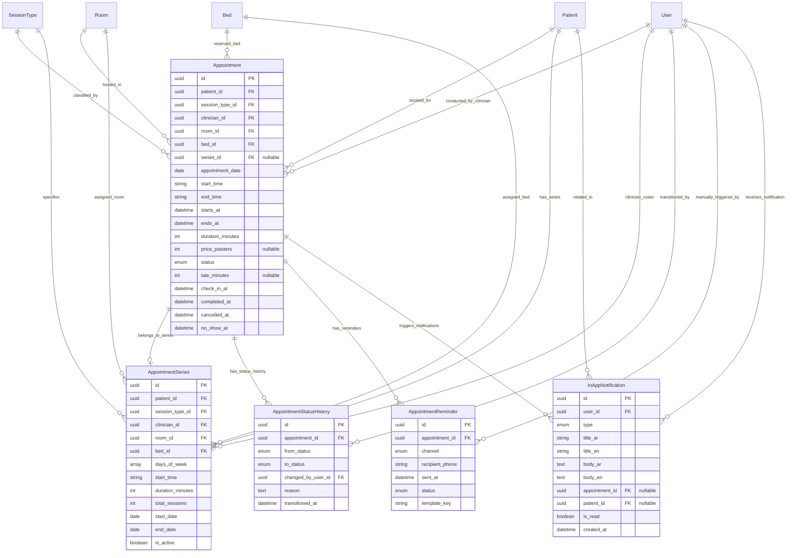
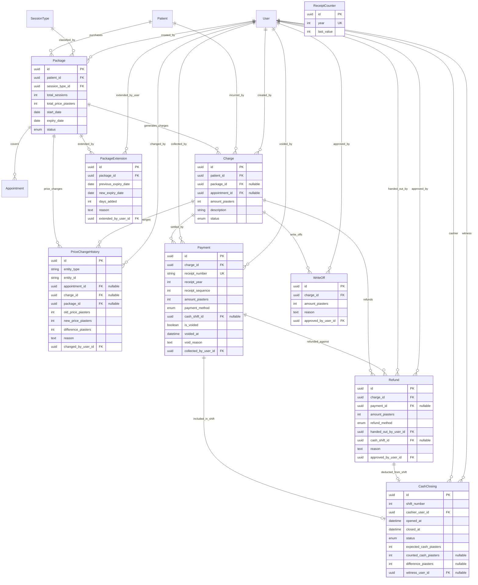
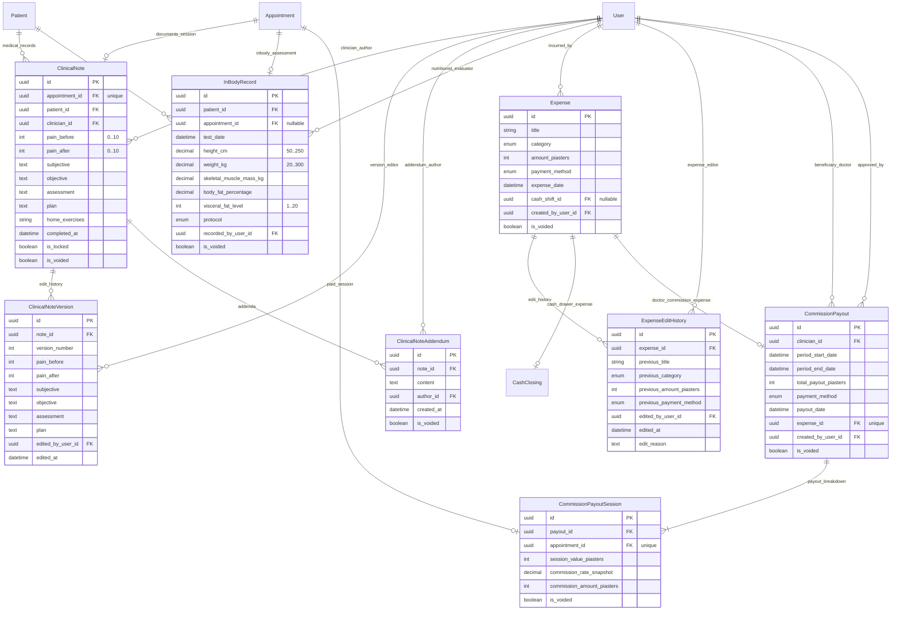

# Masaar Clinic System — Data Model & Schema Specification

> **Specification Reference:** [docs/FEATURES-v2.2.md](file:///F:/Claude%20CRM/docs/FEATURES-v2.2.md)  
> **Rules Index:** [docs/design/rules-index.md](file:///F:/Claude%20CRM/docs/design/rules-index.md)  
> **Decisions Log:** [docs/design/decisions.md](file:///F:/Claude%20CRM/docs/design/decisions.md)  
> **Calculations Reference:** [docs/design/calculations.md](file:///F:/Claude%20CRM/docs/design/calculations.md)  
> **Prisma Schema:** [`prisma/schema.prisma`](file:///F:/Claude%20CRM/prisma/schema.prisma)  
> **Database Engine:** PostgreSQL 16+

---

## 1. Global Architectural & Schema Conventions

1. **Currency Representation (`R-0-4`, `DEC-002`):**
   - Stored strictly as **integer piasters** (`INTEGER` or `BIGINT`, $1\text{ EGP} = 100\text{ piasters}$).
   - Columns explicitly suffixed with `_piasters` (e.g. `default_price_piasters`, `commission_fixed_piasters`).
   - Floating-point numeric types (`real`, `double precision`) are strictly forbidden.
2. **Timestamps & Timezones (`R-0-5`, `DEC-004`):**
   - Persisted in UTC as `TIMESTAMPTZ` with `_at` suffix (`created_at`, `updated_at`, `expires_at`, `attempted_at`).
   - Calendar date-only fields use `DATE` with `_date` suffix (`closure_date`, `start_date`, `end_date`).
   - All clinic-local calendar calculations, shift closures, and receipt rollover evaluate at `Africa/Cairo` timezone boundaries.
3. **Soft-Deletion & Immutability (`R-0-3`, `DEC-003`):**
   - Business data is **never hard-deleted**. Records use active toggles (`is_active = false`), cancellation/revocation states (`is_revoked = true`, `revoked_at`), or deactivation timestamps (`deactivated_at`).
4. **Calculated Values Policy (`R-0-6`, `DEC-005`):**
   - Quantities derived from other fields (clinician utilization rates, attendance percentages, remaining shift minutes, days left, account balances) are **never stored in the database**; they are dynamically computed per [calculations.md](file:///F:/Claude%20CRM/docs/design/calculations.md).
5. **Auditability & Traceability (`R-0-2`, `R-13-1`, `R-13-2`, `R-13-3`):**
   - All models track `created_at`, `updated_at`, and author references (`created_by_user_id`, `updated_by_user_id`).
   - The `audit_logs` table is append-only with no update or delete operations permitted.

---

## 2. Entity-Relationship Diagrams (ERDs)

### 2.0 Master Consolidated Clinic System ERD (All 44 Tables)

```mermaid
erDiagram
    %% =========================================================================
    %% Master Consolidated Clinic System ERD (All 44 Tables)
    %% =========================================================================

    %% Slice A: Clinic, Staff, Auth
    ClinicSetting ||--o| User : "updated_by"
    ClinicOpeningHour ||--o| User : "updated_by"
    ClinicClosure ||--o| User : "created_by"
    Room ||--o{ Bed : "contains"
    Room ||--o| User : "created_by"
    Bed ||--o| User : "created_by"
    SessionType ||--o| User : "created_by"
    MessageTemplate ||--o| User : "updated_by"
    User ||--o{ StaffSchedule : "works_shifts"
    User ||--o{ StaffLeave : "takes_leave"
    User ||--o{ UserSession : "logs_into"
    User ||--o| OtpSecret : "enrolled_2fa"
    User ||--o{ OtpBackupCode : "recovery_codes"
    User ||--o{ TrustedDevice : "trusts_devices"
    User ||--o{ PasswordResetCode : "resets_password"
    User ||--o{ AuditLog : "initiates_audit"

    %% Slice B: Patients & Documents
    User ||--o{ Patient : "assigned_physiotherapist"
    User ||--o{ Patient : "assigned_nutritionist"
    Patient ||--o{ PatientDiagnosis : "has_diagnoses"
    Patient ||--o{ PatientDocument : "owns_documents"
    PatientDocument ||--o{ DocumentViewLog : "view_logs"
    Patient ||--o{ CoveringAccessLog : "accessed_via_covering"
    UserSession ||--o{ CoveringAccessLog : "session_scope"

    %% Slice C: Scheduling
    Patient ||--o{ Appointment : "booked_for"
    User ||--o{ Appointment : "clinician_attending"
    Room ||--o{ Appointment : "hosted_in"
    Bed ||--o{ Appointment : "bed_assigned"
    SessionType ||--o{ Appointment : "categorized_as"
    AppointmentSeries ||--o{ Appointment : "generates_instances"
    Patient ||--o{ AppointmentSeries : "patient_series"
    Appointment ||--o{ AppointmentStatusHistory : "tracks_status"
    Appointment ||--o{ AppointmentReminder : "receives_reminders"
    User ||--o{ InAppNotification : "receives_notifications"
    Appointment ||--o{ InAppNotification : "appointment_notifications"

    %% Slice D: Packages & Money
    Patient ||--o{ Package : "purchases_packages"
    SessionType ||--o{ Package : "package_session_type"
    Package ||--o{ PackageExtension : "extended_by"
    Package ||--o{ Appointment : "covers_appointments"
    Patient ||--o{ Charge : "billed_charges"
    Package ||--o{ Charge : "package_charges"
    Appointment ||--o{ Charge : "appointment_charges"
    Charge ||--o{ Payment : "settled_by_payments"
    Charge ||--o{ Refund : "refunded_from"
    Charge ||--o{ WriteOff : "written_off_by"
    Payment ||--o{ Refund : "payment_refunds"
    CashClosing ||--o{ Payment : "closed_in_shift"
    CashClosing ||--o{ Refund : "cash_refunds_in_shift"
    CashClosing ||--o{ Expense : "cash_expenses_in_shift"
    User ||--o{ CashClosing : "cashier_closings"

    %% Slice E: Clinical, Nutrition & Back Office
    Appointment ||--o| ClinicalNote : "session_soap_chart"
    Patient ||--o{ ClinicalNote : "patient_notes"
    ClinicalNote ||--o{ ClinicalNoteVersion : "edit_versions"
    ClinicalNote ||--o{ ClinicalNoteAddendum : "appended_addenda"
    Patient ||--o{ InBodyRecord : "inbody_consultations"
    Appointment ||--o| InBodyRecord : "appointment_inbody"
    Expense ||--o{ ExpenseEditHistory : "expense_revisions"
    User ||--o{ CommissionPayout : "clinician_payouts"
    CommissionPayout ||--o{ CommissionPayoutSession : "paid_session_links"
    Appointment ||--o| CommissionPayoutSession : "session_commission"
    CommissionPayout ||--o| Expense : "generates_commission_expense"
```



---

### 2.1 Slice A — Clinic, Staff & Auth ERD


### 2.2 Slice B — Patients & Documents ERD



### 2.3 Slice C — Scheduling ERD



### 2.4 Slice D — Packages & Money ERD



### 2.5 Slice E — Clinical, Nutrition & Back Office ERD



---

## 3. Database Table Dictionaries

### Slice A — Clinic, Staff & Auth Tables

### 3.1 `clinic_settings`
- **Purpose:** Singleton configuration table storing clinic branding, legal identity, working parameters, and lock horizons.
- **Rule References:** `R-2-1`, `R-2-6`, `R-2-7`, `R-2-8`, `R-9.2-1`, `DEC-016`

| Column | Type | Nullable | Default | Description (AR / EN) | Rule ID |
|---|---|:---:|---|---|:---:|
| `id` | `UUID` | No | `uuid()` | Primary Key (معرف الإعدادات) | `R-2-1` |
| `name_ar` | `VARCHAR(120)` | No | — | Clinic Arabic name (اسم المركز بالعربية) | `R-2-1` |
| `name_en` | `VARCHAR(120)` | No | — | Clinic English name (اسم المركز بالإنجليزية) | `R-2-1` |
| `address_ar` | `TEXT` | Yes | `NULL` | Arabic physical address (العنوان بالعربية) | `R-2-1` |
| `address_en` | `TEXT` | Yes | `NULL` | English physical address (العنوان بالإنجليزية) | `R-2-1` |
| `phone` | `VARCHAR(30)` | No | — | Main reception landline / mobile (هاتف المركز) | `R-2-1` |
| `logo_url` | `TEXT` | Yes | `NULL` | Clinic logo storage key / URL (شعار المركز) | `R-2-1` |
| `timezone` | `VARCHAR(50)` | No | `'Africa/Cairo'` | Operational timezone identifier (التوقيت المعتمد) | `R-0-5`, `DEC-004` |
| `default_package_expiry_days` | `INTEGER` | No | `60` | Default validity window in days (صلاحية الباقة الافتراضية) | `R-2-6`, `R-7-1` |
| `doctor_daily_soft_limit` | `INTEGER` | No | `10` | Daily booking soft warning threshold (الحد اليومي التنبيهي للطبيب) | `R-2-7`, `R-5.2-11` |
| `receipt_prefix` | `VARCHAR(10)` | No | `'INV'` | Annual receipt serial prefix (بادئة الفواتير) | `R-2-8`, `R-8.2-2` |
| `note_edit_window_hours` | `INTEGER` | No | `24` | Clinical note author edit window (مهلة تعديل التقرير الطبي) | `R-9.2-1`, `DEC-016` |
| `updated_by_user_id` | `UUID` | Yes | `NULL` | FK to `users.id` of editor (آخر تعديل بواسطة) | `R-0-2` |
| `created_at` | `TIMESTAMPTZ` | No | `now()` | Record creation timestamp (تاريخ الإنشاء) | `R-0-5` |
| `updated_at` | `TIMESTAMPTZ` | No | `now()` | Record update timestamp (تاريخ آخر تعديل) | `R-0-5` |

- **Foreign Keys:** `updated_by_user_id REFERENCES users(id) ON DELETE SET NULL`.
- **Check Constraints:**
  - `CHECK (default_package_expiry_days > 0)`
  - `CHECK (doctor_daily_soft_limit > 0)`
  - `CHECK (note_edit_window_hours >= 1 AND note_edit_window_hours <= 168)`

---

### 3.2 `clinic_opening_hours`
- **Purpose:** Clinic-wide operating hours defined for each day of the week (Saturday through Friday).
- **Rule References:** `R-2-2`, `R-5.2-1`

| Column | Type | Nullable | Default | Description (AR / EN) | Rule ID |
|---|---|:---:|---|---|:---:|
| `id` | `UUID` | No | `uuid()` | Primary Key | `R-2-2` |
| `day_of_week` | `INTEGER` | No | — | 0=Sat, 1=Sun, 2=Mon, 3=Tue, 4=Wed, 5=Thu, 6=Fri (يوم الأسبوع) | `R-2-2` |
| `is_open` | `BOOLEAN` | No | `true` | Operating status flag (مفتوح / مغلق) | `R-2-2` |
| `open_time` | `VARCHAR(5)` | No | `'09:00'` | Opening time `HH:mm` (وقت الفتح) | `R-2-2` |
| `close_time` | `VARCHAR(5)` | No | `'21:00'` | Closing time `HH:mm` (وقت الإغلاق) | `R-2-2` |
| `updated_by_user_id` | `UUID` | Yes | `NULL` | FK to `users.id` | `R-0-2` |
| `created_at` | `TIMESTAMPTZ` | No | `now()` | Creation timestamp | `R-0-5` |
| `updated_at` | `TIMESTAMPTZ` | No | `now()` | Update timestamp | `R-0-5` |

- **Unique Constraints:** `UNIQUE (day_of_week)` (guarantees exactly 1 configuration per weekday).
- **Check Constraints:**
  - `CHECK (day_of_week BETWEEN 0 AND 6)`
  - `CHECK (open_time < close_time)`
  - `CHECK (open_time ~ '^([01][0-9]|2[0-3]):[0-5][0-9]$')`
  - `CHECK (close_time ~ '^([01][0-9]|2[0-3]):[0-5][0-9]$')`

---

### 3.3 `clinic_closures`
- **Purpose:** Public holidays, religious feasts (Eid), and ad-hoc closure dates blocking appointment scheduling.
- **Rule References:** `R-2-3`, `R-5.2-1`

| Column | Type | Nullable | Default | Description (AR / EN) | Rule ID |
|---|---|:---:|---|---|:---:|
| `id` | `UUID` | No | `uuid()` | Primary Key | `R-2-3` |
| `closure_date` | `DATE` | No | — | Local closure date in Egypt (تاريخ العطلة) | `R-2-3` |
| `reason_ar` | `VARCHAR(150)` | No | — | Arabic closure reason e.g. "عيد الفطر" (سبب الإغلاق بالعربية) | `R-2-3` |
| `reason_en` | `VARCHAR(150)` | No | — | English closure reason e.g. "Eid Al-Fitr" (سبب الإغلاق بالإنجليزية) | `R-2-3` |
| `is_active` | `BOOLEAN` | No | `true` | Active toggle; false unblocks scheduling (حالة العطلة) | `R-0-3` |
| `created_by_user_id` | `UUID` | Yes | `NULL` | FK to `users.id` | `R-0-2` |
| `created_at` | `TIMESTAMPTZ` | No | `now()` | Creation timestamp | `R-0-5` |
| `updated_at` | `TIMESTAMPTZ` | No | `now()` | Update timestamp | `R-0-5` |

- **Unique Constraints:** `UNIQUE (closure_date)` (prevents duplicate closure records on the same calendar day).
- **Foreign Keys:** `created_by_user_id REFERENCES users(id) ON DELETE SET NULL`.

---

### 3.4 `rooms`
- **Purpose:** Treatment cubicles and consultation rooms hosting one or more beds.
- **Rule References:** `R-2-4`

| Column | Type | Nullable | Default | Description (AR / EN) | Rule ID |
|---|---|:---:|---|---|:---:|
| `id` | `UUID` | No | `uuid()` | Primary Key | `R-2-4` |
| `name_ar` | `VARCHAR(100)` | No | — | Arabic room label (اسم الغرفة / الكابينة بالعربية) | `R-2-4` |
| `name_en` | `VARCHAR(100)` | No | — | English room label (اسم الغرفة بالإنجليزية) | `R-2-4` |
| `is_active` | `BOOLEAN` | No | `true` | Active status; never delete (`R-0-3`) | `R-2-4` |
| `created_by_user_id` | `UUID` | Yes | `NULL` | FK to `users.id` | `R-0-2` |
| `created_at` | `TIMESTAMPTZ` | No | `now()` | Creation timestamp | `R-0-5` |
| `updated_at` | `TIMESTAMPTZ` | No | `now()` | Update timestamp | `R-0-5` |

- **Foreign Keys:** `created_by_user_id REFERENCES users(id) ON DELETE SET NULL`.

---

### 3.5 `beds`
- **Purpose:** Physical treatment beds constrained by PostgreSQL exclusion constraints against overlapping bookings.
- **Rule References:** `R-2-4`, `R-5.2-4`, `R-5.2-12`, `DEC-006`

| Column | Type | Nullable | Default | Description (AR / EN) | Rule ID |
|---|---|:---:|---|---|:---:|
| `id` | `UUID` | No | `uuid()` | Primary Key | `R-2-4` |
| `room_id` | `UUID` | No | — | FK to parent `rooms.id` (معرف الغرفة) | `R-2-4` |
| `name` | `VARCHAR(100)` | No | — | Bed name or identifier e.g. "Bed 1" (اسم السرير) | `R-2-4` |
| `is_active` | `BOOLEAN` | No | `true` | Active status; never delete (`R-0-3`) | `R-2-4` |
| `created_by_user_id` | `UUID` | Yes | `NULL` | FK to `users.id` | `R-0-2` |
| `created_at` | `TIMESTAMPTZ` | No | `now()` | Creation timestamp | `R-0-5` |
| `updated_at` | `TIMESTAMPTZ` | No | `now()` | Update timestamp | `R-0-5` |

- **Unique Constraints:** `UNIQUE (room_id, name)` (a bed name must be unique within its parent room).
- **Foreign Keys:**
  - `room_id REFERENCES rooms(id) ON DELETE RESTRICT` (cannot delete or orphan a room with beds).
  - `created_by_user_id REFERENCES users(id) ON DELETE SET NULL`.

---

### 3.6 `session_types`
- **Purpose:** Billable clinic service catalog (*Physiotherapy*, *Nutrition*, *Consultant Assessment*) with default durations and pricing suggestions.
- **Rule References:** `R-2-5`, `R-5.1-1`, `R-7` (Q-02, DEC-009)

| Column | Type | Nullable | Default | Description (AR / EN) | Rule ID |
|---|---|:---:|---|---|:---:|
| `id` | `UUID` | No | `uuid()` | Primary Key | `R-2-5` |
| `code` | `VARCHAR(50)` | No | — | Unique uppercase code e.g. `PHYSIOTHERAPY` (كود الخدمة) | `R-2-5` |
| `category` | `ENUM` | No | `'PHYSIOTHERAPY'` | Category: `PHYSIOTHERAPY`, `NUTRITION`, `CONSULTANT_ASSESSMENT` | `R-2-5`, `DEC-009` |
| `name_ar` | `VARCHAR(120)` | No | — | Arabic service name (اسم الجلسة بالعربية) | `R-2-5` |
| `name_en` | `VARCHAR(120)` | No | — | English service name (اسم الجلسة بالإنجليزية) | `R-2-5` |
| `default_duration_minutes` | `INTEGER` | No | `45` | Duration in minutes (المدة الافتراضية بالدقائق) | `R-2-5`, `R-5.1-1` |
| `default_price_piasters` | `INTEGER` | No | — | Price suggestion in integer piasters (السعر الافتراضي بالقروش) | `R-0-4`, `R-2-5` |
| `is_active` | `BOOLEAN` | No | `true` | Active status; deactivated services hide from booking (`R-0-3`) | `R-2-5` |
| `created_by_user_id` | `UUID` | Yes | `NULL` | FK to `users.id` | `R-0-2` |
| `created_at` | `TIMESTAMPTZ` | No | `now()` | Creation timestamp | `R-0-5` |
| `updated_at` | `TIMESTAMPTZ` | No | `now()` | Update timestamp | `R-0-5` |

- **Unique Constraints:** `UNIQUE (code)`.
- **Check Constraints:**
  - `CHECK (default_duration_minutes >= 15 AND default_duration_minutes <= 180)`
  - `CHECK (default_duration_minutes % 15 = 0)` (must be increments of 15 minutes per `R-5.1-1`)
  - `CHECK (default_price_piasters >= 0)` (prices cannot be negative per `R-0-4`)
- **Foreign Keys:** `created_by_user_id REFERENCES users(id) ON DELETE SET NULL`.

---

### 3.7 `users`
- **Purpose:** Core identity and profile table for clinic staff across all 5 roles with credential security, commission structures, and activity flags.
- **Rule References:** `R-1-1`–`R-1-5`, `R-3-1`, `R-3-4`, `R-3-5`, `R-11-1`, `R-15.1-1`–`R-15.1-5`, `DEC-010`

| Column | Type | Nullable | Default | Description (AR / EN) | Rule ID |
|---|---|:---:|---|---|:---:|
| `id` | `UUID` | No | `uuid()` | Primary Key | `R-3-1` |
| `email` | `VARCHAR(255)` | No | — | Case-insensitive login email (البريد الإلكتروني للدخول) | `R-3-1`, `R-15.1-1` |
| `password_hash` | `VARCHAR(255)` | No | — | bcrypt/argon2 hash; plaintext never stored (كلمة المرور المشفرة) | `R-3-4`, `R-15.1-1` |
| `full_name` | `VARCHAR(120)` | No | — | Clinician / staff full name (الاسم الكامل) | `R-3-1` |
| `phone` | `VARCHAR(30)` | No | — | Personal / contact mobile (رقم الهاتف) | `R-3-1` |
| `job_title` | `VARCHAR(100)` | No | — | Professional title e.g. "Senior Physiotherapist" (المسمى الوظيفي) | `R-3-1` |
| `role` | `ENUM` | No | — | Role: `OWNER`, `MANAGER`, `RECEPTIONIST`, `PHYSIOTHERAPIST`, `NUTRITIONIST` | `R-1-1`–`R-1-5` |
| `preferred_language` | `ENUM` | No | `'AR'` | UI language: `AR` (Arabic RTL) or `EN` (English) | `R-0-7`, `R-3-1` |
| `is_active` | `BOOLEAN` | No | `true` | Active status; deactivation blocks login immediately (`R-3-5`, `R-15.1-5`) | `R-3-1`, `R-3-5` |
| `deactivated_at` | `TIMESTAMPTZ` | Yes | `NULL` | Timestamp account was deactivated (تاريخ التعطيل) | `R-3-5` |
| `must_change_password` | `BOOLEAN` | No | `false` | True when password was reset by Owner (`R-3-4`) | `R-3-4` |
| `failed_login_count` | `INTEGER` | No | `0` | Consecutive failed attempts (عدد محاولات الدخول الخاطئة) | `R-15.1-3` |
| `locked_until` | `TIMESTAMPTZ` | Yes | `NULL` | 15-minute lockout horizon after 5 failures (تاريخ فك الحظر المؤقت) | `R-15.1-3` |
| `otp_status` | `ENUM` | No | `'NOT_SET'` | 2FA state: `NOT_SET`, `PENDING`, `ACTIVE` | `R-15.2-1`, `R-15.2-2` |
| `can_assess` | `BOOLEAN` | No | `false` | Clinician assessment qualification flag (`R-5.2-8`) | `R-5.2-8` |
| `commission_type` | `ENUM` | No | `'NONE'` | Commission model: `PERCENT`, `FIXED_PER_SESSION`, `NONE` | `R-3-1`, `R-11-1`, `DEC-010` |
| `commission_percent_basis_points` | `INTEGER` | No | `0` | Percentage stored in basis points (2500 = 25.00%) | `R-11-1`, `calculations.md §5.5` |
| `commission_fixed_piasters` | `INTEGER` | No | `0` | Fixed session reward in integer piasters (e.g. 7500 = 75.00 EGP) | `R-11-1` |
| `created_by_user_id` | `UUID` | Yes | `NULL` | FK to `users.id` of creator (Owner) | `R-0-2` |
| `created_at` | `TIMESTAMPTZ` | No | `now()` | Creation timestamp | `R-0-5` |
| `updated_at` | `TIMESTAMPTZ` | No | `now()` | Update timestamp | `R-0-5` |

- **Unique Constraints:**
  - `CREATE UNIQUE INDEX idx_users_email_ci ON users (LOWER(email))` (strict case-insensitive email uniqueness).
- **Check Constraints:**
  - `CHECK (failed_login_count >= 0)`
  - `CHECK (commission_percent_basis_points >= 0 AND commission_percent_basis_points <= 10000)` (0.00% to 100.00%)
  - `CHECK (commission_fixed_piasters >= 0)`
- **Foreign Keys:** `created_by_user_id REFERENCES users(id) ON DELETE SET NULL`.

---

### 3.8 `staff_schedules`
- **Purpose:** Clinician weekly shifts supporting up to 2 distinct shifts per working day (e.g. morning & evening).
- **Rule References:** `R-3-2`, `R-5.2-2`

| Column | Type | Nullable | Default | Description (AR / EN) | Rule ID |
|---|---|:---:|---|---|:---:|
| `id` | `UUID` | No | `uuid()` | Primary Key | `R-3-2` |
| `user_id` | `UUID` | No | — | FK to `users.id` (معرف المعالج / الموظف) | `R-3-2` |
| `day_of_week` | `INTEGER` | No | — | 0=Sat, 1=Sun, 2=Mon, 3=Tue, 4=Wed, 5=Thu, 6=Fri (يوم الأسبوع) | `R-3-2` |
| `shift_number` | `INTEGER` | No | — | Shift order: 1 (Shift 1) or 2 (Shift 2) (رقم الوردية) | `R-3-2` |
| `is_working` | `BOOLEAN` | No | `true` | Working toggle for this day (يعمل / عطلة) | `R-3-2` |
| `start_time` | `VARCHAR(5)` | No | — | Shift start `HH:mm` (بداية الوردية) | `R-3-2` |
| `end_time` | `VARCHAR(5)` | No | — | Shift end `HH:mm` (نهاية الوردية) | `R-3-2` |
| `created_at` | `TIMESTAMPTZ` | No | `now()` | Creation timestamp | `R-0-5` |
| `updated_at` | `TIMESTAMPTZ` | No | `now()` | Update timestamp | `R-0-5` |

- **Unique Constraints:** `UNIQUE (user_id, day_of_week, shift_number)` (at most 2 shifts per clinician per weekday).
- **Check Constraints:**
  - `CHECK (day_of_week BETWEEN 0 AND 6)`
  - `CHECK (shift_number IN (1, 2))`
  - `CHECK (start_time < end_time)`
  - `CHECK (start_time ~ '^([01][0-9]|2[0-3]):[0-5][0-9]$')`
  - `CHECK (end_time ~ '^([01][0-9]|2[0-3]):[0-5][0-9]$')`
- **Foreign Keys:** `user_id REFERENCES users(id) ON DELETE CASCADE`.

---

### 3.9 `staff_leaves`
- **Purpose:** Clinician leaves (annual, sick, personal) blocking bookings during the leave interval.
- **Rule References:** `R-3-3`, `R-5.2-2`

| Column | Type | Nullable | Default | Description (AR / EN) | Rule ID |
|---|---|:---:|---|---|:---:|
| `id` | `UUID` | No | `uuid()` | Primary Key | `R-3-3` |
| `user_id` | `UUID` | No | — | FK to `users.id` (معرف المعالج) | `R-3-3` |
| `start_date` | `DATE` | No | — | Leave start date (تاريخ بداية الإجازة) | `R-3-3` |
| `end_date` | `DATE` | No | — | Leave end date (تاريخ نهاية الإجازة) | `R-3-3` |
| `leave_type` | `ENUM` | No | — | Type: `ANNUAL`, `SICK`, `UNPAID`, `OTHER` (نوع الإجازة) | `R-3-3` |
| `status` | `ENUM` | No | `'APPROVED'` | Status: `PENDING`, `APPROVED`, `REJECTED`, `CANCELLED` | `R-3-3` |
| `note` | `TEXT` | Yes | `NULL` | Reason / handover notes (ملاحظات الإجازة) | `R-3-3` |
| `approved_by_user_id` | `UUID` | Yes | `NULL` | FK to `users.id` of approving Manager/Owner | `R-0-2` |
| `created_at` | `TIMESTAMPTZ` | No | `now()` | Creation timestamp | `R-0-5` |
| `updated_at` | `TIMESTAMPTZ` | No | `now()` | Update timestamp | `R-0-5` |

- **Indexes:** `CREATE INDEX idx_staff_leaves_user_dates ON staff_leaves (user_id, start_date, end_date)`.
- **Check Constraints:** `CHECK (start_date <= end_date)`.
- **Foreign Keys:**
  - `user_id REFERENCES users(id) ON DELETE CASCADE`.
  - `approved_by_user_id REFERENCES users(id) ON DELETE SET NULL`.

---

### 3.10 `login_attempts`
- **Purpose:** Record login events to enforce the 5-failure account lockout rule. Passwords are never logged.
- **Rule References:** `R-15.1-1`, `R-15.1-2`, `R-15.1-3`, `R-15.4-3`

| Column | Type | Nullable | Default | Description (AR / EN) | Rule ID |
|---|---|:---:|---|---|:---:|
| `id` | `UUID` | No | `uuid()` | Primary Key | `R-15.1-3` |
| `email` | `VARCHAR(255)` | No | — | Input email attempted (البريد المدخل) | `R-15.1-3` |
| `ip_address` | `VARCHAR(45)` | No | — | IPv4 / IPv6 of client (عنوان الآي بي) | `R-15.1-3` |
| `user_agent` | `TEXT` | Yes | `NULL` | Browser client header (بيانات المتصفح) | `R-15.1-3` |
| `is_successful` | `BOOLEAN` | No | — | True if credentials passed (نجاح / فشل) | `R-15.1-3` |
| `failure_reason` | `VARCHAR(100)` | Yes | `NULL` | Audit reason e.g. "INVALID_PASSWORD", "ACCOUNT_LOCKED" | `R-15.1-2` |
| `attempted_at` | `TIMESTAMPTZ` | No | `now()` | Exact UTC timestamp of attempt | `R-0-5` |

- **Security Rule:** The entered password is **never stored** in plain text or hash in `login_attempts`.
- **Indexes:**
  - `CREATE INDEX idx_login_attempts_email_time ON login_attempts (email, attempted_at)`.
  - `CREATE INDEX idx_login_attempts_ip_time ON login_attempts (ip_address, attempted_at)`.

---

### 3.11 `user_sessions`
- **Purpose:** Tracks authenticated browser sessions subject to 12-hour absolute lifetime and 15-minute idle lockouts.
- **Rule References:** `R-15.1-4`, `R-15.1-5`, `R-15.1-6`, `DEC-013`

| Column | Type | Nullable | Default | Description (AR / EN) | Rule ID |
|---|---|:---:|---|---|:---:|
| `id` | `UUID` | No | `uuid()` | Primary Key | `R-15.1-4` |
| `user_id` | `UUID` | No | — | FK to `users.id` | `R-15.1-4` |
| `token_hash` | `VARCHAR(255)` | No | — | SHA-256 hash of session cookie token (تجزئة رمز الجلسة) | `R-15.1-4` |
| `ip_address` | `VARCHAR(45)` | No | — | Client IP address | `R-15.1-4` |
| `user_agent` | `TEXT` | Yes | `NULL` | Browser user-agent | `R-15.1-4` |
| `last_active_at` | `TIMESTAMPTZ` | No | `now()` | Evaluated for 15-minute idle lock (آخر نشاط) | `R-15.1-4` |
| `expires_at` | `TIMESTAMPTZ` | No | — | Max 12-hour session expiry timestamp | `R-15.1-4` |
| `is_revoked` | `BOOLEAN` | No | `false` | Revocation flag (إلغاء الجلسة) | `R-15.1-4` |
| `revoked_at` | `TIMESTAMPTZ` | Yes | `NULL` | Revocation timestamp | `R-15.1-4` |
| `created_at` | `TIMESTAMPTZ` | No | `now()` | Session start timestamp | `R-0-5` |

- **Unique Constraints:** `UNIQUE (token_hash)`.
- **Indexes:** `CREATE INDEX idx_user_sessions_user_active ON user_sessions (user_id, is_revoked)`.
- **Foreign Keys:** `user_id REFERENCES users(id) ON DELETE CASCADE`.

---

### 3.12 `otp_secrets`
- **Purpose:** Two-step verification (TOTP) authenticator app secrets, encrypted at rest using a server-side AES key.
- **Rule References:** `R-15.2-1`, `R-15.2-5`, `R-15.2-7`, `DEC-007`

| Column | Type | Nullable | Default | Description (AR / EN) | Rule ID |
|---|---|:---:|---|---|:---:|
| `id` | `UUID` | No | `uuid()` | Primary Key | `R-15.2-1` |
| `user_id` | `UUID` | No | — | FK to `users.id` (معرف المستخدم) | `R-15.2-1` |
| `secret_encrypted` | `TEXT` | No | — | AES-256-GCM ciphertext (مفتاح التحقق المشفر) | `R-15.2-7` |
| `verified_at` | `TIMESTAMPTZ` | Yes | `NULL` | Verification timestamp completing initial QR setup | `R-15.2-2` |
| `failed_otp_attempts` | `INTEGER` | No | `0` | Consecutive wrong OTP counter (محاولات التحقق الفاشلة) | `R-15.2-5` |
| `otp_locked_until` | `TIMESTAMPTZ` | Yes | `NULL` | 15-minute lock horizon after 5 failures | `R-15.2-5` |
| `created_at` | `TIMESTAMPTZ` | No | `now()` | Enrollment timestamp | `R-0-5` |
| `updated_at` | `TIMESTAMPTZ` | No | `now()` | Update timestamp | `R-0-5` |

- **Security Rule:** The decryption key is loaded from the environment (`.env`) and is **never stored in the database**.
- **Unique Constraints:** `UNIQUE (user_id)`.
- **Foreign Keys:** `user_id REFERENCES users(id) ON DELETE CASCADE`.

---

### 3.13 `otp_backup_codes`
- **Purpose:** 10 single-use recovery codes generated during OTP setup, stored strictly as one-way hashes.
- **Rule References:** `R-15.2-2`, `R-15.2-3`

| Column | Type | Nullable | Default | Description (AR / EN) | Rule ID |
|---|---|:---:|---|---|:---:|
| `id` | `UUID` | No | `uuid()` | Primary Key | `R-15.2-2` |
| `user_id` | `UUID` | No | — | FK to `users.id` | `R-15.2-2` |
| `code_hash` | `VARCHAR(255)` | No | — | bcrypt / SHA-256 hash of recovery code (تجزئة كود الطوارئ) | `R-15.2-2` |
| `is_used` | `BOOLEAN` | No | `false` | Consumption toggle; codes are single-use | `R-15.2-2` |
| `used_at` | `TIMESTAMPTZ` | Yes | `NULL` | Consumption timestamp | `R-15.2-2` |
| `created_at` | `TIMESTAMPTZ` | No | `now()` | Generation timestamp | `R-0-5` |

- **Indexes:** `CREATE INDEX idx_otp_backup_codes_user_unused ON otp_backup_codes (user_id, is_used)`.
- **Foreign Keys:** `user_id REFERENCES users(id) ON DELETE CASCADE`.

---

### 3.14 `trusted_devices`
- **Purpose:** 30-day OTP bypass cookies granted when the user checks "Trust this device". Revocable by Owner.
- **Rule References:** `R-15.2-4`

| Column | Type | Nullable | Default | Description (AR / EN) | Rule ID |
|---|---|:---:|---|---|:---:|
| `id` | `UUID` | No | `uuid()` | Primary Key | `R-15.2-4` |
| `user_id` | `UUID` | No | — | FK to `users.id` | `R-15.2-4` |
| `device_token_hash` | `VARCHAR(255)` | No | — | SHA-256 hash of trusted device cookie (تجزئة رمز الجهاز الموثوق) | `R-15.2-4` |
| `device_name` | `VARCHAR(120)` | No | — | Friendly label e.g. "Front Desk Chrome" (اسم الجهاز) | `R-15.2-4` |
| `ip_address` | `VARCHAR(45)` | No | — | IP address at registration | `R-15.2-4` |
| `user_agent` | `TEXT` | Yes | `NULL` | Browser user-agent | `R-15.2-4` |
| `expires_at` | `TIMESTAMPTZ` | No | — | Exactly 30 days from creation | `R-15.2-4` |
| `is_revoked` | `BOOLEAN` | No | `false` | Revocation toggle | `R-15.2-4` |
| `revoked_at` | `TIMESTAMPTZ` | Yes | `NULL` | Revocation timestamp | `R-15.2-4` |
| `created_at` | `TIMESTAMPTZ` | No | `now()` | Registration timestamp | `R-0-5` |

- **Unique Constraints:** `UNIQUE (device_token_hash)`.
- **Indexes:** `CREATE INDEX idx_trusted_devices_user_active ON trusted_devices (user_id, is_revoked)`.
- **Foreign Keys:** `user_id REFERENCES users(id) ON DELETE CASCADE`.

---

### 3.15 `password_reset_codes`
- **Purpose:** 6-digit email password reset codes (10-minute validity, max 5 attempts, single-use).
- **Rule References:** `R-15.3-1`, `R-15.3-2`

| Column | Type | Nullable | Default | Description (AR / EN) | Rule ID |
|---|---|:---:|---|---|:---:|
| `id` | `UUID` | No | `uuid()` | Primary Key | `R-15.3-1` |
| `user_id` | `UUID` | No | — | FK to `users.id` | `R-15.3-1` |
| `code_hash` | `VARCHAR(255)` | No | — | Hashed 6-digit verification code | `R-15.3-1` |
| `expires_at` | `TIMESTAMPTZ` | No | — | Exactly 10 minutes from creation | `R-15.3-1` |
| `attempts_count` | `INTEGER` | No | `0` | Failed verification attempts (max 5) | `R-15.3-1` |
| `is_used` | `BOOLEAN` | No | `false` | Single-use flag | `R-15.3-1` |
| `used_at` | `TIMESTAMPTZ` | Yes | `NULL` | Use timestamp | `R-15.3-1` |
| `created_at` | `TIMESTAMPTZ` | No | `now()` | Generation timestamp | `R-0-5` |

- **Check Constraints:** `CHECK (attempts_count >= 0 AND attempts_count <= 5)`.
- **Indexes:** `CREATE INDEX idx_password_resets_user_unused ON password_reset_codes (user_id, is_used)`.
- **Foreign Keys:** `user_id REFERENCES users(id) ON DELETE CASCADE`.

---

### 3.16 `message_templates`
- **Purpose:** Customizable WhatsApp notification templates with dynamic placeholders, editable by Owner in settings.
- **Rule References:** `R-2-7`, `R-6-4`

| Column | Type | Nullable | Default | Description (AR / EN) | Rule ID |
|---|---|:---:|---|---|:---:|
| `id` | `UUID` | No | `uuid()` | Primary Key | `R-6-4` |
| `key` | `VARCHAR(50)` | No | — | Template key: `WELCOME`, `REMINDER`, `RESCHEDULE`, etc. | `R-6-4` |
| `language` | `ENUM` | No | — | Language: `AR` or `EN` | `R-4.1-12`, `R-6-4` |
| `template_text` | `TEXT` | No | — | Template content with placeholders like `{patientName}` | `R-6-4` |
| `updated_by_user_id` | `UUID` | Yes | `NULL` | FK to `users.id` of Owner | `R-0-2` |
| `created_at` | `TIMESTAMPTZ` | No | `now()` | Creation timestamp | `R-0-5` |
| `updated_at` | `TIMESTAMPTZ` | No | `now()` | Update timestamp | `R-0-5` |

- **Unique Constraints:** `UNIQUE (key, language)`.
- **Foreign Keys:** `updated_by_user_id REFERENCES users(id) ON DELETE SET NULL`.

---

### 3.17 `audit_logs`
- **Purpose:** Immutable append-only audit trail recording every state change, security event, and financial transaction across the system.
- **Rule References:** `R-0-2`, `R-13-1`, `R-13-2`, `R-13-3`, `R-15.4-3`

| Column | Type | Nullable | Default | Description (AR / EN) | Rule ID |
|---|---|:---:|---|---|:---:|
| `id` | `UUID` | No | `uuid()` | Primary Key | `R-13-1` |
| `created_at` | `TIMESTAMPTZ` | No | `now()` | Event UTC timestamp | `R-13-2` |
| `user_id` | `UUID` | Yes | `NULL` | FK to `users.id` (nullable for anonymous / system events) | `R-13-2` |
| `user_role` | `VARCHAR(50)` | Yes | `NULL` | Snapshot of role at event time | `R-13-2` |
| `action` | `VARCHAR(100)` | No | — | Action name e.g. `LOGIN_FAILED`, `CREATE_USER`, `UPDATE_PRICE` | `R-13-2` |
| `entity_type` | `VARCHAR(100)` | No | — | Target entity e.g. `USER`, `SETTING`, `SESSION_TYPE` | `R-13-2` |
| `entity_id` | `VARCHAR(100)` | Yes | `NULL` | Target record ID | `R-13-2` |
| `before_state` | `JSONB` | Yes | `NULL` | Snapshot of record prior to mutation | `R-13-2` |
| `after_state` | `JSONB` | Yes | `NULL` | Snapshot of record after mutation | `R-13-2` |
| `reason` | `TEXT` | Yes | `NULL` | Mandatory reason for overrides/voids | `R-13-2` |
| `ip_address` | `VARCHAR(45)` | Yes | `NULL` | Client IP address | `R-13-2` |
| `user_agent` | `TEXT` | Yes | `NULL` | Client browser user-agent | `R-13-2` |

- **Foreign Keys:** `user_id REFERENCES users(id) ON DELETE SET NULL` (audit log records must NEVER be deleted when a user is deleted or purged).
- **Indexes:**
  - `CREATE INDEX idx_audit_logs_user_time ON audit_logs (user_id, created_at)`
  - `CREATE INDEX idx_audit_logs_entity ON audit_logs (entity_type, entity_id)`
  - `CREATE INDEX idx_audit_logs_action_time ON audit_logs (action, created_at)`

---

### Slice B — Patients & Documents Tables

### 3.18 `patients`
- **Purpose:** Central demographic, administrative, and clinical summary profile for all clinic patients (adults and dependents).
- **Rule References:** `R-4.1-1` through `R-4.1-21`, `R-4.2-1` through `R-4.2-6`, `DEC-014`

| Column | Type | Nullable | Default | Description (AR / EN) | Rule ID |
|---|---|:---:|---|---|:---:|
| `id` | `UUID` | No | `uuid()` | Primary Key (معرف المريض) | `R-4.1-1` |
| `file_number` | `INTEGER` | No | `autoincrement()` | Sequential permanent medical file number e.g. M-0001 (رقم الملف الطبي الدائم) | `R-4.1-1`, `glossary` |
| `full_name` | `VARCHAR(120)` | No | — | Patient full name (الاسم بالكامل) | `R-4.1-1` |
| `mobile_phone` | `VARCHAR(15)` | Yes | `NULL` | Egyptian mobile `01XXXXXXXXX`, unique for adults via partial index (رقم المحمول للبالغين) | `R-4.1-2`, `R-4.2-1`, `R-4.2-2` |
| `is_dependent` | `BOOLEAN` | No | `false` | True for minor/elderly using guardian contact (مريض تابع - طفل أو مسن) | `R-4.1-3`, `R-4.2-3` |
| `guardian_name` | `VARCHAR(120)` | Yes | `NULL` | Full name of parent/guardian (اسم ولي الأمر / المرافق) | `R-4.1-4`, `R-4.2-3` |
| `guardian_relation` | `VARCHAR(30)` | Yes | `NULL` | Relationship enum: `FATHER`, `MOTHER`, `SON`, `DAUGHTER`, `SPOUSE`, `OTHER` (صلة القرابة) | `R-4.1-5`, `R-4.2-3` |
| `guardian_phone` | `VARCHAR(15)` | Yes | `NULL` | Guardian Egyptian mobile `01XXXXXXXXX`, allows duplicates across dependents (هاتف ولي الأمر) | `R-4.1-6`, `R-4.2-3` |
| `whatsapp_phone` | `VARCHAR(15)` | Yes | `NULL` | WhatsApp communication number, defaults to mobile or guardian phone (رقم الواتساب) | `R-4.1-7` |
| `date_of_birth` | `DATE` | No | — | Date of birth; age is dynamically calculated per calculations.md §1.1 (تاريخ الميلاد) | `R-4.1-8`, `R-0-6` |
| `gender` | `VARCHAR(10)` | No | — | Biological sex: `MALE` or `FEMALE` (النوع) | `R-4.1-9` |
| `address` | `TEXT` | Yes | `NULL` | Residential address details (العنوان) | `R-4.1-10` |
| `emergency_contact_name` | `VARCHAR(120)` | Yes | `NULL` | Emergency contact person name (اسم شخص للطوارئ) | `R-4.1-11` |
| `emergency_contact_phone` | `VARCHAR(30)` | Yes | `NULL` | Emergency contact telephone number (هاتف الطوارئ) | `R-4.1-11` |
| `preferred_language` | `VARCHAR(2)` | No | `'AR'` | Notification language: `AR` or `EN` (اللغة المفضلة للتواصل) | `R-4.1-12` |
| `referral_source` | `VARCHAR(50)` | No | — | Channel source: `DOCTOR`, `FACEBOOK`, `INSTAGRAM`, `GOOGLE`, `FRIEND_FAMILY`, `WALK_IN`, `OTHER` (مصدر الإحالة) | `R-4.1-13` |
| `referral_source_details` | `VARCHAR(255)` | Yes | `NULL` | Additional detail for referral source / campaign (تفاصيل مصدر الإحالة) | `R-4.1-13` |
| `referring_doctor` | `VARCHAR(120)` | Yes | `NULL` | Name of referring physician if applicable (الطبيب المحول) | `R-4.1-14` |
| `initial_complaint` | `TEXT` | No | — | Initial visit complaint written by reception; NOT a diagnosis (الشكوى المبدئية عند الاستقبال) | `R-4.1-15` |
| `has_diabetes` | `BOOLEAN` | No | `false` | Medical alert: Diabetes (تنبيه طبي: مرض السكري) | `R-4.1-16` |
| `has_pacemaker` | `BOOLEAN` | No | `false` | Medical alert: Pacemaker (تنبيه طبي: منظم ضربات القلب) | `R-4.1-16` |
| `has_hypertension` | `BOOLEAN` | No | `false` | Medical alert: High blood pressure (تنبيه طبي: ارتفاع ضغط الدم) | `R-4.1-16` |
| `has_osteoporosis` | `BOOLEAN` | No | `false` | Medical alert: Osteoporosis (تنبيه طبي: هشاشة العظام) | `R-4.1-16` |
| `has_fall_risk` | `BOOLEAN` | No | `false` | Medical alert: High risk of falls (تنبيه طبي: قابلية السقوط) | `R-4.1-16` |
| `is_pregnant` | `BOOLEAN` | No | `false` | Medical alert: Pregnancy (تنبيه طبي: حمل) | `R-4.1-16` |
| `medical_alerts_notes` | `TEXT` | Yes | `NULL` | Clinical notes on alerts (visible to clinicians; reception sees only warning badge) (تفاصيل التنبيهات الطبية) | `R-4.1-16` |
| `assigned_physiotherapist_id` | `UUID` | Yes | `NULL` | FK to `users.id` for default physiotherapist (أخصائي العلاج الطبيعي المتابع) | `R-4.1-17` |
| `assigned_nutritionist_id` | `UUID` | Yes | `NULL` | FK to `users.id` for default nutritionist (أخصائي التغذية المتابع) | `R-4.1-18` |
| `status` | `VARCHAR(20)` | No | `'LEAD'` | State machine: `LEAD`, `ACTIVE`, `DISCHARGED` (حالة ملف المريض) | `R-4.1-19`, `R-4.2-6` |
| `data_consent` | `BOOLEAN` | No | `false` | Patient signed medical data processing consent (موافقة معالجة البيانات الطبية) | `R-4.1-20` |
| `data_consent_date` | `TIMESTAMPTZ` | Yes | `NULL` | Timestamp consent was recorded (تاريخ توقيع الموافقة) | `R-4.1-20` |
| `whatsapp_consent` | `BOOLEAN` | No | `true` | Separate opt-in toggle for WhatsApp messaging (موافقة استلام رسائل الواتساب) | `R-4.1-21` |
| `reception_notes` | `TEXT` | Yes | `NULL` | Non-clinical notes visible to front desk (ملاحظات الاستقبال الإدارية) | `glossary` |
| `first_visit_at` | `TIMESTAMPTZ` | Yes | `NULL` | Check-in timestamp of first visit, triggers LEAD -> ACTIVE (تاريخ أول حضور فعلي) | `R-4.2-6` |
| `discharged_at` | `TIMESTAMPTZ` | Yes | `NULL` | Timestamp patient concluded treatment (تاريخ إنهاء العلاج والتخريج) | `R-4.2-6` |
| `discharged_by_user_id` | `UUID` | Yes | `NULL` | FK to `users.id` of clinician discharging patient (المعالج الذي قام بالتخريج) | `R-4.2-6` |
| `discharge_reason` | `TEXT` | Yes | `NULL` | Clinical conclusion summary or reason for discharge (سبب أو ملخص إنهاء العلاج) | `R-4.2-6` |
| `created_by_user_id` | `UUID` | Yes | `NULL` | FK to `users.id` who registered patient (سجل بواسطة) | `R-0-2` |
| `updated_by_user_id` | `UUID` | Yes | `NULL` | FK to `users.id` of last editor (آخر تعديل بواسطة) | `R-0-2` |
| `created_at` | `TIMESTAMPTZ` | No | `now()` | Record creation timestamp (تاريخ التسجيل) | `R-0-5` |
| `updated_at` | `TIMESTAMPTZ` | No | `now()` | Record modification timestamp (تاريخ آخر تحديث) | `R-0-5` |

- **Unique Constraints:**
  - `UNIQUE (file_number)`
  - Partial Unique Index: `CREATE UNIQUE INDEX idx_patients_mobile_phone_unique ON patients (mobile_phone) WHERE mobile_phone IS NOT NULL;` (`R-4.2-2`)
- **Foreign Keys:**
  - `assigned_physiotherapist_id REFERENCES users(id) ON DELETE SET NULL`
  - `assigned_nutritionist_id REFERENCES users(id) ON DELETE SET NULL`
  - `discharged_by_user_id REFERENCES users(id) ON DELETE SET NULL`
  - `created_by_user_id REFERENCES users(id) ON DELETE SET NULL`
  - `updated_by_user_id REFERENCES users(id) ON DELETE SET NULL`
- **Indexes:**
  - `CREATE INDEX idx_patients_full_name ON patients (full_name)`
  - `CREATE INDEX idx_patients_mobile_phone ON patients (mobile_phone)`
  - `CREATE INDEX idx_patients_guardian_phone ON patients (guardian_phone)` (`R-4.2-4`)
  - `CREATE INDEX idx_patients_status ON patients (status)`
  - `CREATE INDEX idx_patients_assigned_physio ON patients (assigned_physiotherapist_id)`
  - `CREATE INDEX idx_patients_assigned_nutrition ON patients (assigned_nutritionist_id)`

---

### 3.19 `patient_diagnoses`
- **Purpose:** Audit-compliant clinical diagnosis log recording primary and secondary clinical diagnoses formulated by clinicians.
- **Rule References:** `R-1.1-2`, `R-4.1-22`, `R-9.3-1`, `R-12-8`

| Column | Type | Nullable | Default | Description (AR / EN) | Rule ID |
|---|---|:---:|---|---|:---:|
| `id` | `UUID` | No | `uuid()` | Primary Key (معرف التشخيص) | `R-9.3-1` |
| `patient_id` | `UUID` | No | — | FK to `patients.id` (معرف المريض) | `R-9.3-1` |
| `diagnosis_text` | `TEXT` | No | — | Clinical diagnosis description / ICD text (نص التشخيص الطبي) | `R-4.1-22`, `R-9.3-1` |
| `diagnosed_by_user_id` | `UUID` | No | — | FK to `users.id` (clinician author) (الطبيب المشخص) | `R-1.1-2`, `R-9.3-1` |
| `diagnosed_at` | `TIMESTAMPTZ` | No | `now()` | Date and time diagnosis was entered (تاريخ ووقت التشخيص) | `R-9.3-1` |
| `is_active` | `BOOLEAN` | No | `true` | True for current diagnosis, false once resolved/superseded (تشخيص نشط حالي) | `R-9.3-1` |
| `resolved_at` | `TIMESTAMPTZ` | Yes | `NULL` | Timestamp diagnosis marked resolved (تاريخ انتهاء الحالة) | `R-9.3-1` |
| `notes` | `TEXT` | Yes | `NULL` | Supplementary clinical observations (ملاحظات سريرية إضافية) | `R-9.3-1` |
| `created_by_user_id` | `UUID` | Yes | `NULL` | FK to `users.id` | `R-0-2` |
| `updated_by_user_id` | `UUID` | Yes | `NULL` | FK to `users.id` | `R-0-2` |
| `created_at` | `TIMESTAMPTZ` | No | `now()` | Record creation timestamp | `R-0-5` |
| `updated_at` | `TIMESTAMPTZ` | No | `now()` | Record update timestamp | `R-0-5` |

- **Foreign Keys:**
  - `patient_id REFERENCES patients(id) ON DELETE RESTRICT`
  - `diagnosed_by_user_id REFERENCES users(id) ON DELETE RESTRICT`
  - `created_by_user_id REFERENCES users(id) ON DELETE SET NULL`
  - `updated_by_user_id REFERENCES users(id) ON DELETE SET NULL`
- **Indexes:**
  - `CREATE INDEX idx_patient_diagnoses_patient_active ON patient_diagnoses (patient_id, is_active)`
  - `CREATE INDEX idx_patient_diagnoses_clinician ON patient_diagnoses (diagnosed_by_user_id)`

---

### 3.20 `patient_documents`
- **Purpose:** Metadata and storage references for clinical and administrative file attachments (X-rays, MRIs, prescriptions, lab results, IDs, payments).
- **Rule References:** `R-1.1-2`, `R-1.1-3`, `R-9.5-1`, `R-0-3`

| Column | Type | Nullable | Default | Description (AR / EN) | Rule ID |
|---|---|:---:|---|---|:---:|
| `id` | `UUID` | No | `uuid()` | Primary Key (معرف المستند) | `R-9.5-1` |
| `patient_id` | `UUID` | No | — | FK to `patients.id` (معرف المريض) | `R-9.5-1` |
| `category` | `VARCHAR(30)` | No | — | Category enum: `PRESCRIPTION`, `X_RAY`, `MRI`, `LAB_REPORT`, `REFERRAL`, `ID_ADMINISTRATIVE`, `PAYMENT_PROOF`, `OTHER` (تصنيف المستند) | `R-9.5-1` |
| `title` | `VARCHAR(150)` | No | — | Human-readable document title (عنوان المستند) | `R-9.5-1` |
| `file_key` | `VARCHAR(500)` | No | — | Private storage path/key outside web root (مسار التخزين الخاص المشفر) | `R-9.5-1` |
| `file_name` | `VARCHAR(255)` | No | — | Original client upload file name (اسم الملف الأصلي) | `R-9.5-1` |
| `file_size_bytes` | `INTEGER` | No | — | Size in bytes, constrained to $\le 10,485,760$ (حجم الملف بالبايت) | `R-9.5-1` |
| `mime_type` | `VARCHAR(100)` | No | — | MIME content type e.g. `application/pdf`, `image/jpeg` (نوع الملف البرمجي) | `R-9.5-1` |
| `is_medical` | `BOOLEAN` | No | `true` | True if clinical (hidden from receptionist), false for admin/payment proofs (مستند طبي محمي) | `R-1.1-2`, `R-9.5-1` |
| `uploaded_by_user_id` | `UUID` | No | — | FK to `users.id` who uploaded file (رفع بواسطة) | `R-1.1-3`, `R-9.5-1` |
| `is_active` | `BOOLEAN` | No | `true` | Soft-delete flag; records are voided, never hard-deleted (حالة الفاعلية) | `R-0-3` |
| `voided_at` | `TIMESTAMPTZ` | Yes | `NULL` | Timestamp when document was archived/voided (تاريخ الإلغاء) | `R-0-3` |
| `void_reason` | `TEXT` | Yes | `NULL` | Required reason for voiding document (سبب الإلغاء) | `R-0-3`, `R-13-1` |
| `created_by_user_id` | `UUID` | Yes | `NULL` | FK to `users.id` | `R-0-2` |
| `updated_by_user_id` | `UUID` | Yes | `NULL` | FK to `users.id` | `R-0-2` |
| `created_at` | `TIMESTAMPTZ` | No | `now()` | Record creation timestamp | `R-0-5` |
| `updated_at` | `TIMESTAMPTZ` | No | `now()` | Record update timestamp | `R-0-5` |

- **Foreign Keys:**
  - `patient_id REFERENCES patients(id) ON DELETE RESTRICT`
  - `uploaded_by_user_id REFERENCES users(id) ON DELETE RESTRICT`
  - `created_by_user_id REFERENCES users(id) ON DELETE SET NULL`
  - `updated_by_user_id REFERENCES users(id) ON DELETE SET NULL`
- **Indexes:**
  - `CREATE INDEX idx_patient_documents_patient_cat ON patient_documents (patient_id, category)`
  - `CREATE INDEX idx_patient_documents_uploader ON patient_documents (uploaded_by_user_id)`
  - `CREATE INDEX idx_patient_documents_active ON patient_documents (is_active)`

---

### 3.21 `document_view_logs`
- **Purpose:** Immutable security log recording every single access to a patient document, including watermark tracking.
- **Rule References:** `R-9.5-1`, `R-13-1`, `R-13-2`

| Column | Type | Nullable | Default | Description (AR / EN) | Rule ID |
|---|---|:---:|---|---|:---:|
| `id` | `UUID` | No | `uuid()` | Primary Key (معرف سجل المشاهدة) | `R-9.5-1` |
| `document_id` | `UUID` | No | — | FK to `patient_documents.id` (معرف المستند) | `R-9.5-1` |
| `viewed_by_user_id` | `UUID` | No | — | FK to `users.id` (viewer identity) (المستخدم المشاهد) | `R-9.5-1` |
| `viewed_at` | `TIMESTAMPTZ` | No | `now()` | Access UTC timestamp (وقت وتاريخ المشاهدة) | `R-9.5-1` |
| `watermark_applied` | `BOOLEAN` | No | `true` | Indicates dynamic watermark (viewer name + timestamp) was rendered (تطبيق العلامة المائية) | `R-9.5-1` |
| `ip_address` | `VARCHAR(45)` | No | — | Client IP address (عنوان IP) | `R-13-2` |
| `user_agent` | `TEXT` | Yes | `NULL` | Browser User-Agent header (بيانات المتصفح) | `R-13-2` |

- **Foreign Keys:**
  - `document_id REFERENCES patient_documents(id) ON DELETE CASCADE`
  - `viewed_by_user_id REFERENCES users(id) ON DELETE RESTRICT`
- **Indexes:**
  - `CREATE INDEX idx_document_view_logs_doc_time ON document_view_logs (document_id, viewed_at)`
  - `CREATE INDEX idx_document_view_logs_user_time ON document_view_logs (viewed_by_user_id, viewed_at)`

---

### 3.22 `covering_access_logs`
- **Purpose:** Time-bounded authorization log recording covering access granted to substitute clinicians to inspect non-assigned patient charts.
- **Rule References:** `R-1.1-21`, `DEC-001`, `DEC-013`, `R-13-1`

| Column | Type | Nullable | Default | Description (AR / EN) | Rule ID |
|---|---|:---:|---|---|:---:|
| `id` | `UUID` | No | `uuid()` | Primary Key (معرف صلاحية التغطية) | `R-1.1-21` |
| `patient_id` | `UUID` | No | — | FK to `patients.id` (المريض الذي تم الوصول لملفه) | `R-1.1-21` |
| `clinician_id` | `UUID` | No | — | FK to `users.id` of substitute clinician (المعالج البديل) | `R-1.1-21` |
| `session_id` | `UUID` | Yes | `NULL` | FK to `user_sessions.id` tying grant to current active login session (معرف جلسة تسجيل الدخول) | `R-1.1-21`, `DEC-013` |
| `reason` | `TEXT` | No | — | Mandatory clinical justification entered by clinician (السبب الطبي المكتوب) | `R-1.1-21` |
| `granted_at` | `TIMESTAMPTZ` | No | `now()` | Access grant start timestamp (وقت منح الصلاحية) | `R-1.1-21` |
| `expires_at` | `TIMESTAMPTZ` | No | — | Access expiration timestamp, strictly capped at session expiry or 12h (وقت انتهاء الصلاحية) | `R-1.1-21`, `DEC-013` |
| `ip_address` | `VARCHAR(45)` | No | — | Client IP address (عنوان IP) | `R-13-2` |
| `user_agent` | `TEXT` | Yes | `NULL` | Browser User-Agent header (بيانات المتصفح) | `R-13-2` |

- **Foreign Keys:**
  - `patient_id REFERENCES patients(id) ON DELETE RESTRICT`
  - `clinician_id REFERENCES users(id) ON DELETE RESTRICT`
  - `session_id REFERENCES user_sessions(id) ON DELETE SET NULL`
- **Indexes:**
  - `CREATE INDEX idx_covering_access_clinician_patient ON covering_access_logs (clinician_id, patient_id, granted_at)`
  - `CREATE INDEX idx_covering_access_session ON covering_access_logs (session_id)`

---

### Slice C — Scheduling Tables

### 3.23 `appointments`
- **Purpose:** Core calendar booking record linking a patient, clinician, session type, room, bed, and time interval.
- **Rule References:** `R-5.1-1`, `R-5.1-2`, `R-5.2-1` through `R-5.2-12`, `R-5.5-1` through `R-5.5-13`, `R-14-2`, `DEC-006`, `DEC-021`

| Column | Type | Nullable | Default | Description (AR / EN) | Rule ID |
|---|---|:---:|---|---|:---:|
| `id` | `UUID` | No | `uuid()` | Primary Key (معرف الموعد) | `R-5.1-1` |
| `patient_id` | `UUID` | No | — | FK to `patients.id` (معرف المريض) | `R-5.1-1` |
| `session_type_id` | `UUID` | No | — | FK to `session_types.id` (نوع الجلسة) | `R-5.1-1`, `R-5.2-8` |
| `clinician_id` | `UUID` | No | — | FK to `users.id` (المعالج المحدد) | `R-5.1-1`, `R-5.2-2` |
| `room_id` | `UUID` | No | — | FK to `rooms.id` (غرفة العلاج) | `R-5.1-1` |
| `bed_id` | `UUID` | No | — | FK to `beds.id` (سرير العلاج المحدد) | `R-5.1-1`, `R-5.2-4` |
| `series_id` | `UUID` | Yes | `NULL` | FK to `appointment_series.id` if recurring (معرف سلسلة المواعيد المتكررة) | `R-5.3-1` |
| `package_id` | `UUID` | Yes | `NULL` | FK to `packages.id` if covered by package (معرف الباقة المرتبطة) | `R-5.1-1`, `R-5.2-7` |
| `appointment_date` | `DATE` | No | — | Clinic-local calendar date in Cairo time (تاريخ الموعد الفعلي) | `R-0-5`, `R-5.1-1` |
| `start_time` | `VARCHAR(5)` | No | — | Local time HH:mm 24h e.g. "09:30" (وقت البدء) | `R-5.1-1` |
| `end_time` | `VARCHAR(5)` | No | — | Local time HH:mm 24h e.g. "10:15" (وقت الانتهاء) | `R-5.1-1` |
| `starts_at` | `TIMESTAMPTZ` | No | — | Exact UTC start timestamp for btree_gist range (بداية الموعد بالتوقيت الموحد) | `R-0-5`, `R-5.2-12` |
| `ends_at` | `TIMESTAMPTZ` | No | — | Exact UTC end timestamp for btree_gist range (نهاية الموعد بالتوقيت الموحد) | `R-0-5`, `R-5.2-12` |
| `duration_minutes` | `INTEGER` | No | `45` | Duration in minutes (15..180, steps of 15) (مدة الجلسة بالدقائق) | `R-5.1-1` |
| `price_piasters` | `INTEGER` | Yes | `NULL` | Price in integer piasters; NULL when covered by package (سعر الجلسة بالقروش) | `R-0-4`, `R-5.1-1` |
| `status` | `VARCHAR(20)` | No | `'SCHEDULED'` | Status: `SCHEDULED`, `ARRIVED`, `COMPLETED`, `CANCELLED`, `NO_SHOW`, `WAITLISTED` (حالة الموعد) | `R-5.5-1` |
| `notes_for_reception` | `TEXT` | Yes | `NULL` | Operational notes for front desk staff (ملاحظات الاستقبال) | `R-5.1-1` |
| `check_in_at` | `TIMESTAMPTZ` | Yes | `NULL` | Physical arrival timestamp at clinic desk (وقت تسجيل الحضور) | `R-5.5-3`, `R-6-2` |
| `completedAt` | `TIMESTAMPTZ` | Yes | `NULL` | Session form submission timestamp (وقت إتمام الجلسة سريرياً) | `R-5.5-5`, `R-9.1-7` |
| `cancelled_at` | `TIMESTAMPTZ` | Yes | `NULL` | Cancellation timestamp (وقت الإلغاء) | `R-5.5-6` |
| `cancellation_reason` | `TEXT` | Yes | `NULL` | Mandatory reason recorded for cancellation (سبب الإلغاء الإلزامي) | `R-5.5-6` |
| `no_show_at` | `TIMESTAMPTZ` | Yes | `NULL` | Timestamp marked as no-show (وقت تسجيل عدم الحضور) | `R-5.5-7` |
| `no_show_reason` | `TEXT` | Yes | `NULL` | Optional reason/notes for no-show (سبب عدم الحضور) | `R-5.5-7` |
| `created_by_user_id` | `UUID` | Yes | `NULL` | FK to `users.id` who booked (حجز بواسطة) | `R-0-2` |
| `updated_by_user_id` | `UUID` | Yes | `NULL` | FK to `users.id` who last modified (آخر تعديل بواسطة) | `R-0-2` |
| `created_at` | `TIMESTAMPTZ` | No | `now()` | Record creation timestamp | `R-0-5` |
| `updated_at` | `TIMESTAMPTZ` | No | `now()` | Record update timestamp | `R-0-5` |

- **Foreign Keys:**
  - `patient_id REFERENCES patients(id) ON DELETE RESTRICT`
  - `session_type_id REFERENCES session_types(id) ON DELETE RESTRICT`
  - `clinician_id REFERENCES users(id) ON DELETE RESTRICT`
  - `room_id REFERENCES rooms(id) ON DELETE RESTRICT`
  - `bed_id REFERENCES beds(id) ON DELETE RESTRICT`
  - `series_id REFERENCES appointment_series(id) ON DELETE SET NULL`
  - `created_by_user_id REFERENCES users(id) ON DELETE SET NULL`
  - `updated_by_user_id REFERENCES users(id) ON DELETE SET NULL`
- **Indexes:**
  - `CREATE INDEX idx_appointments_patient_date ON appointments (patient_id, appointment_date)`
  - `CREATE INDEX idx_appointments_clinician_time ON appointments (clinician_id, starts_at, ends_at)`
  - `CREATE INDEX idx_appointments_bed_time ON appointments (bed_id, starts_at, ends_at)`
  - `CREATE INDEX idx_appointments_date_status ON appointments (appointment_date, status)`
  - `CREATE INDEX idx_appointments_room_date ON appointments (room_id, appointment_date)`
  - `CREATE INDEX idx_appointments_clinician_report ON appointments (clinician_id, appointment_date, status)`
  - `CREATE INDEX idx_appointments_series ON appointments (series_id)`

---

### 3.24 `appointment_series`
- **Purpose:** Recurring booking series definition generating linked appointments across regular weekly schedule patterns.
- **Rule References:** `R-5.3-1`

| Column | Type | Nullable | Default | Description (AR / EN) | Rule ID |
|---|---|:---:|---|---|:---:|
| `id` | `UUID` | No | `uuid()` | Primary Key (معرف السلسلة) | `R-5.3-1` |
| `patient_id` | `UUID` | No | — | FK to `patients.id` (معرف المريض) | `R-5.3-1` |
| `session_type_id` | `UUID` | No | — | FK to `session_types.id` (نوع الجلسات بالسلسلة) | `R-5.3-1` |
| `clinician_id` | `UUID` | No | — | FK to `users.id` (المعالج المحدد) | `R-5.3-1` |
| `room_id` | `UUID` | No | — | FK to `rooms.id` (الغرفة) | `R-5.3-1` |
| `bed_id` | `UUID` | No | — | FK to `beds.id` (السرير المخصص) | `R-5.3-1` |
| `days_of_week` | `INTEGER[]` | No | — | Days of week array e.g. `[0, 2, 4]` for Sat, Mon, Wed (أيام الأسبوع المحددة) | `R-5.3-1` |
| `start_time` | `VARCHAR(5)` | No | — | Slot start time HH:mm (وقت البدء الموحد) | `R-5.3-1` |
| `duration_minutes` | `INTEGER` | No | `45` | Duration per appointment in minutes (مدة كل جلسة) | `R-5.3-1` |
| `total_sessions` | `INTEGER` | No | — | Total appointment count planned in series (إجمالي جلسات السلسلة) | `R-5.3-1` |
| `start_date` | `DATE` | No | — | First appointment date of series (تاريخ أول جلسة) | `R-5.3-1` |
| `end_date` | `DATE` | Yes | `NULL` | Estimated series end date (تاريخ نهاية السلسلة) | `R-5.3-1` |
| `is_active` | `BOOLEAN` | No | `true` | Active status toggle for series (حالة فاعلية السلسلة) | `R-0-3` |
| `created_by_user_id` | `UUID` | Yes | `NULL` | FK to `users.id` who generated series (أنشئت بواسطة) | `R-0-2` |
| `created_at` | `TIMESTAMPTZ` | No | `now()` | Series creation timestamp | `R-0-5` |
| `updated_at` | `TIMESTAMPTZ` | No | `now()` | Series update timestamp | `R-0-5` |

- **Foreign Keys:**
  - `patient_id REFERENCES patients(id) ON DELETE RESTRICT`
  - `session_type_id REFERENCES session_types(id) ON DELETE RESTRICT`
  - `clinician_id REFERENCES users(id) ON DELETE RESTRICT`
  - `room_id REFERENCES rooms(id) ON DELETE RESTRICT`
  - `bed_id REFERENCES beds(id) ON DELETE RESTRICT`
  - `created_by_user_id REFERENCES users(id) ON DELETE SET NULL`
- **Indexes:**
  - `CREATE INDEX idx_appointment_series_patient ON appointment_series (patient_id)`
  - `CREATE INDEX idx_appointment_series_clinician ON appointment_series (clinician_id)`

---

### 3.25 `appointment_status_history`
- **Purpose:** Immutable audit table recording every status transition of an appointment with author and mandatory reason.
- **Rule References:** `R-0-2`, `R-5.5-1` through `R-5.5-13`, `R-13-1`

| Column | Type | Nullable | Default | Description (AR / EN) | Rule ID |
|---|---|:---:|---|---|:---:|
| `id` | `UUID` | No | `uuid()` | Primary Key (معرف سجل التغيير) | `R-13-1` |
| `appointment_id` | `UUID` | No | — | FK to `appointments.id` (معرف الموعد) | `R-13-1` |
| `from_status` | `VARCHAR(20)` | Yes | `NULL` | Pre-transition status (الحالة السابقة) | `R-5.5-1` |
| `to_status` | `VARCHAR(20)` | No | — | New transitioned status (الحالة الجديدة) | `R-5.5-1` |
| `changed_by_user_id` | `UUID` | Yes | `NULL` | FK to `users.id` who triggered change (المستخدم المغيّر) | `R-0-2` |
| `reason` | `TEXT` | Yes | `NULL` | Mandatory reason for cancellations, overrides, no-shows (السبب المسجل) | `R-5.5-6`, `R-5.5-7` |
| `transitioned_at` | `TIMESTAMPTZ` | No | `now()` | Exact UTC timestamp of transition (وقت وتاريخ التغيير) | `R-0-5` |
| `ip_address` | `VARCHAR(45)` | Yes | `NULL` | Client IP address | `R-13-2` |
| `user_agent` | `TEXT` | Yes | `NULL` | Client User-Agent | `R-13-2` |

- **Foreign Keys:**
  - `appointment_id REFERENCES appointments(id) ON DELETE CASCADE`
  - `changed_by_user_id REFERENCES users(id) ON DELETE SET NULL`
- **Indexes:**
  - `CREATE INDEX idx_appointment_status_history_appt ON appointment_status_history (appointment_id, transitioned_at)`
  - `CREATE INDEX idx_appointment_status_history_user ON appointment_status_history (changed_by_user_id, transitioned_at)`

---

### 3.26 `appointment_reminders`
- **Purpose:** Audit tracking for WhatsApp appointment reminder messages (wa.me) and front desk manual calls dispatched to patients (SMS is excluded from v1).
- **Rule References:** `R-4.1-21`, `R-14-1`, `R-14-6`, `R-6-1`

| Column | Type | Nullable | Default | Description (AR / EN) | Rule ID |
|---|---|:---:|---|---|:---:|
| `id` | `UUID` | No | `uuid()` | Primary Key (معرف سجل التذكير) | `R-14-1` |
| `appointment_id` | `UUID` | No | — | FK to `appointments.id` (معرف الموعد) | `R-14-1` |
| `channel` | `VARCHAR(20)` | No | `'WHATSAPP'` | Delivery channel: `WHATSAPP`, `MANUAL_CALL` (قناة الإرسال) | `R-14-1` |
| `recipient_phone` | `VARCHAR(30)` | No | — | Phone number message was dispatched to (رقم الهاتف المستلم) | `R-4.1-2`, `R-4.1-6` |
| `sent_at` | `TIMESTAMPTZ` | No | `now()` | Dispatch timestamp (وقت الإرسال) | `R-0-5` |
| `status` | `VARCHAR(20)` | No | `'PENDING'` | Status: `PENDING`, `SENT`, `FAILED`, `DELIVERED`, `READ` (حالة التسليم) | `R-14-1` |
| `error_message` | `TEXT` | Yes | `NULL` | Provider error message upon delivery failure (رسالة الخطأ إن وجدت) | `R-14-1` |
| `template_key` | `VARCHAR(50)` | Yes | `NULL` | Key of message template dispatched (رمز قالب الرسالة) | `R-14-1` |
| `sent_by_user_id` | `UUID` | Yes | `NULL` | FK to `users.id` if triggered manually by reception (أرسل بواسطة) | `R-0-2` |

- **Foreign Keys:**
  - `appointment_id REFERENCES appointments(id) ON DELETE CASCADE`
  - `sent_by_user_id REFERENCES users(id) ON DELETE SET NULL`
- **Indexes:**
  - `CREATE INDEX idx_appointment_reminders_appt_sent ON appointment_reminders (appointment_id, sent_at)`
  - `CREATE INDEX idx_appointment_reminders_status ON appointment_reminders (status)`

---

### 3.27 `in_app_notifications`
- **Purpose:** Real-time in-app notification alerts for staff dashboard and clinician workspace (check-ins, late arrivals, cancellations).
- **Rule References:** `R-14-1` through `R-14-6`

| Column | Type | Nullable | Default | Description (AR / EN) | Rule ID |
|---|---|:---:|---|---|:---:|
| `id` | `UUID` | No | `uuid()` | Primary Key (معرف الإشعار) | `R-14-1` |
| `user_id` | `UUID` | No | — | FK to `users.id` (recipient clinician or staff) (المستخدم المستلم) | `R-14-1` |
| `type` | `VARCHAR(50)` | No | — | Type: `PATIENT_CHECKED_IN`, `PATIENT_LATE_ARRIVAL`, `APPOINTMENT_CANCELLED`, `APPOINTMENT_RESCHEDULED`, `PACKAGE_LOW_SESSIONS`, `PACKAGE_EXPIRING_SOON`, `SYSTEM_ALERT` (نوع الإشعار) | `R-14-1`–`R-14-5` |
| `title_ar` | `VARCHAR(150)` | No | — | Arabic alert headline (عنوان التنبيه بالعربية) | `R-14-1` |
| `title_en` | `VARCHAR(150)` | No | — | English alert headline (عنوان التنبيه بالإنجليزية) | `R-14-1` |
| `body_ar` | `TEXT` | No | — | Arabic alert message body (تفاصيل التنبيه بالعربية) | `R-14-1` |
| `body_en` | `TEXT` | No | — | English alert message body (تفاصيل التنبيه بالإنجليزية) | `R-14-1` |
| `appointment_id` | `UUID` | Yes | `NULL` | FK to `appointments.id` associated with alert (معرف الموعد المرتبط) | `R-14-1` |
| `patient_id` | `UUID` | Yes | `NULL` | FK to `patients.id` associated with alert (معرف المريض المرتبط) | `R-14-1` |
| `is_read` | `BOOLEAN` | No | `false` | True once user marks alert read (تمت القراءة) | `R-14-6` |
| `read_at` | `TIMESTAMPTZ` | Yes | `NULL` | Timestamp notification was read (تاريخ ووقت القراءة) | `R-14-6` |
| `created_at` | `TIMESTAMPTZ` | No | `now()` | Timestamp notification was generated (تاريخ ووقت التنبيه) | `R-0-5` |

- **Foreign Keys:**
  - `user_id REFERENCES users(id) ON DELETE CASCADE`
  - `appointment_id REFERENCES appointments(id) ON DELETE SET NULL`
  - `patient_id REFERENCES patients(id) ON DELETE SET NULL`
- **Indexes:**
  - `CREATE INDEX idx_in_app_notifications_user_read ON in_app_notifications (user_id, is_read, created_at)`

---

### Slice D — Packages & Money Tables

### 3.28 `packages`
- **Purpose:** Multi-session prepaid bundle for Physiotherapy or Nutrition with defined validity and session quota.
- **Rule References:** `R-2-6`, `R-7-1` through `R-7-6`, `DEC-009`

| Column | Type | Nullable | Default | Description (AR / EN) | Rule ID |
|---|---|:---:|---|---|:---:|
| `id` | `UUID` | No | `uuid()` | Primary Key (معرف الباقة) | `R-7-1` |
| `patient_id` | `UUID` | No | — | FK to `patients.id` (معرف المريض) | `R-7-1` |
| `session_type_id` | `UUID` | No | — | FK to `session_types.id` (نوع جلسات الباقة - علاج طبيعي أو تغذية فقط) | `R-7-1`, `DEC-009` |
| `total_sessions` | `INTEGER` | No | — | Total session count in package e.g. 12 (إجمالي جلسات الباقة) | `R-7-1` |
| `total_price_piasters` | `INTEGER` | No | — | Package price in integer piasters (سعر الباقة بالقروش) | `R-0-4`, `R-7-1` |
| `start_date` | `DATE` | No | — | Validity start calendar date (تاريخ بدء الصلاحية) | `R-7-1` |
| `expiry_date` | `DATE` | No | — | Expiration calendar date, default start + 60 days (تاريخ انتهاء الصلاحية) | `R-2-6`, `R-7-1` |
| `notes` | `TEXT` | Yes | `NULL` | Administrative / clinical notes on package (ملاحظات الباقة) | `R-7-1` |
| `cancelled_at` | `TIMESTAMPTZ` | Yes | `NULL` | Cancellation timestamp if terminated early (تاريخ الإلغاء) | `R-7-2` |
| `cancellation_reason` | `TEXT` | Yes | `NULL` | Required reason for early package cancellation (سبب الإلغاء) | `R-7-2` |
| `created_by_user_id` | `UUID` | Yes | `NULL` | FK to `users.id` who sold package (أنشئت بواسطة) | `R-0-2` |
| `updated_by_user_id` | `UUID` | Yes | `NULL` | FK to `users.id` of last editor (آخر تعديل بواسطة) | `R-0-2` |
| `created_at` | `TIMESTAMPTZ` | No | `now()` | Record creation timestamp | `R-0-5` |
| `updated_at` | `TIMESTAMPTZ` | No | `now()` | Record update timestamp | `R-0-5` |

> **Note on Calculated Status:** In strict compliance with `R-0-6` and `calculations.md §4.3`, package operational status (`ACTIVE`, `COMPLETED`, `EXPIRED`, `CANCELLED`) is dynamically derived at query time based on `cancelled_at`, completed session counts, and `expiry_date` vs current Cairo date. It is never persisted as a database column.

- **Foreign Keys:**
  - `patient_id REFERENCES patients(id) ON DELETE RESTRICT`
  - `session_type_id REFERENCES session_types(id) ON DELETE RESTRICT`
  - `created_by_user_id REFERENCES users(id) ON DELETE SET NULL`
  - `updated_by_user_id REFERENCES users(id) ON DELETE SET NULL`
- **Indexes:**
  - `CREATE INDEX idx_packages_patient_cancelled ON packages (patient_id, cancelled_at)`
  - `CREATE INDEX idx_packages_expiry_cancelled ON packages (expiry_date, cancelled_at)`

---

### 3.29 `package_extensions`
- **Purpose:** Audit record of validity extensions granted by Owner/Manager to expiring or expired packages.
- **Rule References:** `R-7-6`

| Column | Type | Nullable | Default | Description (AR / EN) | Rule ID |
|---|---|:---:|---|---|:---:|
| `id` | `UUID` | No | `uuid()` | Primary Key (معرف التمديد) | `R-7-6` |
| `package_id` | `UUID` | No | — | FK to `packages.id` (معرف الباقة الممددة) | `R-7-6` |
| `previous_expiry_date` | `DATE` | No | — | Expiry date prior to extension (تاريخ الانتهاء السابق) | `R-7-6` |
| `new_expiry_date` | `DATE` | No | — | New extended expiry date (تاريخ الانتهاء الجديد) | `R-7-6` |
| `days_added` | `INTEGER` | No | — | Number of days extended, 1..365 (الأيام المضافة) | `R-7-6` |
| `reason` | `TEXT` | No | — | Mandatory administrative explanation (سبب التمديد الإلزامي) | `R-7-6` |
| `extended_by_user_id` | `UUID` | No | — | FK to `users.id` of approving Owner/Manager (اعتمد بواسطة) | `R-1.1-10`, `R-7-6` |
| `extended_at` | `TIMESTAMPTZ` | No | `now()` | Exact timestamp extension was granted (وقت التمديد) | `R-0-5` |

- **Foreign Keys:**
  - `package_id REFERENCES packages(id) ON DELETE RESTRICT`
  - `extended_by_user_id REFERENCES users(id) ON DELETE RESTRICT`
- **Indexes:**
  - `CREATE INDEX idx_package_extensions_pkg ON package_extensions (package_id)`
  - `CREATE INDEX idx_package_extensions_user ON package_extensions (extended_by_user_id)`

---

### 3.30 `charges`
- **Purpose:** Financial invoice / receivable obligation generated for package sales or standalone appointments.
- **Rule References:** `R-8.1-1` through `R-8.1-4`

| Column | Type | Nullable | Default | Description (AR / EN) | Rule ID |
|---|---|:---:|---|---|:---:|
| `id` | `UUID` | No | `uuid()` | Primary Key (معرف الاستحقاق المالي) | `R-8.1-1` |
| `patient_id` | `UUID` | No | — | FK to `patients.id` (معرف المريض) | `R-8.1-1` |
| `package_id` | `UUID` | Yes | `NULL` | FK to `packages.id` if charge represents package sale (الباقة المرتبطة) | `R-8.1-1` |
| `appointment_id` | `UUID` | Yes | `NULL` | FK to `appointments.id` if single visit charge (الموعد المرتبط) | `R-8.1-1` |
| `amount_piasters` | `INTEGER` | No | — | Obligation amount in integer piasters (قيمة الاستحقاق بالقروش) | `R-0-4`, `R-8.1-1` |
| `description` | `VARCHAR(200)` | No | — | Billing item description e.g. "12-session Physiotherapy Package" (بيان الفاتورة) | `R-8.1-1` |
| `status` | `VARCHAR(20)` | No | `'ACTIVE'` | Status: `ACTIVE`, `CANCELLED` (حالة الاستحقاق) | `R-8.1-1` |
| `created_by_user_id` | `UUID` | Yes | `NULL` | FK to `users.id` who generated charge (أنشئ بواسطة) | `R-0-2` |
| `created_at` | `TIMESTAMPTZ` | No | `now()` | Record creation timestamp | `R-0-5` |
| `updated_at` | `TIMESTAMPTZ` | No | `now()` | Record update timestamp | `R-0-5` |

- **Foreign Keys:**
  - `patient_id REFERENCES patients(id) ON DELETE RESTRICT`
  - `package_id REFERENCES packages(id) ON DELETE SET NULL`
  - `appointment_id REFERENCES appointments(id) ON DELETE SET NULL`
  - `created_by_user_id REFERENCES users(id) ON DELETE SET NULL`
- **Indexes:**
  - `CREATE INDEX idx_charges_patient_status ON charges (patient_id, status)`
  - `CREATE INDEX idx_charges_package ON charges (package_id)`
  - `CREATE INDEX idx_charges_appointment ON charges (appointment_id)`

---

### 3.31 `payments`
- **Purpose:** Financial payment receipt collected against an invoice charge, generating gapless annual receipt serials.
- **Rule References:** `R-8.2-1` through `R-8.2-5`, `DEC-017`

| Column | Type | Nullable | Default | Description (AR / EN) | Rule ID |
|---|---|:---:|---|---|:---:|
| `id` | `UUID` | No | `uuid()` | Primary Key (معرف الدفعة) | `R-8.2-1` |
| `charge_id` | `UUID` | No | — | FK to `charges.id` (الاستحقاق المالي المسدد) | `R-8.2-1` |
| `receipt_number` | `VARCHAR(30)` | No | — | Gapless serial e.g. `INV-2026-00001` (رقم الإيصال السنوي الموحد) | `R-8.2-2`, `DEC-017` |
| `receipt_year` | `INTEGER` | No | — | Fiscal calendar year in Cairo time e.g. 2026 (سنة الإيصال) | `DEC-017` |
| `receipt_sequence` | `INTEGER` | No | — | Sequence number within year (الرقم التسلسلي السنوي) | `DEC-017` |
| `amount_piasters` | `INTEGER` | No | — | Payment amount collected in integer piasters (المبلغ المسدد بالقروش) | `R-0-4`, `R-8.2-1` |
| `payment_method` | `VARCHAR(30)` | No | — | Channel: `CASH`, `INSTAPAY`, `VODAFONE_CASH`, `CARD`, `FAWRY`, `BANK_TRANSFER` (وسيلة الدفع) | `R-8.2-1` |
| `cash_shift_id` | `UUID` | Yes | `NULL` | FK to `cash_closings.id` of active shift (وردية الخزينة النقدية) | `R-8.4-1` |
| `is_voided` | `BOOLEAN` | No | `false` | True if payment voided by Owner/Manager (تم إلغاء الإيصال) | `R-0-3`, `R-8.3-1` |
| `voided_at` | `TIMESTAMPTZ` | Yes | `NULL` | Voiding timestamp (تاريخ ووقت الإلغاء) | `R-8.3-1` |
| `void_reason` | `TEXT` | Yes | `NULL` | Mandatory reason recorded for voiding (سبب إلغاء الإيصال) | `R-8.3-1` |
| `voided_by_user_id` | `UUID` | Yes | `NULL` | FK to `users.id` of approving Owner/Manager (أُلغي بواسطة) | `R-1.1-12`, `R-8.3-1` |
| `collected_by_user_id` | `UUID` | No | — | FK to `users.id` of receptionist/cashier (حُصّل بواسطة) | `R-0-2`, `R-8.2-1` |
| `collected_at` | `TIMESTAMPTZ` | No | `now()` | Collection timestamp (تاريخ ووقت التحصيل) | `R-0-5` |
| `created_at` | `TIMESTAMPTZ` | No | `now()` | Record creation timestamp | `R-0-5` |
| `updated_at` | `TIMESTAMPTZ` | No | `now()` | Record update timestamp | `R-0-5` |

- **Unique Constraints:** `UNIQUE (receipt_number)`
- **Foreign Keys:**
  - `charge_id REFERENCES charges(id) ON DELETE RESTRICT`
  - `cash_shift_id REFERENCES cash_closings(id) ON DELETE SET NULL`
  - `voided_by_user_id REFERENCES users(id) ON DELETE SET NULL`
  - `collected_by_user_id REFERENCES users(id) ON DELETE RESTRICT`
- **Indexes:**
  - `CREATE INDEX idx_payments_charge_voided ON payments (charge_id, is_voided)`
  - `CREATE INDEX idx_payments_cashier_time ON payments (collected_by_user_id, collected_at)`
  - `CREATE INDEX idx_payments_revenue_report ON payments (collected_at, is_voided)`
  - `CREATE INDEX idx_payments_cash_shift ON payments (cash_shift_id)`
  - `CREATE INDEX idx_payments_method ON payments (payment_method)`

---

### 3.32 `receipt_counters`
- **Purpose:** Gapless annual sequential receipt number generator table rolling over at 00:00:00 Cairo time on Jan 1.
- **Rule References:** `R-8.2-2`, `DEC-017`

| Column | Type | Nullable | Default | Description (AR / EN) | Rule ID |
|---|---|:---:|---|---|:---:|
| `id` | `UUID` | No | `uuid()` | Primary Key (معرف العداد) | `DEC-017` |
| `year` | `INTEGER` | No | — | Calendar year unique key e.g. 2026 (سنة العداد) | `DEC-017` |
| `last_value` | `INTEGER` | No | `0` | Last assigned receipt sequence number (آخر رقم مسلسل صادر) | `DEC-017` |
| `updated_at` | `TIMESTAMPTZ` | No | `now()` | Timestamp of last counter increment (تاريخ آخر إصدار) | `DEC-017` |

- **Unique Constraints:** `UNIQUE (year)`

---

### 3.33 `refunds`
- **Purpose:** Payout record of money returned to a patient with cashier drawer attribution and method tracking.
- **Rule References:** `R-8.3-2`, `R-8.3-3`, `DEC-019`

| Column | Type | Nullable | Default | Description (AR / EN) | Rule ID |
|---|---|:---:|---|---|:---:|
| `id` | `UUID` | No | `uuid()` | Primary Key (معرف الاسترداد) | `R-8.3-2` |
| `charge_id` | `UUID` | No | — | FK to `charges.id` (الاستحقاق المسترد منه) | `R-8.3-2` |
| `payment_id` | `UUID` | Yes | `NULL` | FK to `payments.id` if refunding a specific payment (الإيصال المرتبط) | `R-8.3-2` |
| `amount_piasters` | `INTEGER` | No | — | Refund payout in integer piasters (المبلغ المسترد بالقروش) | `R-0-4`, `R-8.3-2` |
| `refund_method` | `VARCHAR(30)` | No | — | Channel refund disbursed by: `CASH`, `INSTAPAY`, `VODAFONE_CASH`, `CARD`, `BANK_TRANSFER` (وسيلة رد المبلغ) | `R-8.3-2` |
| `handed_out_by_user_id` | `UUID` | No | — | FK to `users.id` who physically handed out cash/refund (المستخدم المسلم للنقدية) | `R-8.3-3`, `DEC-019` |
| `cash_shift_id` | `UUID` | Yes | `NULL` | FK to `cash_closings.id` of cashier's shift if cash (وردية الخزينة المتأثرة) | `R-8.3-3` |
| `reason` | `TEXT` | No | — | Mandatory administrative explanation (سبب الاسترداد الإلزامي) | `R-8.3-2` |
| `approved_by_user_id` | `UUID` | No | — | FK to `users.id` of approving Owner/Manager (اعتمد بواسطة) | `R-1.1-12`, `R-8.3-2` |
| `refunded_at` | `TIMESTAMPTZ` | No | `now()` | Refund transaction timestamp | `R-0-5` |
| `created_at` | `TIMESTAMPTZ` | No | `now()` | Record creation timestamp | `R-0-5` |
| `updated_at` | `TIMESTAMPTZ` | No | `now()` | Record update timestamp | `R-0-5` |

- **Foreign Keys:**
  - `charge_id REFERENCES charges(id) ON DELETE RESTRICT`
  - `payment_id REFERENCES payments(id) ON DELETE SET NULL`
  - `handed_out_by_user_id REFERENCES users(id) ON DELETE RESTRICT`
  - `cash_shift_id REFERENCES cash_closings(id) ON DELETE SET NULL`
  - `approved_by_user_id REFERENCES users(id) ON DELETE RESTRICT`
- **Indexes:**
  - `CREATE INDEX idx_refunds_charge ON refunds (charge_id)`
  - `CREATE INDEX idx_refunds_cashier ON refunds (handed_out_by_user_id)`
  - `CREATE INDEX idx_refunds_cash_shift ON refunds (cash_shift_id)`

---

### 3.34 `write_offs`
- **Purpose:** Audit record of uncollectible patient account balance forgiveness authorized by Owner/Manager.
- **Rule References:** `R-1.1-10`, `R-8.1-4`

| Column | Type | Nullable | Default | Description (AR / EN) | Rule ID |
|---|---|:---:|---|---|:---:|
| `id` | `UUID` | No | `uuid()` | Primary Key (معرف الشطب المالي) | `R-8.1-4` |
| `charge_id` | `UUID` | No | — | FK to `charges.id` (الاستحقاق المشطوب منه) | `R-8.1-4` |
| `amount_piasters` | `INTEGER` | No | — | Forgiven balance in integer piasters (المبلغ المشطوب بالقروش) | `R-0-4`, `R-8.1-4` |
| `reason` | `TEXT` | No | — | Mandatory financial reason for write-off (سبب الشطب الإلزامي) | `R-8.1-4` |
| `approved_by_user_id` | `UUID` | No | — | FK to `users.id` of approving Owner/Manager (اعتمد بواسطة) | `R-1.1-10`, `R-8.1-4` |
| `written_off_at` | `TIMESTAMPTZ` | No | `now()` | Transaction timestamp | `R-0-5` |
| `created_at` | `TIMESTAMPTZ` | No | `now()` | Record creation timestamp | `R-0-5` |

- **Foreign Keys:**
  - `charge_id REFERENCES charges(id) ON DELETE RESTRICT`
  - `approved_by_user_id REFERENCES users(id) ON DELETE RESTRICT`
- **Indexes:**
  - `CREATE INDEX idx_write_offs_charge ON write_offs (charge_id)`

---

### 3.35 `price_change_history`
- **Purpose:** Immutable audit record of all price adjustments on appointments, packages, and charges.
- **Rule References:** `R-1.1-13`, `R-1.1-14`, `R-5.1-2`, `R-8.3-4`, `DEC-015`

| Column | Type | Nullable | Default | Description (AR / EN) | Rule ID |
|---|---|:---:|---|---|:---:|
| `id` | `UUID` | No | `uuid()` | Primary Key (معرف سجل تعديل السعر) | `R-5.1-2` |
| `entity_type` | `VARCHAR(50)` | No | — | Target entity: `APPOINTMENT`, `CHARGE`, `PACKAGE` (نوع الكيان المعدل سعره) | `R-5.1-2` |
| `entity_id` | `VARCHAR(100)` | No | — | Identifier of modified record (معرف الكيان) | `R-5.1-2` |
| `appointment_id` | `UUID` | Yes | `NULL` | FK to `appointments.id` if appointment price changed | `R-5.1-2` |
| `charge_id` | `UUID` | Yes | `NULL` | FK to `charges.id` if charge price changed | `R-8.3-4` |
| `package_id` | `UUID` | Yes | `NULL` | FK to `packages.id` if package price changed | `R-7-1` |
| `old_price_piasters` | `INTEGER` | No | — | Price prior to change (السعر السابق بالقروش) | `R-5.1-2` |
| `new_price_piasters` | `INTEGER` | No | — | Price after adjustment (السعر الجديد بالقروش) | `R-5.1-2` |
| `reason` | `TEXT` | No | — | Mandatory explanation for price change (سبب تعديل السعر) | `R-5.1-2`, `R-8.3-4` |
| `changed_by_user_id` | `UUID` | No | — | FK to `users.id` who modified price (المستخدم المعدل) | `R-0-2` |
| `changed_at` | `TIMESTAMPTZ` | No | `now()` | Exact modification timestamp | `R-0-5` |

- **Foreign Keys:**
  - `appointment_id REFERENCES appointments(id) ON DELETE SET NULL`
  - `charge_id REFERENCES charges(id) ON DELETE SET NULL`
  - `package_id REFERENCES packages(id) ON DELETE SET NULL`
  - `changed_by_user_id REFERENCES users(id) ON DELETE RESTRICT`
- **Indexes:**
  - `CREATE INDEX idx_price_change_entity ON price_change_history (entity_type, entity_id)`
  - `CREATE INDEX idx_price_change_user ON price_change_history (changed_by_user_id, changed_at)`

---

### 3.36 `cash_closings`
- **Purpose:** End-of-shift cash drawer balance reconciliation record for receptionists and cashiers.
- **Rule References:** `R-1.1-18`, `R-8.4-1` through `R-8.4-4`, `DEC-019`, `DEC-020`

| Column | Type | Nullable | Default | Description (AR / EN) | Rule ID |
|---|---|:---:|---|---|:---:|
| `id` | `UUID` | No | `uuid()` | Primary Key (معرف تقفيل الوردية) | `R-8.4-1` |
| `shift_number` | `INTEGER` | No | — | Sequential shift number (رقم الوردية) | `R-8.4-1` |
| `cashier_user_id` | `UUID` | No | — | FK to `users.id` of receptionist closing drawer (أمين الخزينة / الموظف) | `R-8.4-1` |
| `opened_at` | `TIMESTAMPTZ` | No | — | Shift opening timestamp (وقت فتح الوردية) | `R-8.4-1` |
| `closed_at` | `TIMESTAMPTZ` | Yes | `NULL` | Shift closing timestamp (وقت إغلاق الوردية) | `R-8.4-1` |
| `status` | `VARCHAR(20)` | No | `'OPEN'` | Status: `OPEN`, `CLOSED` (حالة الوردية) | `R-8.4-1` |
| `counted_cash_piasters` | `INTEGER` | Yes | `NULL` | Physical cash counted and entered by cashier (النقدية الفعلية بالدرج) | `R-8.4-1` |
| `expected_cash_piasters` | `INTEGER` | Yes | `NULL` | Frozen snapshot calculated at closing moment (النقدية المتوقعة المحسوبة لحظة الإغلاق) | `R-8.4-1` |
| `difference_piasters` | `INTEGER` | Yes | `NULL` | Frozen snapshot variance: counted - expected (عجز أو زيادة الدرج لحظة الإغلاق) | `R-8.4-1` |
| `included_transaction_ids` | `JSONB` | Yes | `NULL` | Frozen audit snapshot: `{ paymentIds, refundIds, expenseIds }` (قائمة المعاملات المشمولة بالتقفيل) | `R-8.4-1` |
| `closing_notes` | `TEXT` | Yes | `NULL` | Cashier comments or discrepancy notes (ملاحظات التقفيل) | `R-8.4-1` |
| `witness_user_id` | `UUID` | Yes | `NULL` | FK to `users.id` of witnessing Manager/Owner (شاهد التقفيل) | `R-8.4-4` |
| `created_at` | `TIMESTAMPTZ` | No | `now()` | Record creation timestamp | `R-0-5` |
| `updated_at` | `TIMESTAMPTZ` | No | `now()` | Record update timestamp | `R-0-5` |

> **Snapshot Values Rule:** **Snapshot values are allowed only for closed, signed records.** When a cashier closes a shift (`status = CLOSED`), `expected_cash_piasters` and `difference_piasters` are calculated at that exact moment and frozen in the `cash_closings` record alongside `included_transaction_ids` (and linked via `cash_shift_id` on payments, refunds, and expenses). Once signed and closed, these snapshot values are historical signed records and are never recalculated, preserving a 100% reproducible audit trail.

- **Foreign Keys:**
  - `cashier_user_id REFERENCES users(id) ON DELETE RESTRICT`
  - `witness_user_id REFERENCES users(id) ON DELETE SET NULL`
- **Indexes:**
  - `CREATE INDEX idx_cash_closings_cashier ON cash_closings (cashier_user_id, status)`
  - `CREATE INDEX idx_cash_closings_cashier_window ON cash_closings (cashier_user_id, opened_at, closed_at)`
  - `CREATE INDEX idx_cash_closings_window ON cash_closings (opened_at, closed_at)`

---

### Slice E — Clinical, Nutrition & Back Office Tables

### 3.37 `clinical_notes`
- **Purpose:** Primary clinical session completion document capturing SOAP notes, pain scale ratings, treatments administered, and home exercise protocols.
- **Rule References:** `R-9.1-1` through `R-9.1-7`, `R-9.2-1`, `R-9.2-2`, `DEC-016`

| Column | Type | Nullable | Default | Description (AR / EN) | Rule ID |
|---|---|:---:|---|---|:---:|
| `id` | `UUID` | No | `uuid()` | Primary Key (معرف الملاحظة الإكلينيكية) | `R-9.1-1` |
| `appointment_id` | `UUID` | No | — | 1-to-1 FK to `appointments.id` (معرف الموعد المرتبط - علاقة فريدة) | `R-9.1-7` |
| `patient_id` | `UUID` | No | — | FK to `patients.id` (معرف المريض) | `R-9.1-1` |
| `clinician_id` | `UUID` | No | — | FK to `users.id` of attending clinician (الطبيب المعالج / المؤلف) | `R-9.1-1` |
| `pain_before` | `INTEGER` | No | — | Pain score before session: 0..10 integer scale (مستوى الألم قبل الجلسة) | `R-9.1-1` |
| `pain_after` | `INTEGER` | No | — | Pain score after session: 0..10 integer scale (مستوى الألم بعد الجلسة) | `R-9.1-1` |
| `subjective` | `TEXT` | Yes | `NULL` | SOAP - Subjective symptoms reported by patient (الأعراض والشكوى) | `R-9.1-2` |
| `objective` | `TEXT` | Yes | `NULL` | SOAP - Objective clinician findings and tests (الفحص السريري والملاحظات) | `R-9.1-2` |
| `assessment` | `TEXT` | Yes | `NULL` | SOAP - Clinical assessment and progress evaluation (التقييم الإكلينيكي) | `R-9.1-2` |
| `plan` | `TEXT` | Yes | `NULL` | SOAP - Treatment plan for upcoming visits (الخطة العلاجية القادمة) | `R-9.1-2` |
| `treatment_modalities` | `VARCHAR(50)[]` | No | `'{}'` | Modalities applied: TENS, Ultrasound, Shockwave, Laser, Manual therapy, Dry needling, Exercise therapy, Other (العلاجات المقدمة) | `R-9.1-3` |
| `treatment_notes` | `TEXT` | Yes | `NULL` | Detailed notes on treatments or settings used (تفاصيل الأجهزة والعلاج) | `R-9.1-3` |
| `home_exercises` | `TEXT` | Yes | `NULL` | Prescribed home exercises, carried forward and editable (التمارين المنزلية) | `R-9.1-4` |
| `completed_at` | `TIMESTAMPTZ` | No | `now()` | Exact timestamp session was completed; starts 24h edit window (تاريخ ووقت إتمام الجلسة) | `R-9.2-1`, `DEC-016` |
| `is_locked` | `BOOLEAN` | No | `false` | True once 24h editing window elapses (قفل الملاحظة الإكلينيكية) | `R-9.2-2` |
| `is_voided` | `BOOLEAN` | No | `false` | Soft-delete flag (إلغاء الملاحظة) | `R-0-3` |
| `void_reason` | `TEXT` | Yes | `NULL` | Justification for voiding note (سبب الإلغاء) | `R-0-3` |
| `voided_at` | `TIMESTAMPTZ` | Yes | `NULL` | Voiding timestamp (تاريخ الإلغاء) | `R-0-3` |
| `voided_by_user_id` | `UUID` | Yes | `NULL` | FK to `users.id` who voided note (أُلغي بواسطة) | `R-0-2` |
| `created_by_user_id` | `UUID` | Yes | `NULL` | FK to `users.id` of author | `R-0-2` |
| `updated_by_user_id` | `UUID` | Yes | `NULL` | FK to `users.id` of editor | `R-0-2` |
| `created_at` | `TIMESTAMPTZ` | No | `now()` | Record creation timestamp | `R-0-5` |
| `updated_at` | `TIMESTAMPTZ` | No | `now()` | Record update timestamp | `R-0-5` |

- **Foreign Keys:**
  - `appointment_id REFERENCES appointments(id) ON DELETE RESTRICT`
  - `patient_id REFERENCES patients(id) ON DELETE RESTRICT`
  - `clinician_id REFERENCES users(id) ON DELETE RESTRICT`
  - `voided_by_user_id REFERENCES users(id) ON DELETE SET NULL`
  - `created_by_user_id REFERENCES users(id) ON DELETE SET NULL`
  - `updated_by_user_id REFERENCES users(id) ON DELETE SET NULL`
- **Unique Constraints:**
  - `UNIQUE (appointment_id)` — One note per completed appointment.
- **Indexes:**
  - `CREATE INDEX idx_clinical_notes_patient_completed ON clinical_notes (patient_id, completed_at)`
  - `CREATE INDEX idx_clinical_notes_clinician ON clinical_notes (clinician_id)`
  - `CREATE INDEX idx_clinical_notes_voided ON clinical_notes (is_voided)`

---

### 3.38 `clinical_note_versions`
- **Purpose:** Full audit snapshot history of modifications made to a clinical note by its author within the 24-hour edit window.
- **Rule References:** `R-9.2-1`, `DEC-016`

| Column | Type | Nullable | Default | Description (AR / EN) | Rule ID |
|---|---|:---:|---|---|:---:|
| `id` | `UUID` | No | `uuid()` | Primary Key (معرف إصدار الملاحظة) | `R-9.2-1` |
| `note_id` | `UUID` | No | — | FK to `clinical_notes.id` (معرف الملاحظة الأصلية) | `R-9.2-1` |
| `version_number` | `INTEGER` | No | — | Sequential revision number 1, 2, 3... (رقم الإصدار) | `R-9.2-1` |
| `pain_before` | `INTEGER` | No | — | Snapshot of pain before (مستوى الألم قبل الجلسة) | `R-9.2-1` |
| `pain_after` | `INTEGER` | No | — | Snapshot of pain after (مستوى الألم بعد الجلسة) | `R-9.2-1` |
| `subjective` | `TEXT` | Yes | `NULL` | Snapshot of SOAP Subjective | `R-9.2-1` |
| `objective` | `TEXT` | Yes | `NULL` | Snapshot of SOAP Objective | `R-9.2-1` |
| `assessment` | `TEXT` | Yes | `NULL` | Snapshot of SOAP Assessment | `R-9.2-1` |
| `plan` | `TEXT` | Yes | `NULL` | Snapshot of SOAP Plan | `R-9.2-1` |
| `treatment_modalities` | `VARCHAR(50)[]` | No | `'{}'` | Snapshot of treatment modalities array | `R-9.2-1` |
| `treatment_notes` | `TEXT` | Yes | `NULL` | Snapshot of treatment notes | `R-9.2-1` |
| `home_exercises` | `TEXT` | Yes | `NULL` | Snapshot of home exercises | `R-9.2-1` |
| `edited_by_user_id` | `UUID` | No | — | FK to `users.id` who performed edit (عُدل بواسطة) | `R-9.2-1` |
| `edited_at` | `TIMESTAMPTZ` | No | `now()` | Exact timestamp of revision (تاريخ وتوقيت التعديل) | `R-0-5` |
| `change_summary` | `TEXT` | Yes | `NULL` | Optional author summary of changes (ملخص التعديلات) | `R-9.2-1` |

- **Foreign Keys:**
  - `note_id REFERENCES clinical_notes(id) ON DELETE CASCADE`
  - `edited_by_user_id REFERENCES users(id) ON DELETE RESTRICT`
- **Unique Constraints:**
  - `UNIQUE (note_id, version_number)`
- **Indexes:**
  - `CREATE INDEX idx_clinical_note_versions_note ON clinical_note_versions (note_id)`
  - `CREATE INDEX idx_clinical_note_versions_user ON clinical_note_versions (edited_by_user_id)`

---

### 3.39 `clinical_note_addenda`
- **Purpose:** Supplementary clinical entries appended after the 24-hour edit window has expired, preserving the original sealed record.
- **Rule References:** `R-9.2-2`

| Column | Type | Nullable | Default | Description (AR / EN) | Rule ID |
|---|---|:---:|---|---|:---:|
| `id` | `UUID` | No | `uuid()` | Primary Key (معرف ملحق الملاحظة) | `R-9.2-2` |
| `note_id` | `UUID` | No | — | FK to `clinical_notes.id` (معرف الملاحظة الإكلينيكية الأصلية) | `R-9.2-2` |
| `content` | `TEXT` | No | — | Clinical addendum text / remarks (نص الملحق الإكلينيكي الإضافي) | `R-9.2-2` |
| `author_id` | `UUID` | No | — | FK to `users.id` of author adding addendum (كاتب الملحق) | `R-9.2-2` |
| `is_voided` | `BOOLEAN` | No | `false` | Soft-delete flag (إلغاء الملحق) | `R-0-3` |
| `void_reason` | `TEXT` | Yes | `NULL` | Reason for voiding addendum (سبب الإلغاء) | `R-0-3` |
| `voided_at` | `TIMESTAMPTZ` | Yes | `NULL` | Voiding timestamp (تاريخ الإلغاء) | `R-0-3` |
| `voided_by_user_id` | `UUID` | Yes | `NULL` | FK to `users.id` who voided addendum (أُلغي بواسطة) | `R-0-2` |
| `created_at` | `TIMESTAMPTZ` | No | `now()` | Record creation timestamp | `R-0-5` |
| `updated_at` | `TIMESTAMPTZ` | No | `now()` | Record update timestamp | `R-0-5` |

- **Foreign Keys:**
  - `note_id REFERENCES clinical_notes(id) ON DELETE CASCADE`
  - `author_id REFERENCES users(id) ON DELETE RESTRICT`
  - `voided_by_user_id REFERENCES users(id) ON DELETE SET NULL`
- **Indexes:**
  - `CREATE INDEX idx_clinical_note_addenda_note ON clinical_note_addenda (note_id)`
  - `CREATE INDEX idx_clinical_note_addenda_author ON clinical_note_addenda (author_id)`

---

### 3.40 `inbody_records`
- **Purpose:** Comprehensive body composition test data and dietary protocol prescriptions from nutrition consultations.
- **Rule References:** `R-9.4-1`

| Column | Type | Nullable | Default | Description (AR / EN) | Rule ID |
|---|---|:---:|---|---|:---:|
| `id` | `UUID` | No | `uuid()` | Primary Key (معرف فحص مكونات الجسم) | `R-9.4-1` |
| `patient_id` | `UUID` | No | — | FK to `patients.id` (معرف المريض) | `R-9.4-1` |
| `appointment_id` | `UUID` | Yes | `NULL` | Optional FK to `appointments.id` (معرف الجلسة الاستشارية) | `R-9.4-1` |
| `test_date` | `TIMESTAMPTZ` | No | — | Test calendar timestamp (تاريخ وتوقيت الفحص) | `R-9.4-1` |
| `height_cm` | `DECIMAL(5,1)` | No | — | Height in cm, 50.0..250.0; pre-filled from profile/prior test, remains editable (الطول بالسنتيمتر) | `R-9.4-1` |
| `weight_kg` | `DECIMAL(5,2)` | No | — | Weight in kg, 20.0..300.0 (الوزن بالكيلوجرام) | `R-9.4-1` |
| `target_weight_kg` | `DECIMAL(5,2)` | Yes | `NULL` | Goal weight in kg (الوزن المستهدف) | `R-9.4-1` |
| `skeletal_muscle_mass_kg` | `DECIMAL(5,2)` | Yes | `NULL` | Skeletal muscle mass in kg (الكتلة العضلية الهيكلية) | `R-9.4-1` |
| `body_fat_percentage` | `DECIMAL(4,1)` | Yes | `NULL` | Body fat percentage e.g. 22.4% (نسبة الدهون بالجسم) | `R-9.4-1` |
| `visceral_fat_level` | `INTEGER` | Yes | `NULL` | Visceral fat rating: 1..20 scale (مستوى الدهون الحشوية) | `R-9.4-1` |
| `device_bmr_kcal` | `INTEGER` | Yes | `NULL` | Device-measured BMR override in kcal/day if device differs from Mifflin-St Jeor (معدل الحرق الأساسي المقاس بالجهاز) | `R-9.4-1` |
| `calorie_target_kcal` | `INTEGER` | Yes | `NULL` | Prescribed daily caloric intake target (السعرات الحرارية المستهدفة يومياً) | `R-9.4-1` |
| `target_protein_grams` | `INTEGER` | Yes | `NULL` | Prescribed daily protein intake in grams (البروتين المستهدف بالجرام) | `R-9.4-1` |
| `target_carbs_grams` | `INTEGER` | Yes | `NULL` | Prescribed daily carbohydrate intake in grams (الكربوهيدرات بالجرام) | `R-9.4-1` |
| `target_fat_grams` | `INTEGER` | Yes | `NULL` | Prescribed daily fat intake in grams (الدهون بالجرام) | `R-9.4-1` |
| `protocol` | `VARCHAR(50)` | No | `'BALANCED_LIFESTYLE'` | Diet protocol: `KETO`, `LOW_CARB_ANTI_INFLAMMATORY`, `INTERMITTENT_FASTING`, `SPORTS_NUTRITION`, `DIABETIC_INSULIN_RESISTANCE`, `POST_BARIATRIC`, `BALANCED_LIFESTYLE`, `OTHER` (البروتوكول الغذائي) | `R-9.4-1` |
| `protocol_notes` | `TEXT` | Yes | `NULL` | Specific protocol meal instructions (إرشادات النظام الغذائي) | `R-9.4-1` |
| `clinical_notes` | `TEXT` | Yes | `NULL` | Nutritionist clinical evaluation notes (ملاحظات أخصائي التغذية) | `R-9.4-1` |
| `recorded_by_user_id` | `UUID` | No | — | FK to `users.id` of attending nutritionist (سجل بواسطة) | `R-9.4-1` |
| `is_voided` | `BOOLEAN` | No | `false` | Soft-delete flag (إلغاء الفحص) | `R-0-3` |
| `void_reason` | `TEXT` | Yes | `NULL` | Justification for voiding record (سبب الإلغاء) | `R-0-3` |
| `voided_at` | `TIMESTAMPTZ` | Yes | `NULL` | Voiding timestamp | `R-0-3` |
| `voided_by_user_id` | `UUID` | Yes | `NULL` | FK to `users.id` who voided record | `R-0-2` |
| `created_by_user_id` | `UUID` | Yes | `NULL` | FK to `users.id` of author | `R-0-2` |
| `updated_by_user_id` | `UUID` | Yes | `NULL` | FK to `users.id` of editor | `R-0-2` |
| `created_at` | `TIMESTAMPTZ` | No | `now()` | Record creation timestamp | `R-0-5` |
| `updated_at` | `TIMESTAMPTZ` | No | `now()` | Record update timestamp | `R-0-5` |

- **Foreign Keys:**
  - `patient_id REFERENCES patients(id) ON DELETE RESTRICT`
  - `appointment_id REFERENCES appointments(id) ON DELETE SET NULL`
  - `recorded_by_user_id REFERENCES users(id) ON DELETE RESTRICT`
  - `voided_by_user_id REFERENCES users(id) ON DELETE SET NULL`
  - `created_by_user_id REFERENCES users(id) ON DELETE SET NULL`
  - `updated_by_user_id REFERENCES users(id) ON DELETE SET NULL`
- **Unique Constraints:**
  - `UNIQUE (appointment_id)` — One InBody record per appointment if linked.
- **Indexes:**
  - `CREATE INDEX idx_inbody_records_patient_date ON inbody_records (patient_id, test_date)`
  - `CREATE INDEX idx_inbody_records_user ON inbody_records (recorded_by_user_id)`
  - `CREATE INDEX idx_inbody_records_voided ON inbody_records (is_voided)`

---

### 3.41 `expenses`
- **Purpose:** Operational and back-office expense vouchers with category classification, payment method, receipt images, and cash shift linkage.
- **Rule References:** `R-10-1`, `R-10-2`, `R-10-3`, `R-0-3`, `R-0-4`, `DEC-020`

| Column | Type | Nullable | Default | Description (AR / EN) | Rule ID |
|---|---|:---:|---|---|:---:|
| `id` | `UUID` | No | `uuid()` | Primary Key (معرف سند المصروف) | `R-10-1` |
| `title` | `VARCHAR(150)` | No | — | Expense title e.g. "Physical Therapy Gel Supplies" (بيان المصروف) | `R-10-1` |
| `category` | `VARCHAR(50)` | No | — | Category: `SUPPLIES`, `EQUIPMENT`, `MAINTENANCE`, `RENT`, `UTILITIES`, `SALARIES`, `DOCTOR_COMMISSION`, `HOSPITALITY`, `MARKETING`, `OTHER` (بند المصروفات) | `R-10-1` |
| `amount_piasters` | `INTEGER` | No | — | Expense amount in integer piasters > 0 (قيمة المصروف بالقروش) | `R-0-4`, `R-10-1` |
| `payment_method` | `VARCHAR(50)` | No | — | Method: `CASH`, `INSTAPAY`, `VODAFONE_CASH`, `CARD`, `FAWRY`, `BANK_TRANSFER` (طريقة السداد) | `R-10-1` |
| `expense_date` | `TIMESTAMPTZ` | No | — | Date and time expense was incurred (تاريخ المصروف) | `R-10-1` |
| `reason` | `TEXT` | Yes | `NULL` | Business justification or detailed breakdown (سبب ومبرر الصرف) | `R-10-1` |
| `receipt_file_key` | `VARCHAR(500)` | Yes | `NULL` | Private storage path for scanned receipt/invoice image (صورة الإيصال أو الفاتورة) | `R-10-1` |
| `cash_shift_id` | `UUID` | Yes | `NULL` | FK to `cash_closings.id` if disbursed from cash drawer; locks when shift closes (الوردية المرتبطة) | `R-10-2`, `DEC-020` |
| `is_voided` | `BOOLEAN` | No | `false` | Soft-delete flag; records are voided, never hard-deleted (إلغاء المصروف) | `R-0-3`, `R-10-3` |
| `void_reason` | `TEXT` | Yes | `NULL` | Mandatory reason for voiding expense (سبب الإلغاء) | `R-10-3` |
| `voided_at` | `TIMESTAMPTZ` | Yes | `NULL` | Voiding timestamp | `R-10-3` |
| `voided_by_user_id` | `UUID` | Yes | `NULL` | FK to `users.id` who voided expense (أُلغي بواسطة) | `R-0-2` |
| `created_by_user_id` | `UUID` | No | — | FK to `users.id` of author (أُنشئ بواسطة) | `R-0-2`, `R-10-1` |
| `updated_by_user_id` | `UUID` | Yes | `NULL` | FK to `users.id` of editor | `R-0-2` |
| `created_at` | `TIMESTAMPTZ` | No | `now()` | Record creation timestamp | `R-0-5` |
| `updated_at` | `TIMESTAMPTZ` | No | `now()` | Record update timestamp | `R-0-5` |

- **Foreign Keys:**
  - `cash_shift_id REFERENCES cash_closings(id) ON DELETE SET NULL`
  - `voided_by_user_id REFERENCES users(id) ON DELETE SET NULL`
  - `created_by_user_id REFERENCES users(id) ON DELETE RESTRICT`
  - `updated_by_user_id REFERENCES users(id) ON DELETE SET NULL`
- **Indexes:**
  - `CREATE INDEX idx_expenses_category_date ON expenses (category, expense_date)`
  - `CREATE INDEX idx_expenses_report ON expenses (expense_date, is_voided)`
  - `CREATE INDEX idx_expenses_cash_shift ON expenses (cash_shift_id)`
  - `CREATE INDEX idx_expenses_user ON expenses (created_by_user_id)`
  - `CREATE INDEX idx_expenses_voided ON expenses (is_voided)`

---

### 3.42 `expense_edit_history`
- **Purpose:** Full audit log of modifications made to expense records by Owner/Manager with mandatory justification.
- **Rule References:** `R-10-3`

| Column | Type | Nullable | Default | Description (AR / EN) | Rule ID |
|---|---|:---:|---|---|:---:|
| `id` | `UUID` | No | `uuid()` | Primary Key (معرف سجل تعديل المصروف) | `R-10-3` |
| `expense_id` | `UUID` | No | — | FK to `expenses.id` (معرف المصروف المعدل) | `R-10-3` |
| `previous_title` | `VARCHAR(150)` | No | — | Title before modification (البيان السابق) | `R-10-3` |
| `previous_category` | `VARCHAR(50)` | No | — | Category before modification (البند السابق) | `R-10-3` |
| `previous_amount_piasters` | `INTEGER` | No | — | Amount in piasters before modification (المبلغ السابق بالقروش) | `R-10-3` |
| `previous_payment_method` | `VARCHAR(50)` | No | — | Payment method before modification (طريقة السداد السابقة) | `R-10-3` |
| `previous_expense_date` | `TIMESTAMPTZ` | No | — | Date before modification (تاريخ الصرف السابق) | `R-10-3` |
| `previous_reason` | `TEXT` | Yes | `NULL` | Reason before modification (السبب السابق) | `R-10-3` |
| `edited_by_user_id` | `UUID` | No | — | FK to `users.id` who made change (عُدل بواسطة) | `R-10-3` |
| `edited_at` | `TIMESTAMPTZ` | No | `now()` | Timestamp of modification (تاريخ وتوقيت التعديل) | `R-0-5` |
| `edit_reason` | `TEXT` | No | — | Mandatory administrative explanation for edit (سبب التعديل الإلزامي) | `R-10-3` |

- **Foreign Keys:**
  - `expense_id REFERENCES expenses(id) ON DELETE RESTRICT`
  - `edited_by_user_id REFERENCES users(id) ON DELETE RESTRICT`
- **Indexes:**
  - `CREATE INDEX idx_expense_edit_history_expense ON expense_edit_history (expense_id)`
  - `CREATE INDEX idx_expense_edit_history_user ON expense_edit_history (edited_by_user_id)`

---

### 3.43 `commission_payouts`
- **Purpose:** Settlement voucher paying a clinician their earned commissions for completed sessions over a specified period.
- **Rule References:** `R-11-1`, `R-11-2`, `R-11-3`, `R-0-3`, `R-0-4`

| Column | Type | Nullable | Default | Description (AR / EN) | Rule ID |
|---|---|:---:|---|---|:---:|
| `id` | `UUID` | No | `uuid()` | Primary Key (معرف إذن صرف العمولة) | `R-11-2` |
| `clinician_id` | `UUID` | No | — | FK to `users.id` of doctor receiving payout (الطبيب المستحق) | `R-11-2` |
| `period_start_date` | `TIMESTAMPTZ` | No | — | Start of payout period (بداية فترة الاستحقاق) | `R-11-2` |
| `period_end_date` | `TIMESTAMPTZ` | No | — | End of payout period (نهاية فترة الاستحقاق) | `R-11-2` |
| `total_payout_piasters` | `INTEGER` | No | — | Total commission paid in integer piasters (إجمالي العمولة المستحقة بالقروش) | `R-0-4`, `R-11-2` |
| `payment_method` | `VARCHAR(50)` | No | — | Method: `CASH`, `INSTAPAY`, `BANK_TRANSFER`, etc. (طريقة الصرف) | `R-11-2` |
| `payout_date` | `TIMESTAMPTZ` | No | — | Date and time payout was processed (تاريخ وتوقيت الصرف) | `R-11-2` |
| `expense_id` | `UUID` | Yes | `NULL` | 1-to-1 FK to `expenses.id` generated under category DOCTOR_COMMISSION (معرف المصروف المرتبط) | `R-11-2` |
| `notes` | `TEXT` | Yes | `NULL` | Administrative remarks or deduction notes (ملاحظات الصرف) | `R-11-2` |
| `is_voided` | `BOOLEAN` | No | `false` | Soft-delete flag (إلغاء الصرف) | `R-0-3` |
| `void_reason` | `TEXT` | Yes | `NULL` | Justification for voiding payout (سبب إلغاء الصرف) | `R-0-3` |
| `voided_at` | `TIMESTAMPTZ` | Yes | `NULL` | Voiding timestamp | `R-0-3` |
| `voided_by_user_id` | `UUID` | Yes | `NULL` | FK to `users.id` who voided payout (أُلغي بواسطة) | `R-0-2` |
| `created_by_user_id` | `UUID` | No | — | FK to `users.id` of Owner/Manager who approved payout (اعتمد بواسطة) | `R-11-2` |
| `updated_by_user_id` | `UUID` | Yes | `NULL` | FK to `users.id` of editor | `R-0-2` |
| `created_at` | `TIMESTAMPTZ` | No | `now()` | Record creation timestamp | `R-0-5` |
| `updated_at` | `TIMESTAMPTZ` | No | `now()` | Record update timestamp | `R-0-5` |

- **Foreign Keys:**
  - `clinician_id REFERENCES users(id) ON DELETE RESTRICT`
  - `expense_id REFERENCES expenses(id) ON DELETE SET NULL`
  - `voided_by_user_id REFERENCES users(id) ON DELETE SET NULL`
  - `created_by_user_id REFERENCES users(id) ON DELETE RESTRICT`
  - `updated_by_user_id REFERENCES users(id) ON DELETE SET NULL`
- **Unique Constraints:**
  - `UNIQUE (expense_id)` — One expense per commission payout voucher.
- **Indexes:**
  - `CREATE INDEX idx_commission_payouts_clinician_date ON commission_payouts (clinician_id, payout_date)`
  - `CREATE INDEX idx_commission_payouts_voided ON commission_payouts (is_voided)`

---

### 3.44 `commission_payout_sessions`
- **Purpose:** Audit join table tying specific completed appointment sessions to a commission payout voucher, guaranteeing no session can ever be paid twice.
- **Rule References:** `R-11-1`, `R-11-2`, `R-11-3`

| Column | Type | Nullable | Default | Description (AR / EN) | Rule ID |
|---|---|:---:|---|---|:---:|
| `id` | `UUID` | No | `uuid()` | Primary Key (معرف ربط جلسة العمولة) | `R-11-2` |
| `payout_id` | `UUID` | No | — | FK to `commission_payouts.id` (معرف إذن الصرف) | `R-11-2` |
| `appointment_id` | `UUID` | No | — | FK to `appointments.id` (معرف الجلسة المنجزة - محمي من التكرار) | `R-11-2` |
| `session_value_piasters` | `INTEGER` | No | — | Monetary session value at payout time: appointment price or floor(package_price / sessions) (قيمة الجلسة بالقروش) | `R-11-1`, `calculations.md §5.5` |
| `commission_rate_snapshot` | `DECIMAL(5,2)` | No | — | Clinician commission rate snapshot e.g. 25.00% or fixed piasters (نسبة أو فئة العمولة المعتمدة) | `R-11-1`, `DEC-010` |
| `commission_amount_piasters` | `INTEGER` | No | — | Exact commission paid for this session in integer piasters (قيمة عمولة الجلسة بالقروش) | `R-11-1`, `calculations.md §5.5` |
| `is_voided` | `BOOLEAN` | No | `false` | True if parent payout was voided, releasing the session (إلغاء صرف الجلسة) | `R-11-2` |
| `created_at` | `TIMESTAMPTZ` | No | `now()` | Record creation timestamp | `R-0-5` |

- **Foreign Keys:**
  - `payout_id REFERENCES commission_payouts(id) ON DELETE RESTRICT`
  - `appointment_id REFERENCES appointments(id) ON DELETE RESTRICT`
- **Unique Constraints:**
  - `UNIQUE (appointment_id)` — Enforced at DB level via partial unique index `idx_unique_active_paid_session WHERE is_voided = false` to guarantee no session can ever be paid twice.
- **Indexes:**
  - `CREATE INDEX idx_commission_payout_sessions_payout ON commission_payout_sessions (payout_id)`
  - `CREATE INDEX idx_commission_payout_sessions_appointment ON commission_payout_sessions (appointment_id)`

---

## 4. PostgreSQL Database Triggers & Check Constraints (Raw SQL)

The following database triggers and constraints are written in raw SQL and will be packaged into Prisma migrations in Stage 2 to guarantee database-level enforcement of business rules:

```sql
-- 1. Immutable Audit Log Trigger (R-13-3)
-- Completely blocks UPDATE and DELETE statements on audit_logs.
CREATE OR REPLACE FUNCTION trg_block_audit_log_mutation()
RETURNS TRIGGER AS $$
BEGIN
    RAISE EXCEPTION 'Audit log entries are immutable. UPDATE and DELETE operations are prohibited.'
        USING ERRCODE = 'integrity_constraint_violation';
END;
$$ LANGUAGE plpgsql;

CREATE TRIGGER trg_audit_logs_immutability
BEFORE UPDATE OR DELETE ON audit_logs
FOR EACH ROW
EXECUTE FUNCTION trg_block_audit_log_mutation();

-- 2. Staff Schedule Shift Overlap Prevention (R-3-2)
-- Ensures that if a clinician has 2 shifts on the same day, Shift 1 ends before Shift 2 starts.
CREATE OR REPLACE FUNCTION trg_check_staff_schedule_shifts()
RETURNS TRIGGER AS $$
DECLARE
    other_shift RECORD;
BEGIN
    IF NEW.shift_number = 2 THEN
        SELECT start_time, end_time INTO other_shift
        FROM staff_schedules
        WHERE user_id = NEW.user_id 
          AND day_of_week = NEW.day_of_week 
          AND shift_number = 1
          AND id != NEW.id;
          
        IF FOUND AND other_shift.end_time > NEW.start_time THEN
            RAISE EXCEPTION 'Shift 2 start time (%) cannot overlap or precede Shift 1 end time (%).', 
                NEW.start_time, other_shift.end_time;
        END IF;
    ELSIF NEW.shift_number = 1 THEN
        SELECT start_time, end_time INTO other_shift
        FROM staff_schedules
        WHERE user_id = NEW.user_id 
          AND day_of_week = NEW.day_of_week 
          AND shift_number = 2
          AND id != NEW.id;
          
        IF FOUND AND NEW.end_time > other_shift.start_time THEN
            RAISE EXCEPTION 'Shift 1 end time (%) cannot overlap or exceed Shift 2 start time (%).', 
                NEW.end_time, other_shift.start_time;
        END IF;
    END IF;
    RETURN NEW;
END;
$$ LANGUAGE plpgsql;

CREATE TRIGGER trg_staff_schedules_shift_order
BEFORE INSERT OR UPDATE ON staff_schedules
FOR EACH ROW
EXECUTE FUNCTION trg_check_staff_schedule_shifts();

-- 3. Adult Egyptian Mobile Uniqueness (Partial Unique Index) (R-4.1-2, R-4.2-2)
-- Enforces that adult patients cannot share an Egyptian mobile phone number.
CREATE UNIQUE INDEX IF NOT EXISTS idx_patients_mobile_phone_unique 
ON patients (mobile_phone) 
WHERE mobile_phone IS NOT NULL;

-- 4. Egyptian Mobile Number Format Check Constraint (R-4.2-1)
-- Enforces that both mobile_phone and guardian_phone adhere to Egyptian mobile format: 01[0125]XXXXXXXX
ALTER TABLE patients 
ADD CONSTRAINT chk_patients_mobile_phone_format 
CHECK (mobile_phone IS NULL OR mobile_phone ~ '^01[0125][0-9]{8}$');

ALTER TABLE patients 
ADD CONSTRAINT chk_patients_guardian_phone_format 
CHECK (guardian_phone IS NULL OR guardian_phone ~ '^01[0125][0-9]{8}$');

-- 5. Dependent Patient Integrity Check Constraint (R-4.1-3, R-4.1-4, R-4.1-6, R-4.2-3)
-- Enforces: If dependent, guardian name and phone are mandatory. If adult, mobile phone is mandatory.
ALTER TABLE patients 
ADD CONSTRAINT chk_patients_dependent_integrity 
CHECK (
    (is_dependent = false AND mobile_phone IS NOT NULL) OR 
    (is_dependent = true AND guardian_name IS NOT NULL AND guardian_phone IS NOT NULL)
);

-- 5b. Patient Hard-Delete Prevention Trigger (R-0-3)
-- Completely blocks hard DELETE operations on patients (deactivate or discharge only).
CREATE OR REPLACE FUNCTION trg_prevent_patient_hard_delete()
RETURNS TRIGGER AS $$
BEGIN
    RAISE EXCEPTION 'Patient records cannot be hard-deleted. Use soft deactivation (is_active = false) or clinical discharge.'
        USING ERRCODE = 'integrity_constraint_violation';
END;
$$ LANGUAGE plpgsql;

CREATE TRIGGER trg_patients_prevent_hard_delete
BEFORE DELETE ON patients
FOR EACH ROW
EXECUTE FUNCTION trg_prevent_patient_hard_delete();

-- 6. Document Size and Allowed MIME Types Validation (R-9.5-1)
-- Enforces that uploaded files do not exceed 10 MB (10,485,760 bytes) and match supported clinical/admin MIME types.
ALTER TABLE patient_documents 
ADD CONSTRAINT chk_patient_documents_file_size 
CHECK (file_size_bytes > 0 AND file_size_bytes <= 10485760);

ALTER TABLE patient_documents 
ADD CONSTRAINT chk_patient_documents_mime_type 
CHECK (mime_type IN ('application/pdf', 'image/jpeg', 'image/png', 'image/webp'));

-- 7. Document View Log Immutability Trigger (R-9.5-1, R-13-1)
-- Completely blocks UPDATE and DELETE operations on document_view_logs.
CREATE OR REPLACE FUNCTION trg_block_document_view_log_mutation()
RETURNS TRIGGER AS $$
BEGIN
    RAISE EXCEPTION 'Document view logs are immutable audit records. UPDATE and DELETE operations are prohibited.'
        USING ERRCODE = 'integrity_constraint_violation';
END;
$$ LANGUAGE plpgsql;

CREATE TRIGGER trg_document_view_logs_immutability
BEFORE UPDATE OR DELETE ON document_view_logs
FOR EACH ROW
EXECUTE FUNCTION trg_block_document_view_log_mutation();

-- 8. Covering Access Log Immutability Trigger (R-1.1-21, R-13-1)
-- Completely blocks UPDATE and DELETE operations on covering_access_logs.
CREATE OR REPLACE FUNCTION trg_block_covering_access_log_mutation()
RETURNS TRIGGER AS $$
BEGIN
    RAISE EXCEPTION 'Covering access logs are immutable compliance records. UPDATE and DELETE operations are prohibited.'
        USING ERRCODE = 'integrity_constraint_violation';
END;
$$ LANGUAGE plpgsql;

CREATE TRIGGER trg_covering_access_logs_immutability
BEFORE UPDATE OR DELETE ON covering_access_logs
FOR EACH ROW
EXECUTE FUNCTION trg_block_covering_access_log_mutation();

-- 9. PostgreSQL Exclusion Constraints (btree_gist) for Double-Booking Prevention (R-5.2-3, R-5.2-4, R-5.2-5, R-5.2-12)
-- Requires btree_gist extension. Prevents overlapping active appointments for the same clinician, bed, or patient.
-- Active statuses are: 'SCHEDULED', 'ARRIVED', 'COMPLETED' (R-5.2-9).
CREATE EXTENSION IF NOT EXISTS btree_gist;

-- Clinician Overlap Exclusion Constraint (R-5.2-3, R-5.2-12)
ALTER TABLE appointments 
ADD CONSTRAINT exclude_clinician_time_overlap 
EXCLUDE USING gist (
    clinician_id WITH =,
    tstzrange(starts_at, ends_at, '[)') WITH &&
)
WHERE (status IN ('SCHEDULED', 'ARRIVED', 'COMPLETED'));

-- Bed Overlap Exclusion Constraint (R-5.2-4, R-5.2-12, DEC-006, DEC-021)
ALTER TABLE appointments 
ADD CONSTRAINT exclude_bed_time_overlap 
EXCLUDE USING gist (
    bed_id WITH =,
    tstzrange(starts_at, ends_at, '[)') WITH &&
)
WHERE (status IN ('SCHEDULED', 'ARRIVED', 'COMPLETED'));

-- Patient Overlap Exclusion Constraint (R-5.2-5)
ALTER TABLE appointments 
ADD CONSTRAINT exclude_patient_time_overlap 
EXCLUDE USING gist (
    patient_id WITH =,
    tstzrange(starts_at, ends_at, '[)') WITH &&
)
WHERE (status IN ('SCHEDULED', 'ARRIVED', 'COMPLETED'));

-- 10. Appointment Duration and Range Check Constraints (R-5.1-1)
-- Enforces: Duration must be between 15 and 180 minutes in 15-minute steps.
ALTER TABLE appointments 
ADD CONSTRAINT chk_appointments_duration_step 
CHECK (duration_minutes >= 15 AND duration_minutes <= 180 AND duration_minutes % 15 = 0);

-- Enforces: starts_at must be strictly before ends_at.
ALTER TABLE appointments 
ADD CONSTRAINT chk_appointments_time_order 
CHECK (starts_at < ends_at);

-- 11. Appointment Status History Immutability Trigger (R-13-1, R-13-3)
-- Completely blocks UPDATE and DELETE operations on appointment_status_history.
CREATE OR REPLACE FUNCTION trg_block_appointment_status_history_mutation()
RETURNS TRIGGER AS $$
BEGIN
    RAISE EXCEPTION 'Appointment status history is an immutable audit log. UPDATE and DELETE operations are prohibited.'
        USING ERRCODE = 'integrity_constraint_violation';
END;
$$ LANGUAGE plpgsql;

CREATE TRIGGER trg_appointment_status_history_immutability
BEFORE UPDATE OR DELETE ON appointment_status_history
FOR EACH ROW
EXECUTE FUNCTION trg_block_appointment_status_history_mutation();

-- 12. Annual Receipt Number Sequential Generator Function (DEC-017, R-8.2-2, R-8.2-3)
-- Transactional row lock guarantees gapless numbering without duplicates.
CREATE OR REPLACE FUNCTION generate_next_receipt_number()
RETURNS TRIGGER AS $$
DECLARE
    current_cairo_year INT;
    next_seq INT;
BEGIN
    -- Evaluate year in Cairo local time boundary
    current_cairo_year := EXTRACT(YEAR FROM (NEW.collected_at AT TIME ZONE 'Africa/Cairo'));
    NEW.receipt_year := current_cairo_year;

    -- Upsert annual counter with strict row lock
    INSERT INTO receipt_counters (id, year, last_value, updated_at)
    VALUES (gen_random_uuid(), current_cairo_year, 1, now())
    ON CONFLICT (year) DO UPDATE 
    SET last_value = receipt_counters.last_value + 1, updated_at = now()
    RETURNING last_value INTO next_seq;

    NEW.receipt_sequence := next_seq;
    NEW.receipt_number := 'INV-' || current_cairo_year || '-' || LPAD(next_seq::TEXT, 5, '0');
    RETURN NEW;
END;
$$ LANGUAGE plpgsql;

CREATE TRIGGER trg_generate_receipt_number
BEFORE INSERT ON payments
FOR EACH ROW
WHEN (NEW.receipt_number IS NULL OR NEW.receipt_number = '')
EXECUTE FUNCTION generate_next_receipt_number();

-- 13. Financial Amounts Positive Check Constraints (R-0-4)
-- Enforces that all financial transactions have positive non-zero piasters.
ALTER TABLE packages ADD CONSTRAINT chk_packages_positive_price CHECK (total_price_piasters > 0 AND total_sessions > 0);
ALTER TABLE charges ADD CONSTRAINT chk_charges_positive_amount CHECK (amount_piasters > 0);
ALTER TABLE payments ADD CONSTRAINT chk_payments_positive_amount CHECK (amount_piasters > 0);
ALTER TABLE refunds ADD CONSTRAINT chk_refunds_positive_amount CHECK (amount_piasters > 0);
ALTER TABLE write_offs ADD CONSTRAINT chk_write_offs_positive_amount CHECK (amount_piasters > 0);

-- 14. Closed Shift Modification Lock Trigger (R-8.4-3, DEC-020)
-- After a shift is closed, blocks changes to amount, method, date, collected-by and shift link.
-- ALLOWS setting void fields (is_voided, voided_at, voided_by_user_id, void_reason) so Owner/Manager can void closed-shift transactions without altering historical closing snapshots.
CREATE OR REPLACE FUNCTION trg_check_closed_shift_payment_lock()
RETURNS TRIGGER AS $$
DECLARE
    shift_status VARCHAR(20);
BEGIN
    IF TG_OP = 'DELETE' THEN
        IF OLD.cash_shift_id IS NOT NULL THEN
            SELECT status INTO shift_status FROM cash_closings WHERE id = OLD.cash_shift_id;
            IF shift_status = 'CLOSED' THEN
                RAISE EXCEPTION 'Payments in a closed cash drawer shift cannot be hard-deleted.'
                    USING ERRCODE = 'integrity_constraint_violation';
            END IF;
        END IF;
        RETURN OLD;
    END IF;

    -- For UPDATE operations:
    IF OLD.cash_shift_id IS NOT NULL THEN
        SELECT status INTO shift_status FROM cash_closings WHERE id = OLD.cash_shift_id;
        IF shift_status = 'CLOSED' THEN
            -- Block changes to amount, payment method, collected_at, collector, charge, or shift linkage
            IF NEW.amount_piasters <> OLD.amount_piasters OR
               NEW.payment_method <> OLD.payment_method OR
               NEW.collected_at <> OLD.collected_at OR
               NEW.collected_by_user_id <> OLD.collected_by_user_id OR
               NEW.charge_id <> OLD.charge_id OR
               (NEW.cash_shift_id IS DISTINCT FROM OLD.cash_shift_id) THEN
                RAISE EXCEPTION 'Payment belongs to a closed cash shift. Core financial fields and shift linkage cannot be modified.'
                    USING ERRCODE = 'integrity_constraint_violation';
            END IF;

            -- Prevent unvoiding once voided
            IF OLD.is_voided = true AND NEW.is_voided = false THEN
                RAISE EXCEPTION 'A voided payment in a closed cash drawer shift cannot be unvoided.'
                    USING ERRCODE = 'integrity_constraint_violation';
            END IF;

            -- ALLOW setting void fields: is_voided, voided_at, voided_by_user_id, void_reason
        END IF;
    END IF;
    RETURN NEW;
END;
$$ LANGUAGE plpgsql;

CREATE TRIGGER trg_lock_closed_shift_payments
BEFORE UPDATE OR DELETE ON payments
FOR EACH ROW
EXECUTE FUNCTION trg_check_closed_shift_payment_lock();

-- 15. Price Change History Immutability Trigger (R-5.1-2, R-13-1)
-- Blocks UPDATE and DELETE on price_change_history.
CREATE OR REPLACE FUNCTION trg_block_price_change_history_mutation()
RETURNS TRIGGER AS $$
BEGIN
    RAISE EXCEPTION 'Price change history records are immutable audit entries. UPDATE and DELETE are prohibited.'
        USING ERRCODE = 'integrity_constraint_violation';
END;
$$ LANGUAGE plpgsql;

CREATE TRIGGER trg_price_change_history_immutability
BEFORE UPDATE OR DELETE ON price_change_history
FOR EACH ROW
EXECUTE FUNCTION trg_block_price_change_history_mutation();

-- 16. Clinical Note 24-Hour Edit Window Trigger (R-9.2-1, R-9.2-2, DEC-016)
-- Allows author to edit note within 24 hours of initial completion.
-- Does NOT block: inserting addenda (stored in clinical_note_addenda), inserting note versions (clinical_note_versions),
-- or the Owner re-open flow (appointment COMPLETED -> ARRIVED, where appt status is ARRIVED).
CREATE OR REPLACE FUNCTION trg_check_clinical_note_edit_window()
RETURNS TRIGGER AS $$
DECLARE
    appt_status VARCHAR(50);
BEGIN
    -- 1. Check if parent appointment has been re-opened by Owner (R-5.5-11)
    SELECT status INTO appt_status FROM appointments WHERE id = OLD.appointment_id;
    IF appt_status = 'ARRIVED' THEN
        -- Owner re-open flow active: allow editing and re-completing the clinical note
        RETURN NEW;
    END IF;

    -- 2. Allow setting void fields (soft voiding note with reason)
    IF NEW.is_voided = true AND OLD.is_voided = false THEN
        RETURN NEW;
    END IF;

    -- 3. If 24 hours have elapsed since completed_at, block changes to clinical content
    IF now() > (OLD.completed_at + INTERVAL '24 hours') THEN
        IF (NEW.pain_before IS DISTINCT FROM OLD.pain_before OR
            NEW.pain_after IS DISTINCT FROM OLD.pain_after OR
            NEW.subjective IS DISTINCT FROM OLD.subjective OR
            NEW.objective IS DISTINCT FROM OLD.objective OR
            NEW.assessment IS DISTINCT FROM OLD.assessment OR
            NEW.plan IS DISTINCT FROM OLD.plan OR
            NEW.treatment_modalities IS DISTINCT FROM OLD.treatment_modalities OR
            NEW.treatment_notes IS DISTINCT FROM OLD.treatment_notes OR
            NEW.home_exercises IS DISTINCT FROM OLD.home_exercises) THEN
            RAISE EXCEPTION 'The 24-hour edit window for this clinical note has expired. Please append an addendum instead.'
                USING ERRCODE = 'integrity_constraint_violation';
        END IF;
    END IF;
    RETURN NEW;
END;
$$ LANGUAGE plpgsql;

CREATE TRIGGER trg_clinical_notes_edit_window
BEFORE UPDATE ON clinical_notes
FOR EACH ROW
EXECUTE FUNCTION trg_check_clinical_note_edit_window();

-- 17. Closed Cash Shift Expense Modification Lock Trigger (R-10-2, DEC-020)
-- After a shift is closed, blocks changes to amount, method, date, creator, title, category, and shift link.
-- ALLOWS setting void fields (is_voided, voided_at, voided_by_user_id, void_reason) so Owner/Manager can void closed-shift expenses.
CREATE OR REPLACE FUNCTION trg_check_closed_shift_expense_lock()
RETURNS TRIGGER AS $$
DECLARE
    shift_status VARCHAR(20);
BEGIN
    IF TG_OP = 'DELETE' THEN
        IF OLD.cash_shift_id IS NOT NULL THEN
            SELECT status INTO shift_status FROM cash_closings WHERE id = OLD.cash_shift_id;
            IF shift_status = 'CLOSED' THEN
                RAISE EXCEPTION 'Expenses in a closed cash drawer shift cannot be hard-deleted.'
                    USING ERRCODE = 'integrity_constraint_violation';
            END IF;
        END IF;
        RETURN OLD;
    END IF;

    -- For UPDATE operations:
    IF OLD.cash_shift_id IS NOT NULL THEN
        SELECT status INTO shift_status FROM cash_closings WHERE id = OLD.cash_shift_id;
        IF shift_status = 'CLOSED' THEN
            -- Block changes to amount, payment method, date, creator, title, category, or shift linkage
            IF NEW.amount_piasters <> OLD.amount_piasters OR
               NEW.payment_method <> OLD.payment_method OR
               NEW.expense_date <> OLD.expense_date OR
               NEW.created_by_user_id <> OLD.created_by_user_id OR
               NEW.title <> OLD.title OR
               NEW.category <> OLD.category OR
               (NEW.cash_shift_id IS DISTINCT FROM OLD.cash_shift_id) THEN
                RAISE EXCEPTION 'Expense belongs to a closed cash shift. Core expense fields and shift linkage cannot be modified.'
                    USING ERRCODE = 'integrity_constraint_violation';
            END IF;

            -- Prevent unvoiding once voided
            IF OLD.is_voided = true AND NEW.is_voided = false THEN
                RAISE EXCEPTION 'A voided expense in a closed cash drawer shift cannot be unvoided.'
                    USING ERRCODE = 'integrity_constraint_violation';
            END IF;

            -- ALLOW setting void fields: is_voided, voided_at, voided_by_user_id, void_reason
        END IF;
    END IF;
    RETURN NEW;
END;
$$ LANGUAGE plpgsql;

CREATE TRIGGER trg_lock_closed_shift_expenses
BEFORE UPDATE OR DELETE ON expenses
FOR EACH ROW
EXECUTE FUNCTION trg_check_closed_shift_expense_lock();

-- 18. Commission Single-Payout Partial Unique Index (R-11-2)
-- Enforces that an appointment session can never be included in more than one active commission payout.
CREATE UNIQUE INDEX IF NOT EXISTS idx_unique_active_paid_session 
ON commission_payout_sessions (appointment_id) 
WHERE is_voided = false;

-- 19. Clinical, Nutrition & Back-Office Check Constraints (R-0-4, R-9.1-1, R-9.4-1, R-10-1, R-11-2)
ALTER TABLE clinical_notes 
ADD CONSTRAINT chk_clinical_notes_pain_before 
CHECK (pain_before >= 0 AND pain_before <= 10);

ALTER TABLE clinical_notes 
ADD CONSTRAINT chk_clinical_notes_pain_after 
CHECK (pain_after >= 0 AND pain_after <= 10);

ALTER TABLE inbody_records 
ADD CONSTRAINT chk_inbody_records_height 
CHECK (height_cm >= 50.0 AND height_cm <= 250.0);

ALTER TABLE inbody_records 
ADD CONSTRAINT chk_inbody_records_weight 
CHECK (weight_kg >= 20.0 AND weight_kg <= 300.0);

ALTER TABLE inbody_records 
ADD CONSTRAINT chk_inbody_records_visceral_fat 
CHECK (visceral_fat_level IS NULL OR (visceral_fat_level >= 1 AND visceral_fat_level <= 20));

ALTER TABLE expenses 
ADD CONSTRAINT chk_expenses_positive_amount 
CHECK (amount_piasters > 0);

ALTER TABLE commission_payouts 
ADD CONSTRAINT chk_commission_payouts_period 
CHECK (period_start_date <= period_end_date);

ALTER TABLE commission_payouts 
ADD CONSTRAINT chk_commission_payouts_positive_amount 
CHECK (total_payout_piasters >= 0);
```

---

## 5. Non-Stored Calculated Values (Traceability to `calculations.md`)

In strict accordance with **Rule R-0-6** and **DEC-005**, the following values are dynamically calculated at query time and **omitted from physical database tables**:

| Derived Entity / Metric | Formula Source | Why Not Stored |
|---|---|---|
| **Clinician Utilization Rate** | [calculations.md §3.3](file:///F:/Claude%20CRM/docs/design/calculations.md#33-clinician-daily-utilization-rate) | Derived dynamically from booked session minutes divided by active shift minutes. |
| **Clinician Daily Patient Count** | [calculations.md §3.1](file:///F:/Claude%20CRM/docs/design/calculations.md#31-appointment-overlap-detection) | Computed dynamically from appointment counts on that clinic date. |
| **Account Lock Status** | [calculations.md §1.4](file:///F:/Claude%20CRM/docs/design/calculations.md#14-non-stored-derived-values) | Dynamically evaluated from `locked_until > now()` and `failed_login_count >= 5`. |
| **Active Session Time Remaining** | [calculations.md §1.4](file:///F:/Claude%20CRM/docs/design/calculations.md#14-non-stored-derived-values) | Evaluated dynamically from `expires_at - now()`. |
| **Idle Lock Window Status** | [calculations.md §1.4](file:///F:/Claude%20CRM/docs/design/calculations.md#14-non-stored-derived-values) | Evaluated dynamically from `last_active_at + 15 minutes < now()`. |
| **Patient Age** | [calculations.md §1.1](file:///F:/Claude%20CRM/docs/design/calculations.md#11-patient-age-calculation) | Dynamically computed from `date_of_birth` and current date in `Africa/Cairo` timezone (`R-4.1-8`). Storing age leads to stale data on birthdays. |
| **Has Medical Alerts (Summary Flag)** | [calculations.md §1.4](file:///F:/Claude%20CRM/docs/design/calculations.md#14-non-stored-derived-values) | Dynamically evaluated from alert booleans (`has_diabetes OR has_pacemaker OR ... OR medical_alerts_notes IS NOT NULL`) for receptionist badge (`R-4.1-16`). |
| **Adult vs Dependent Status** | [calculations.md §1.1](file:///F:/Claude%20CRM/docs/design/calculations.md#11-patient-age-calculation) | Evaluated dynamically: `is_adult = (age >= 18 AND is_dependent = false)` (`R-4.1-3`). |
| **Patient Outstanding Balance** | [calculations.md §2.3](file:///F:/Claude%20CRM/docs/design/calculations.md#23-charge-balance-calculation) | Dynamically summed from unvoided charges minus non-voided payments plus refunds and write-offs (`R-0-6`, `R-8.1-1`). |
| **Patient Active Package Remaining Sessions** | [calculations.md §2.1](file:///F:/Claude%20CRM/docs/design/calculations.md#21-package-remaining-sessions) | Dynamically calculated from package total sessions minus completed sessions (`R-7-1`). |
| **Appointment Overlap Detection** | [calculations.md §3.1](file:///F:/Claude%20CRM/docs/design/calculations.md#31-appointment-overlap-detection) | Dynamically evaluated using interval intersection condition `new_start < existing_end AND new_end > existing_start` (`R-5.2-3`, `R-5.2-4`). |
| **Patient Daily Session Type Count** | [calculations.md §3.1](file:///F:/Claude%20CRM/docs/design/calculations.md#31-appointment-overlap-detection) | Computed dynamically as count of active bookings for same patient + date + session type (max 1 per type per day per `R-5.2-6`). |
| **Late Minutes Alert Trigger** | [calculations.md §1.2](file:///F:/Claude%20CRM/docs/design/calculations.md#12-late-arrival-minutes-calculation) | Evaluated dynamically: alert triggers if `now() > starts_at + 10 minutes` and status is still `SCHEDULED` (`R-14-2`). |
| **Bed Reservation Persistence Window** | [calculations.md §3.1](file:///F:/Claude%20CRM/docs/design/calculations.md#31-appointment-overlap-detection) | Bed exclusion constraint holds until scheduled `ends_at` even if completed early (`DEC-021`, `R-5.2-10`). |
| **Package Remaining Sessions** | [calculations.md §2.1](file:///F:/Claude%20CRM/docs/design/calculations.md#21-package-remaining-sessions) | Dynamically computed: `total_sessions - completed_sessions` (`R-7-1`). Never stored in DB. |
| **Package Available Sessions for Booking** | [calculations.md §2.2](file:///F:/Claude%20CRM/docs/design/calculations.md#22-package-available-sessions-for-booking) | Dynamically computed: `total - completed - future_booked` (`DEC-008`, `R-5.2-7`). |
| **Package Status (Operational State)** | [calculations.md §4.3](file:///F:/Claude%20CRM/docs/design/calculations.md#43-package-status-dynamic-resolution) | Dynamically resolved from `cancelled_at`, session consumption vs total, and expiry date (`R-7-4`). Never stored in DB. |
| **Package Per-Session Value** | [calculations.md §2.2](file:///F:/Claude%20CRM/docs/design/calculations.md#22-package-available-sessions-for-booking) | Pro-rata value: `floor(total_price_piasters / total_sessions)` used for commission and refund ceiling (`R-7-3`). |
| **Charge Balance Calculation** | [calculations.md §2.3](file:///F:/Claude%20CRM/docs/design/calculations.md#23-charge-balance-calculation) | Dynamically computed: `max(0, owed - (non_voided_payments - refunds) - write_offs)` (`R-8.1-1`). |
| **Refund Maximum Allowed** | [calculations.md §2.4](file:///F:/Claude%20CRM/docs/design/calculations.md#24-refund-maximum-calculation) | Evaluated dynamically: `paid_piasters - (completed_sessions * per_session_value)` (`R-8.3-2`). |
| **Expected Cash in Shift Closing** | [calculations.md §2.5](file:///F:/Claude%20CRM/docs/design/calculations.md#25-cash-shift-closing-expected-cash) | Evaluated dynamically at closing: `cash_payments - cash_refunds_handed_out - cash_expenses` (`R-8.4-1`). |
| **Cash Closing Drawer Difference** | [calculations.md §2.5](file:///F:/Claude%20CRM/docs/design/calculations.md#25-cash-shift-closing-expected-cash) | Computed: `counted_cash_piasters - expected_cash_piasters` (`R-8.4-1`). |
| **Body Mass Index (BMI)** | [calculations.md §6.1](file:///F:/Claude%20CRM/docs/design/calculations.md#61-body-mass-index-bmi) | Dynamically computed from `weight_kg / (height_m^2)` rounded to 1 decimal place (`R-9.4-1`). |
| **Basal Metabolic Rate (BMR)** | [calculations.md §6.2](file:///F:/Claude%20CRM/docs/design/calculations.md#62-basal-metabolic-rate-bmr--mifflin-st-jeor) | Dynamically computed via Mifflin-St Jeor formula based on age, gender, weight, and height (`R-9.4-1`). |
| **Clinical Note Edit Countdown Minutes** | [calculations.md §6.3](file:///F:/Claude%20CRM/docs/design/calculations.md#63-clinical-note-edit-countdown) | Evaluated dynamically: `max(0, floor((completed_at + 24h - now()) / 60s))` (`R-9.2-1`, `DEC-016`). |
| **Clinician Session Commission Amount** | [calculations.md §5.5](file:///F:/Claude%20CRM/docs/design/calculations.md#55-clinician-commission-calculation) | Evaluated dynamically during payout selection based on session price and doctor commission contract (`R-11-1`). |
| **Total Commission Payout Amount** | [calculations.md §5.5](file:///F:/Claude%20CRM/docs/design/calculations.md#55-clinician-commission-calculation) | Computed dynamically as sum of individual eligible completed sessions for selected doctor and period (`R-11-2`). |

