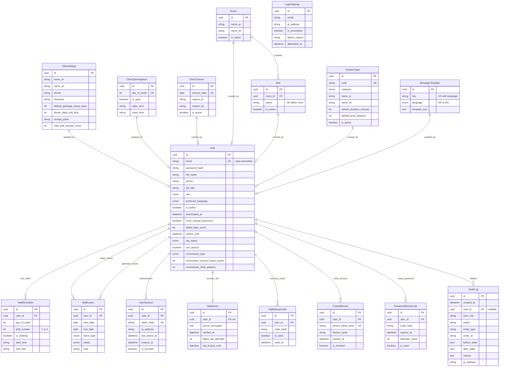

# Masaar Clinic System — Data Model & Schema Specification

> **Specification Reference:** [docs/FEATURES-v2.2.md](file:///F:/Claude%20CRM/docs/FEATURES-v2.2.md)  
> **Rules Index:** [docs/design/rules-index.md](file:///F:/Claude%20CRM/docs/design/rules-index.md)  
> **Decisions Log:** [docs/design/decisions.md](file:///F:/Claude%20CRM/docs/design/decisions.md)  
> **Calculations Reference:** [docs/design/calculations.md](file:///F:/Claude%20CRM/docs/design/calculations.md)  
> **Prisma Schema:** [`prisma/schema.prisma`](file:///F:/Claude%20CRM/prisma/schema.prisma)  
> **Database Engine:** PostgreSQL 16+

---

## 1. Global Architectural & Schema Conventions

1. **Currency Representation (`R-0-4`, `DEC-002`):**
   - Stored strictly as **integer piasters** (`INTEGER` or `BIGINT`, $1\text{ EGP} = 100\text{ piasters}$).
   - Columns explicitly suffixed with `_piasters` (e.g. `default_price_piasters`, `commission_fixed_piasters`).
   - Floating-point numeric types (`real`, `double precision`) are strictly forbidden.
2. **Timestamps & Timezones (`R-0-5`, `DEC-004`):**
   - Persisted in UTC as `TIMESTAMPTZ` with `_at` suffix (`created_at`, `updated_at`, `expires_at`, `attempted_at`).
   - Calendar date-only fields use `DATE` with `_date` suffix (`closure_date`, `start_date`, `end_date`).
   - All clinic-local calendar calculations, shift closures, and receipt rollover evaluate at `Africa/Cairo` timezone boundaries.
3. **Soft-Deletion & Immutability (`R-0-3`, `DEC-003`):**
   - Business data is **never hard-deleted**. Records use active toggles (`is_active = false`), cancellation/revocation states (`is_revoked = true`, `revoked_at`), or deactivation timestamps (`deactivated_at`).
4. **Calculated Values Policy (`R-0-6`, `DEC-005`):**
   - Quantities derived from other fields (clinician utilization rates, attendance percentages, remaining shift minutes, days left, account balances) are **never stored in the database**; they are dynamically computed per [calculations.md](file:///F:/Claude%20CRM/docs/design/calculations.md).
5. **Auditability & Traceability (`R-0-2`, `R-13-1`, `R-13-2`, `R-13-3`):**
   - All models track `created_at`, `updated_at`, and author references (`created_by_user_id`, `updated_by_user_id`).
   - The `audit_logs` table is append-only with no update or delete operations permitted.

---

## 2. Slice A — Entity-Relationship Diagram (ERD)



---

## 3. Slice A Table Dictionaries

### 3.1 `clinic_settings`
- **Purpose:** Singleton configuration table storing clinic branding, legal identity, working parameters, and lock horizons.
- **Rule References:** `R-2-1`, `R-2-6`, `R-2-7`, `R-2-8`, `R-9.2-1`, `DEC-016`

| Column | Type | Nullable | Default | Description (AR / EN) | Rule ID |
|---|---|:---:|---|---|:---:|
| `id` | `UUID` | No | `uuid()` | Primary Key (معرف الإعدادات) | `R-2-1` |
| `name_ar` | `VARCHAR(120)` | No | — | Clinic Arabic name (اسم المركز بالعربية) | `R-2-1` |
| `name_en` | `VARCHAR(120)` | No | — | Clinic English name (اسم المركز بالإنجليزية) | `R-2-1` |
| `address_ar` | `TEXT` | Yes | `NULL` | Arabic physical address (العنوان بالعربية) | `R-2-1` |
| `address_en` | `TEXT` | Yes | `NULL` | English physical address (العنوان بالإنجليزية) | `R-2-1` |
| `phone` | `VARCHAR(30)` | No | — | Main reception landline / mobile (هاتف المركز) | `R-2-1` |
| `logo_url` | `TEXT` | Yes | `NULL` | Clinic logo storage key / URL (شعار المركز) | `R-2-1` |
| `timezone` | `VARCHAR(50)` | No | `'Africa/Cairo'` | Operational timezone identifier (التوقيت المعتمد) | `R-0-5`, `DEC-004` |
| `default_package_expiry_days` | `INTEGER` | No | `60` | Default validity window in days (صلاحية الباقة الافتراضية) | `R-2-6`, `R-7-1` |
| `doctor_daily_soft_limit` | `INTEGER` | No | `10` | Daily booking soft warning threshold (الحد اليومي التنبيهي للطبيب) | `R-2-7`, `R-5.2-11` |
| `receipt_prefix` | `VARCHAR(10)` | No | `'INV'` | Annual receipt serial prefix (بادئة الفواتير) | `R-2-8`, `R-8.2-2` |
| `note_edit_window_hours` | `INTEGER` | No | `24` | Clinical note author edit window (مهلة تعديل التقرير الطبي) | `R-9.2-1`, `DEC-016` |
| `updated_by_user_id` | `UUID` | Yes | `NULL` | FK to `users.id` of editor (آخر تعديل بواسطة) | `R-0-2` |
| `created_at` | `TIMESTAMPTZ` | No | `now()` | Record creation timestamp (تاريخ الإنشاء) | `R-0-5` |
| `updated_at` | `TIMESTAMPTZ` | No | `now()` | Record update timestamp (تاريخ آخر تعديل) | `R-0-5` |

- **Foreign Keys:** `updated_by_user_id REFERENCES users(id) ON DELETE SET NULL`.
- **Check Constraints:**
  - `CHECK (default_package_expiry_days > 0)`
  - `CHECK (doctor_daily_soft_limit > 0)`
  - `CHECK (note_edit_window_hours >= 1 AND note_edit_window_hours <= 168)`

---

### 3.2 `clinic_opening_hours`
- **Purpose:** Clinic-wide operating hours defined for each day of the week (Saturday through Friday).
- **Rule References:** `R-2-2`, `R-5.2-1`

| Column | Type | Nullable | Default | Description (AR / EN) | Rule ID |
|---|---|:---:|---|---|:---:|
| `id` | `UUID` | No | `uuid()` | Primary Key | `R-2-2` |
| `day_of_week` | `INTEGER` | No | — | 0=Sat, 1=Sun, 2=Mon, 3=Tue, 4=Wed, 5=Thu, 6=Fri (يوم الأسبوع) | `R-2-2` |
| `is_open` | `BOOLEAN` | No | `true` | Operating status flag (مفتوح / مغلق) | `R-2-2` |
| `open_time` | `VARCHAR(5)` | No | `'09:00'` | Opening time `HH:mm` (وقت الفتح) | `R-2-2` |
| `close_time` | `VARCHAR(5)` | No | `'21:00'` | Closing time `HH:mm` (وقت الإغلاق) | `R-2-2` |
| `updated_by_user_id` | `UUID` | Yes | `NULL` | FK to `users.id` | `R-0-2` |
| `created_at` | `TIMESTAMPTZ` | No | `now()` | Creation timestamp | `R-0-5` |
| `updated_at` | `TIMESTAMPTZ` | No | `now()` | Update timestamp | `R-0-5` |

- **Unique Constraints:** `UNIQUE (day_of_week)` (guarantees exactly 1 configuration per weekday).
- **Check Constraints:**
  - `CHECK (day_of_week BETWEEN 0 AND 6)`
  - `CHECK (open_time < close_time)`
  - `CHECK (open_time ~ '^([01][0-9]|2[0-3]):[0-5][0-9]$')`
  - `CHECK (close_time ~ '^([01][0-9]|2[0-3]):[0-5][0-9]$')`

---

### 3.3 `clinic_closures`
- **Purpose:** Public holidays, religious feasts (Eid), and ad-hoc closure dates blocking appointment scheduling.
- **Rule References:** `R-2-3`, `R-5.2-1`

| Column | Type | Nullable | Default | Description (AR / EN) | Rule ID |
|---|---|:---:|---|---|:---:|
| `id` | `UUID` | No | `uuid()` | Primary Key | `R-2-3` |
| `closure_date` | `DATE` | No | — | Local closure date in Egypt (تاريخ العطلة) | `R-2-3` |
| `reason_ar` | `VARCHAR(150)` | No | — | Arabic closure reason e.g. "عيد الفطر" (سبب الإغلاق بالعربية) | `R-2-3` |
| `reason_en` | `VARCHAR(150)` | No | — | English closure reason e.g. "Eid Al-Fitr" (سبب الإغلاق بالإنجليزية) | `R-2-3` |
| `is_active` | `BOOLEAN` | No | `true` | Active toggle; false unblocks scheduling (حالة العطلة) | `R-0-3` |
| `created_by_user_id` | `UUID` | Yes | `NULL` | FK to `users.id` | `R-0-2` |
| `created_at` | `TIMESTAMPTZ` | No | `now()` | Creation timestamp | `R-0-5` |
| `updated_at` | `TIMESTAMPTZ` | No | `now()` | Update timestamp | `R-0-5` |

- **Unique Constraints:** `UNIQUE (closure_date)` (prevents duplicate closure records on the same calendar day).
- **Foreign Keys:** `created_by_user_id REFERENCES users(id) ON DELETE SET NULL`.

---

### 3.4 `rooms`
- **Purpose:** Treatment cubicles and consultation rooms hosting one or more beds.
- **Rule References:** `R-2-4`

| Column | Type | Nullable | Default | Description (AR / EN) | Rule ID |
|---|---|:---:|---|---|:---:|
| `id` | `UUID` | No | `uuid()` | Primary Key | `R-2-4` |
| `name_ar` | `VARCHAR(100)` | No | — | Arabic room label (اسم الغرفة / الكابينة بالعربية) | `R-2-4` |
| `name_en` | `VARCHAR(100)` | No | — | English room label (اسم الغرفة بالإنجليزية) | `R-2-4` |
| `is_active` | `BOOLEAN` | No | `true` | Active status; never delete (`R-0-3`) | `R-2-4` |
| `created_by_user_id` | `UUID` | Yes | `NULL` | FK to `users.id` | `R-0-2` |
| `created_at` | `TIMESTAMPTZ` | No | `now()` | Creation timestamp | `R-0-5` |
| `updated_at` | `TIMESTAMPTZ` | No | `now()` | Update timestamp | `R-0-5` |

- **Foreign Keys:** `created_by_user_id REFERENCES users(id) ON DELETE SET NULL`.

---

### 3.5 `beds`
- **Purpose:** Physical treatment beds constrained by PostgreSQL exclusion constraints against overlapping bookings.
- **Rule References:** `R-2-4`, `R-5.2-4`, `R-5.2-12`, `DEC-006`

| Column | Type | Nullable | Default | Description (AR / EN) | Rule ID |
|---|---|:---:|---|---|:---:|
| `id` | `UUID` | No | `uuid()` | Primary Key | `R-2-4` |
| `room_id` | `UUID` | No | — | FK to parent `rooms.id` (معرف الغرفة) | `R-2-4` |
| `name` | `VARCHAR(100)` | No | — | Bed name or identifier e.g. "Bed 1" (اسم السرير) | `R-2-4` |
| `is_active` | `BOOLEAN` | No | `true` | Active status; never delete (`R-0-3`) | `R-2-4` |
| `created_by_user_id` | `UUID` | Yes | `NULL` | FK to `users.id` | `R-0-2` |
| `created_at` | `TIMESTAMPTZ` | No | `now()` | Creation timestamp | `R-0-5` |
| `updated_at` | `TIMESTAMPTZ` | No | `now()` | Update timestamp | `R-0-5` |

- **Unique Constraints:** `UNIQUE (room_id, name)` (a bed name must be unique within its parent room).
- **Foreign Keys:**
  - `room_id REFERENCES rooms(id) ON DELETE RESTRICT` (cannot delete or orphan a room with beds).
  - `created_by_user_id REFERENCES users(id) ON DELETE SET NULL`.

---

### 3.6 `session_types`
- **Purpose:** Billable clinic service catalog (*Physiotherapy*, *Nutrition*, *Consultant Assessment*) with default durations and pricing suggestions.
- **Rule References:** `R-2-5`, `R-5.1-1`, `R-7` (Q-02, DEC-009)

| Column | Type | Nullable | Default | Description (AR / EN) | Rule ID |
|---|---|:---:|---|---|:---:|
| `id` | `UUID` | No | `uuid()` | Primary Key | `R-2-5` |
| `code` | `VARCHAR(50)` | No | — | Unique uppercase code e.g. `PHYSIOTHERAPY` (كود الخدمة) | `R-2-5` |
| `category` | `ENUM` | No | `'PHYSIOTHERAPY'` | Category: `PHYSIOTHERAPY`, `NUTRITION`, `CONSULTANT_ASSESSMENT` | `R-2-5`, `DEC-009` |
| `name_ar` | `VARCHAR(120)` | No | — | Arabic service name (اسم الجلسة بالعربية) | `R-2-5` |
| `name_en` | `VARCHAR(120)` | No | — | English service name (اسم الجلسة بالإنجليزية) | `R-2-5` |
| `default_duration_minutes` | `INTEGER` | No | `45` | Duration in minutes (المدة الافتراضية بالدقائق) | `R-2-5`, `R-5.1-1` |
| `default_price_piasters` | `INTEGER` | No | — | Price suggestion in integer piasters (السعر الافتراضي بالقروش) | `R-0-4`, `R-2-5` |
| `is_active` | `BOOLEAN` | No | `true` | Active status; deactivated services hide from booking (`R-0-3`) | `R-2-5` |
| `created_by_user_id` | `UUID` | Yes | `NULL` | FK to `users.id` | `R-0-2` |
| `created_at` | `TIMESTAMPTZ` | No | `now()` | Creation timestamp | `R-0-5` |
| `updated_at` | `TIMESTAMPTZ` | No | `now()` | Update timestamp | `R-0-5` |

- **Unique Constraints:** `UNIQUE (code)`.
- **Check Constraints:**
  - `CHECK (default_duration_minutes >= 15 AND default_duration_minutes <= 180)`
  - `CHECK (default_duration_minutes % 15 = 0)` (must be increments of 15 minutes per `R-5.1-1`)
  - `CHECK (default_price_piasters >= 0)` (prices cannot be negative per `R-0-4`)
- **Foreign Keys:** `created_by_user_id REFERENCES users(id) ON DELETE SET NULL`.

---

### 3.7 `users`
- **Purpose:** Core identity and profile table for clinic staff across all 5 roles with credential security, commission structures, and activity flags.
- **Rule References:** `R-1-1`–`R-1-5`, `R-3-1`, `R-3-4`, `R-3-5`, `R-11-1`, `R-15.1-1`–`R-15.1-5`, `DEC-010`

| Column | Type | Nullable | Default | Description (AR / EN) | Rule ID |
|---|---|:---:|---|---|:---:|
| `id` | `UUID` | No | `uuid()` | Primary Key | `R-3-1` |
| `email` | `VARCHAR(255)` | No | — | Case-insensitive login email (البريد الإلكتروني للدخول) | `R-3-1`, `R-15.1-1` |
| `password_hash` | `VARCHAR(255)` | No | — | bcrypt/argon2 hash; plaintext never stored (كلمة المرور المشفرة) | `R-3-4`, `R-15.1-1` |
| `full_name` | `VARCHAR(120)` | No | — | Clinician / staff full name (الاسم الكامل) | `R-3-1` |
| `phone` | `VARCHAR(30)` | No | — | Personal / contact mobile (رقم الهاتف) | `R-3-1` |
| `job_title` | `VARCHAR(100)` | No | — | Professional title e.g. "Senior Physiotherapist" (المسمى الوظيفي) | `R-3-1` |
| `role` | `ENUM` | No | — | Role: `OWNER`, `MANAGER`, `RECEPTIONIST`, `PHYSIOTHERAPIST`, `NUTRITIONIST` | `R-1-1`–`R-1-5` |
| `preferred_language` | `ENUM` | No | `'AR'` | UI language: `AR` (Arabic RTL) or `EN` (English) | `R-0-7`, `R-3-1` |
| `is_active` | `BOOLEAN` | No | `true` | Active status; deactivation blocks login immediately (`R-3-5`, `R-15.1-5`) | `R-3-1`, `R-3-5` |
| `deactivated_at` | `TIMESTAMPTZ` | Yes | `NULL` | Timestamp account was deactivated (تاريخ التعطيل) | `R-3-5` |
| `must_change_password` | `BOOLEAN` | No | `false` | True when password was reset by Owner (`R-3-4`) | `R-3-4` |
| `failed_login_count` | `INTEGER` | No | `0` | Consecutive failed attempts (عدد محاولات الدخول الخاطئة) | `R-15.1-3` |
| `locked_until` | `TIMESTAMPTZ` | Yes | `NULL` | 15-minute lockout horizon after 5 failures (تاريخ فك الحظر المؤقت) | `R-15.1-3` |
| `otp_status` | `ENUM` | No | `'NOT_SET'` | 2FA state: `NOT_SET`, `PENDING`, `ACTIVE` | `R-15.2-1`, `R-15.2-2` |
| `can_assess` | `BOOLEAN` | No | `false` | Clinician assessment qualification flag (`R-5.2-8`) | `R-5.2-8` |
| `commission_type` | `ENUM` | No | `'NONE'` | Commission model: `PERCENT`, `FIXED_PER_SESSION`, `NONE` | `R-3-1`, `R-11-1`, `DEC-010` |
| `commission_percent_basis_points` | `INTEGER` | No | `0` | Percentage stored in basis points (2500 = 25.00%) | `R-11-1`, `calculations.md §5.5` |
| `commission_fixed_piasters` | `INTEGER` | No | `0` | Fixed session reward in integer piasters (e.g. 7500 = 75.00 EGP) | `R-11-1` |
| `created_by_user_id` | `UUID` | Yes | `NULL` | FK to `users.id` of creator (Owner) | `R-0-2` |
| `created_at` | `TIMESTAMPTZ` | No | `now()` | Creation timestamp | `R-0-5` |
| `updated_at` | `TIMESTAMPTZ` | No | `now()` | Update timestamp | `R-0-5` |

- **Unique Constraints:**
  - `CREATE UNIQUE INDEX idx_users_email_ci ON users (LOWER(email))` (strict case-insensitive email uniqueness).
- **Check Constraints:**
  - `CHECK (failed_login_count >= 0)`
  - `CHECK (commission_percent_basis_points >= 0 AND commission_percent_basis_points <= 10000)` (0.00% to 100.00%)
  - `CHECK (commission_fixed_piasters >= 0)`
- **Foreign Keys:** `created_by_user_id REFERENCES users(id) ON DELETE SET NULL`.

---

### 3.8 `staff_schedules`
- **Purpose:** Clinician weekly shifts supporting up to 2 distinct shifts per working day (e.g. morning & evening).
- **Rule References:** `R-3-2`, `R-5.2-2`

| Column | Type | Nullable | Default | Description (AR / EN) | Rule ID |
|---|---|:---:|---|---|:---:|
| `id` | `UUID` | No | `uuid()` | Primary Key | `R-3-2` |
| `user_id` | `UUID` | No | — | FK to `users.id` (معرف المعالج / الموظف) | `R-3-2` |
| `day_of_week` | `INTEGER` | No | — | 0=Sat, 1=Sun, 2=Mon, 3=Tue, 4=Wed, 5=Thu, 6=Fri (يوم الأسبوع) | `R-3-2` |
| `shift_number` | `INTEGER` | No | — | Shift order: 1 (Shift 1) or 2 (Shift 2) (رقم الوردية) | `R-3-2` |
| `is_working` | `BOOLEAN` | No | `true` | Working toggle for this day (يعمل / عطلة) | `R-3-2` |
| `start_time` | `VARCHAR(5)` | No | — | Shift start `HH:mm` (بداية الوردية) | `R-3-2` |
| `end_time` | `VARCHAR(5)` | No | — | Shift end `HH:mm` (نهاية الوردية) | `R-3-2` |
| `created_at` | `TIMESTAMPTZ` | No | `now()` | Creation timestamp | `R-0-5` |
| `updated_at` | `TIMESTAMPTZ` | No | `now()` | Update timestamp | `R-0-5` |

- **Unique Constraints:** `UNIQUE (user_id, day_of_week, shift_number)` (at most 2 shifts per clinician per weekday).
- **Check Constraints:**
  - `CHECK (day_of_week BETWEEN 0 AND 6)`
  - `CHECK (shift_number IN (1, 2))`
  - `CHECK (start_time < end_time)`
  - `CHECK (start_time ~ '^([01][0-9]|2[0-3]):[0-5][0-9]$')`
  - `CHECK (end_time ~ '^([01][0-9]|2[0-3]):[0-5][0-9]$')`
- **Foreign Keys:** `user_id REFERENCES users(id) ON DELETE CASCADE`.

---

### 3.9 `staff_leaves`
- **Purpose:** Clinician leaves (annual, sick, personal) blocking bookings during the leave interval.
- **Rule References:** `R-3-3`, `R-5.2-2`

| Column | Type | Nullable | Default | Description (AR / EN) | Rule ID |
|---|---|:---:|---|---|:---:|
| `id` | `UUID` | No | `uuid()` | Primary Key | `R-3-3` |
| `user_id` | `UUID` | No | — | FK to `users.id` (معرف المعالج) | `R-3-3` |
| `start_date` | `DATE` | No | — | Leave start date (تاريخ بداية الإجازة) | `R-3-3` |
| `end_date` | `DATE` | No | — | Leave end date (تاريخ نهاية الإجازة) | `R-3-3` |
| `leave_type` | `ENUM` | No | — | Type: `ANNUAL`, `SICK`, `UNPAID`, `OTHER` (نوع الإجازة) | `R-3-3` |
| `status` | `ENUM` | No | `'APPROVED'` | Status: `PENDING`, `APPROVED`, `REJECTED`, `CANCELLED` | `R-3-3` |
| `note` | `TEXT` | Yes | `NULL` | Reason / handover notes (ملاحظات الإجازة) | `R-3-3` |
| `approved_by_user_id` | `UUID` | Yes | `NULL` | FK to `users.id` of approving Manager/Owner | `R-0-2` |
| `created_at` | `TIMESTAMPTZ` | No | `now()` | Creation timestamp | `R-0-5` |
| `updated_at` | `TIMESTAMPTZ` | No | `now()` | Update timestamp | `R-0-5` |

- **Indexes:** `CREATE INDEX idx_staff_leaves_user_dates ON staff_leaves (user_id, start_date, end_date)`.
- **Check Constraints:** `CHECK (start_date <= end_date)`.
- **Foreign Keys:**
  - `user_id REFERENCES users(id) ON DELETE CASCADE`.
  - `approved_by_user_id REFERENCES users(id) ON DELETE SET NULL`.

---

### 3.10 `login_attempts`
- **Purpose:** Record login events to enforce the 5-failure account lockout rule. Passwords are never logged.
- **Rule References:** `R-15.1-1`, `R-15.1-2`, `R-15.1-3`, `R-15.4-3`

| Column | Type | Nullable | Default | Description (AR / EN) | Rule ID |
|---|---|:---:|---|---|:---:|
| `id` | `UUID` | No | `uuid()` | Primary Key | `R-15.1-3` |
| `email` | `VARCHAR(255)` | No | — | Input email attempted (البريد المدخل) | `R-15.1-3` |
| `ip_address` | `VARCHAR(45)` | No | — | IPv4 / IPv6 of client (عنوان الآي بي) | `R-15.1-3` |
| `user_agent` | `TEXT` | Yes | `NULL` | Browser client header (بيانات المتصفح) | `R-15.1-3` |
| `is_successful` | `BOOLEAN` | No | — | True if credentials passed (نجاح / فشل) | `R-15.1-3` |
| `failure_reason` | `VARCHAR(100)` | Yes | `NULL` | Audit reason e.g. "INVALID_PASSWORD", "ACCOUNT_LOCKED" | `R-15.1-2` |
| `attempted_at` | `TIMESTAMPTZ` | No | `now()` | Exact UTC timestamp of attempt | `R-0-5` |

- **Security Rule:** The entered password is **never stored** in plain text or hash in `login_attempts`.
- **Indexes:**
  - `CREATE INDEX idx_login_attempts_email_time ON login_attempts (email, attempted_at)`.
  - `CREATE INDEX idx_login_attempts_ip_time ON login_attempts (ip_address, attempted_at)`.

---

### 3.11 `user_sessions`
- **Purpose:** Tracks authenticated browser sessions subject to 12-hour absolute lifetime and 15-minute idle lockouts.
- **Rule References:** `R-15.1-4`, `R-15.1-5`, `R-15.1-6`, `DEC-013`

| Column | Type | Nullable | Default | Description (AR / EN) | Rule ID |
|---|---|:---:|---|---|:---:|
| `id` | `UUID` | No | `uuid()` | Primary Key | `R-15.1-4` |
| `user_id` | `UUID` | No | — | FK to `users.id` | `R-15.1-4` |
| `token_hash` | `VARCHAR(255)` | No | — | SHA-256 hash of session cookie token (تجزئة رمز الجلسة) | `R-15.1-4` |
| `ip_address` | `VARCHAR(45)` | No | — | Client IP address | `R-15.1-4` |
| `user_agent` | `TEXT` | Yes | `NULL` | Browser user-agent | `R-15.1-4` |
| `last_active_at` | `TIMESTAMPTZ` | No | `now()` | Evaluated for 15-minute idle lock (آخر نشاط) | `R-15.1-4` |
| `expires_at` | `TIMESTAMPTZ` | No | — | Max 12-hour session expiry timestamp | `R-15.1-4` |
| `is_revoked` | `BOOLEAN` | No | `false` | Revocation flag (إلغاء الجلسة) | `R-15.1-4` |
| `revoked_at` | `TIMESTAMPTZ` | Yes | `NULL` | Revocation timestamp | `R-15.1-4` |
| `created_at` | `TIMESTAMPTZ` | No | `now()` | Session start timestamp | `R-0-5` |

- **Unique Constraints:** `UNIQUE (token_hash)`.
- **Indexes:** `CREATE INDEX idx_user_sessions_user_active ON user_sessions (user_id, is_revoked)`.
- **Foreign Keys:** `user_id REFERENCES users(id) ON DELETE CASCADE`.

---

### 3.12 `otp_secrets`
- **Purpose:** Two-step verification (TOTP) authenticator app secrets, encrypted at rest using a server-side AES key.
- **Rule References:** `R-15.2-1`, `R-15.2-5`, `R-15.2-7`, `DEC-007`

| Column | Type | Nullable | Default | Description (AR / EN) | Rule ID |
|---|---|:---:|---|---|:---:|
| `id` | `UUID` | No | `uuid()` | Primary Key | `R-15.2-1` |
| `user_id` | `UUID` | No | — | FK to `users.id` (معرف المستخدم) | `R-15.2-1` |
| `secret_encrypted` | `TEXT` | No | — | AES-256-GCM ciphertext (مفتاح التحقق المشفر) | `R-15.2-7` |
| `verified_at` | `TIMESTAMPTZ` | Yes | `NULL` | Verification timestamp completing initial QR setup | `R-15.2-2` |
| `failed_otp_attempts` | `INTEGER` | No | `0` | Consecutive wrong OTP counter (محاولات التحقق الفاشلة) | `R-15.2-5` |
| `otp_locked_until` | `TIMESTAMPTZ` | Yes | `NULL` | 15-minute lock horizon after 5 failures | `R-15.2-5` |
| `created_at` | `TIMESTAMPTZ` | No | `now()` | Enrollment timestamp | `R-0-5` |
| `updated_at` | `TIMESTAMPTZ` | No | `now()` | Update timestamp | `R-0-5` |

- **Security Rule:** The decryption key is loaded from the environment (`.env`) and is **never stored in the database**.
- **Unique Constraints:** `UNIQUE (user_id)`.
- **Foreign Keys:** `user_id REFERENCES users(id) ON DELETE CASCADE`.

---

### 3.13 `otp_backup_codes`
- **Purpose:** 10 single-use recovery codes generated during OTP setup, stored strictly as one-way hashes.
- **Rule References:** `R-15.2-2`, `R-15.2-3`

| Column | Type | Nullable | Default | Description (AR / EN) | Rule ID |
|---|---|:---:|---|---|:---:|
| `id` | `UUID` | No | `uuid()` | Primary Key | `R-15.2-2` |
| `user_id` | `UUID` | No | — | FK to `users.id` | `R-15.2-2` |
| `code_hash` | `VARCHAR(255)` | No | — | bcrypt / SHA-256 hash of recovery code (تجزئة كود الطوارئ) | `R-15.2-2` |
| `is_used` | `BOOLEAN` | No | `false` | Consumption toggle; codes are single-use | `R-15.2-2` |
| `used_at` | `TIMESTAMPTZ` | Yes | `NULL` | Consumption timestamp | `R-15.2-2` |
| `created_at` | `TIMESTAMPTZ` | No | `now()` | Generation timestamp | `R-0-5` |

- **Indexes:** `CREATE INDEX idx_otp_backup_codes_user_unused ON otp_backup_codes (user_id, is_used)`.
- **Foreign Keys:** `user_id REFERENCES users(id) ON DELETE CASCADE`.

---

### 3.14 `trusted_devices`
- **Purpose:** 30-day OTP bypass cookies granted when the user checks "Trust this device". Revocable by Owner.
- **Rule References:** `R-15.2-4`

| Column | Type | Nullable | Default | Description (AR / EN) | Rule ID |
|---|---|:---:|---|---|:---:|
| `id` | `UUID` | No | `uuid()` | Primary Key | `R-15.2-4` |
| `user_id` | `UUID` | No | — | FK to `users.id` | `R-15.2-4` |
| `device_token_hash` | `VARCHAR(255)` | No | — | SHA-256 hash of trusted device cookie (تجزئة رمز الجهاز الموثوق) | `R-15.2-4` |
| `device_name` | `VARCHAR(120)` | No | — | Friendly label e.g. "Front Desk Chrome" (اسم الجهاز) | `R-15.2-4` |
| `ip_address` | `VARCHAR(45)` | No | — | IP address at registration | `R-15.2-4` |
| `user_agent` | `TEXT` | Yes | `NULL` | Browser user-agent | `R-15.2-4` |
| `expires_at` | `TIMESTAMPTZ` | No | — | Exactly 30 days from creation | `R-15.2-4` |
| `is_revoked` | `BOOLEAN` | No | `false` | Revocation toggle | `R-15.2-4` |
| `revoked_at` | `TIMESTAMPTZ` | Yes | `NULL` | Revocation timestamp | `R-15.2-4` |
| `created_at` | `TIMESTAMPTZ` | No | `now()` | Registration timestamp | `R-0-5` |

- **Unique Constraints:** `UNIQUE (device_token_hash)`.
- **Indexes:** `CREATE INDEX idx_trusted_devices_user_active ON trusted_devices (user_id, is_revoked)`.
- **Foreign Keys:** `user_id REFERENCES users(id) ON DELETE CASCADE`.

---

### 3.15 `password_reset_codes`
- **Purpose:** 6-digit email password reset codes (10-minute validity, max 5 attempts, single-use).
- **Rule References:** `R-15.3-1`, `R-15.3-2`

| Column | Type | Nullable | Default | Description (AR / EN) | Rule ID |
|---|---|:---:|---|---|:---:|
| `id` | `UUID` | No | `uuid()` | Primary Key | `R-15.3-1` |
| `user_id` | `UUID` | No | — | FK to `users.id` | `R-15.3-1` |
| `code_hash` | `VARCHAR(255)` | No | — | Hashed 6-digit verification code | `R-15.3-1` |
| `expires_at` | `TIMESTAMPTZ` | No | — | Exactly 10 minutes from creation | `R-15.3-1` |
| `attempts_count` | `INTEGER` | No | `0` | Failed verification attempts (max 5) | `R-15.3-1` |
| `is_used` | `BOOLEAN` | No | `false` | Single-use flag | `R-15.3-1` |
| `used_at` | `TIMESTAMPTZ` | Yes | `NULL` | Use timestamp | `R-15.3-1` |
| `created_at` | `TIMESTAMPTZ` | No | `now()` | Generation timestamp | `R-0-5` |

- **Check Constraints:** `CHECK (attempts_count >= 0 AND attempts_count <= 5)`.
- **Indexes:** `CREATE INDEX idx_password_resets_user_unused ON password_reset_codes (user_id, is_used)`.
- **Foreign Keys:** `user_id REFERENCES users(id) ON DELETE CASCADE`.

---

### 3.16 `message_templates`
- **Purpose:** Customizable WhatsApp notification templates with dynamic placeholders, editable by Owner in settings.
- **Rule References:** `R-2-7`, `R-6-4`

| Column | Type | Nullable | Default | Description (AR / EN) | Rule ID |
|---|---|:---:|---|---|:---:|
| `id` | `UUID` | No | `uuid()` | Primary Key | `R-6-4` |
| `key` | `VARCHAR(50)` | No | — | Template key: `WELCOME`, `REMINDER`, `RESCHEDULE`, etc. | `R-6-4` |
| `language` | `ENUM` | No | — | Language: `AR` or `EN` | `R-4.1-12`, `R-6-4` |
| `template_text` | `TEXT` | No | — | Template content with placeholders like `{patientName}` | `R-6-4` |
| `updated_by_user_id` | `UUID` | Yes | `NULL` | FK to `users.id` of Owner | `R-0-2` |
| `created_at` | `TIMESTAMPTZ` | No | `now()` | Creation timestamp | `R-0-5` |
| `updated_at` | `TIMESTAMPTZ` | No | `now()` | Update timestamp | `R-0-5` |

- **Unique Constraints:** `UNIQUE (key, language)`.
- **Foreign Keys:** `updated_by_user_id REFERENCES users(id) ON DELETE SET NULL`.

---

### 3.17 `audit_logs`
- **Purpose:** Immutable append-only audit trail recording every state change, security event, and financial transaction across the system.
- **Rule References:** `R-0-2`, `R-13-1`, `R-13-2`, `R-13-3`, `R-15.4-3`

| Column | Type | Nullable | Default | Description (AR / EN) | Rule ID |
|---|---|:---:|---|---|:---:|
| `id` | `UUID` | No | `uuid()` | Primary Key | `R-13-1` |
| `created_at` | `TIMESTAMPTZ` | No | `now()` | Event UTC timestamp | `R-13-2` |
| `user_id` | `UUID` | Yes | `NULL` | FK to `users.id` (nullable for anonymous / system events) | `R-13-2` |
| `user_role` | `VARCHAR(50)` | Yes | `NULL` | Snapshot of role at event time | `R-13-2` |
| `action` | `VARCHAR(100)` | No | — | Action name e.g. `LOGIN_FAILED`, `CREATE_USER`, `UPDATE_PRICE` | `R-13-2` |
| `entity_type` | `VARCHAR(100)` | No | — | Target entity e.g. `USER`, `SETTING`, `SESSION_TYPE` | `R-13-2` |
| `entity_id` | `VARCHAR(100)` | Yes | `NULL` | Target record ID | `R-13-2` |
| `before_state` | `JSONB` | Yes | `NULL` | Snapshot of record prior to mutation | `R-13-2` |
| `after_state` | `JSONB` | Yes | `NULL` | Snapshot of record after mutation | `R-13-2` |
| `reason` | `TEXT` | Yes | `NULL` | Mandatory reason for overrides/voids | `R-13-2` |
| `ip_address` | `VARCHAR(45)` | Yes | `NULL` | Client IP address | `R-13-2` |
| `user_agent` | `TEXT` | Yes | `NULL` | Client browser user-agent | `R-13-2` |

- **Foreign Keys:** `user_id REFERENCES users(id) ON DELETE SET NULL` (audit log records must NEVER be deleted when a user is deleted or purged).
- **Indexes:**
  - `CREATE INDEX idx_audit_logs_user_time ON audit_logs (user_id, created_at)`
  - `CREATE INDEX idx_audit_logs_entity ON audit_logs (entity_type, entity_id)`
  - `CREATE INDEX idx_audit_logs_action_time ON audit_logs (action, created_at)`

---

## 4. PostgreSQL Database Triggers & Check Constraints (Raw SQL)

The following database triggers and constraints are written in raw SQL and will be packaged into Prisma migrations in Stage 2 to guarantee database-level enforcement of business rules:

```sql
-- 1. Immutable Audit Log Trigger (R-13-3)
-- Completely blocks UPDATE and DELETE statements on audit_logs.
CREATE OR REPLACE FUNCTION trg_block_audit_log_mutation()
RETURNS TRIGGER AS $$
BEGIN
    RAISE EXCEPTION 'Audit log entries are immutable. UPDATE and DELETE operations are prohibited.'
        USING ERRCODE = 'integrity_constraint_violation';
END;
$$ LANGUAGE plpgsql;

CREATE TRIGGER trg_audit_logs_immutability
BEFORE UPDATE OR DELETE ON audit_logs
FOR EACH ROW
EXECUTE FUNCTION trg_block_audit_log_mutation();

-- 2. Staff Schedule Shift Overlap Prevention (R-3-2)
-- Ensures that if a clinician has 2 shifts on the same day, Shift 1 ends before Shift 2 starts.
CREATE OR REPLACE FUNCTION trg_check_staff_schedule_shifts()
RETURNS TRIGGER AS $$
DECLARE
    other_shift RECORD;
BEGIN
    IF NEW.shift_number = 2 THEN
        SELECT start_time, end_time INTO other_shift
        FROM staff_schedules
        WHERE user_id = NEW.user_id 
          AND day_of_week = NEW.day_of_week 
          AND shift_number = 1
          AND id != NEW.id;
          
        IF FOUND AND other_shift.end_time > NEW.start_time THEN
            RAISE EXCEPTION 'Shift 2 start time (%) cannot overlap or precede Shift 1 end time (%).', 
                NEW.start_time, other_shift.end_time;
        END IF;
    ELSIF NEW.shift_number = 1 THEN
        SELECT start_time, end_time INTO other_shift
        FROM staff_schedules
        WHERE user_id = NEW.user_id 
          AND day_of_week = NEW.day_of_week 
          AND shift_number = 2
          AND id != NEW.id;
          
        IF FOUND AND NEW.end_time > other_shift.start_time THEN
            RAISE EXCEPTION 'Shift 1 end time (%) cannot overlap or exceed Shift 2 start time (%).', 
                NEW.end_time, other_shift.start_time;
        END IF;
    END IF;
    RETURN NEW;
END;
$$ LANGUAGE plpgsql;

CREATE TRIGGER trg_staff_schedules_shift_order
BEFORE INSERT OR UPDATE ON staff_schedules
FOR EACH ROW
EXECUTE FUNCTION trg_check_staff_schedule_shifts();
```

---

## 5. Non-Stored Calculated Values (Traceability to `calculations.md`)

In strict accordance with **Rule R-0-6** and **DEC-005**, the following values are dynamically calculated at query time and **omitted from Slice A tables**:

| Derived Entity / Metric | Formula Source | Why Not Stored |
|---|---|---|
| **Clinician Utilization Rate** | [calculations.md §3.3](file:///F:/Claude%20CRM/docs/design/calculations.md#33-clinician-daily-utilization-rate) | Derived dynamically from booked session minutes divided by active shift minutes. |
| **Clinician Daily Patient Count** | [calculations.md §3.1](file:///F:/Claude%20CRM/docs/design/calculations.md#31-appointment-overlap-detection) | Computed dynamically from appointment counts on that clinic date. |
| **Account Lock Status** | [calculations.md §1.4](file:///F:/Claude%20CRM/docs/design/calculations.md#14-non-stored-derived-values) | Dynamically evaluated from `locked_until > now()` and `failed_login_count >= 5`. |
| **Active Session Time Remaining** | [calculations.md §1.4](file:///F:/Claude%20CRM/docs/design/calculations.md#14-non-stored-derived-values) | Evaluated dynamically from `expires_at - now()`. |
| **Idle Lock Window Status** | [calculations.md §1.4](file:///F:/Claude%20CRM/docs/design/calculations.md#14-non-stored-derived-values) | Evaluated dynamically from `last_active_at + 15 minutes < now()`. |
