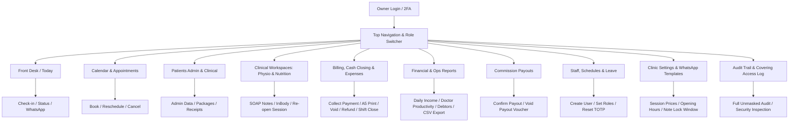
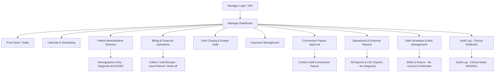
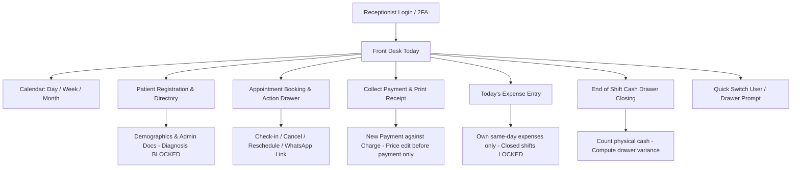
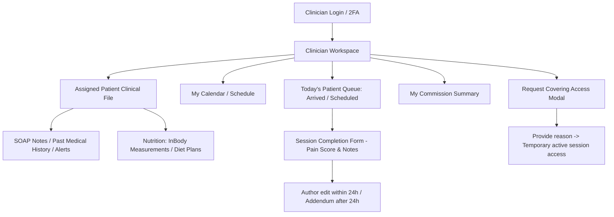

# Masaar Clinic System — Screen Catalog & Navigation Map (Task 1.14)

This document specifies every screen, modal, drawer, and dialog in the Masaar Clinic System, grouped by user role and architectural domain. It details routes, data displayed, available actions linked to permissions, role-based privacy masking, empty states, and error handling.

- **Spec Reference:** [docs/FEATURES-v2.2.md](file:///F:/Claude%20CRM/docs/FEATURES-v2.2.md) (All sections §1 through §15)
- **Permissions Reference:** [docs/design/permissions.md](file:///F:/Claude%20CRM/docs/design/permissions.md) & [`src/domain/permissions.ts`](file:///F:/Claude%20CRM/src/domain/permissions.ts)
- **Rules Index Reference:** [docs/design/rules-index.md](file:///F:/Claude%20CRM/docs/design/rules-index.md)
- **Status Machines Reference:** [docs/design/state-machines.md](file:///F:/Claude%20CRM/docs/design/state-machines.md)
- **Calculations Reference:** [docs/design/calculations.md](file:///F:/Claude%20CRM/docs/design/calculations.md)

---

## 1. System Navigation Architecture & Routes Summary

The system is built as a single responsive web application with Arabic RTL as the primary interface (`dir="rtl"`, Egyptian locale) and English LTR as a fully supported alternative. Navigation is divided into five role-tailored viewports plus global authentication screens.

```
/
├── /auth/
│   ├── /login                      (Email/Password login)
│   ├── /setup-totp                 (First-time TOTP QR + backup codes)
│   ├── /verify-totp                (2FA 6-digit challenge + trust device)
│   ├── /forgot-password            (Password reset flow)
│   └── /quick-unlock               (Idle timeout / switch user modal)
├── /reception/ (Receptionist, Manager, Owner)
│   ├── /today                      (Front desk daily operations hub)
│   ├── /calendar                   (Multi-bed 15-min calendar grid)
│   ├── /patients                   (Patient search & directory)
│   ├── /patients/new               (Patient demographic registration)
│   ├── /patients/[id]              (Patient administrative profile)
│   ├── /billing                    (Daily receipts, charges & collections)
│   ├── /expenses                   (Front desk operational expense logging)
│   └── /cash-closing               (Daily shift drawer closing & count)
├── /clinical/ (Physiotherapist, Owner)
│   ├── /queue                      (Today's scheduled & arrived patient queue)
│   ├── /patients/[id]              (Clinical chart, past SOAP notes & alerts)
│   ├── /sessions/[id]/complete     (Physio session completion & SOAP note)
│   └── /my-commissions             (Personal earned commission breakdown)
├── /nutrition/ (Nutritionist, Owner)
│   ├── /queue                      (Today's nutrition consultation queue)
│   ├── /patients/[id]              (Nutrition chart, InBody history & diet)
│   ├── /consultations/[id]/complete(InBody measurement & diet plan form)
│   └── /my-commissions             (Personal earned commission breakdown)
├── /management/ (Manager, Owner)
│   ├── /reports                    (Financial, clinical & operational reports)
│   ├── /commissions                (All-staff commission audit & payout run)
│   ├── /staff-schedules            (Staff shifts, operating hours & leave)
│   └── /resources                  (Rooms & treatment beds configuration)
└── /admin/ (Owner Only)
    ├── /staff                      (User accounts, roles & credentials reset)
    ├── /settings                   (Clinic profile, services, pricing & lock window)
    ├── /templates                  (WhatsApp message template configuration)
    ├── /audit-log                  (Comprehensive immutable system audit log)
    └── /audit-log/covering         (Clinician covering access emergency log)
```

---

## 2. Role-Based Navigation Maps (Mermaid)

### 2.1 Owner Navigation Map (Unrestricted Access)


### 2.2 Manager Navigation Map (Operational & Financial Oversight)


### 2.3 Receptionist Navigation Map (Front Desk Execution)


### 2.4 Physiotherapist & Nutritionist Navigation Map (Clinical Scope)


---

## 3. Role-Based Field Hiding & Data Masking Rules Matrix

In compliance with **R-1-3**, **R-1.1-2**, **R-1.1-3**, **R-1.1-20**, **R-4.1-21**, **R-9.1-1**, and **R-13-3**, strict field-level redactions are enforced both in API responses and UI views:

| Data Entity & Field | Owner | Manager | Receptionist | Physiotherapist | Nutritionist | Technical Enforcement |
|---|:---:|:---:|:---:|:---:|:---:|---|
| **Patient Demographics** (Name, Phone, DOB, Gender, Referral) | Visible | Visible | Visible | Visible (own/covered) | Visible (own/covered) | DB query projection |
| **Emergency / Guardian Contact** (Child/Elderly phone) | Visible | Visible | Visible | Visible (own/covered) | Visible (own/covered) | DB query projection |
| **Medical Alerts** (Hypertension, Diabetes, Cardiac, Allergy) | Visible | Visible (summary badge) | Visible (summary badge) | Visible (prominent) | Visible (prominent) | Front desk alert flag only (no clinical details) |
| **Clinical Diagnosis & Past Medical History** | Visible | 🚫 **HIDDEN** | 🚫 **HIDDEN** | Visible (own/covered) | Visible (own/covered) | Server Action excludes field from payload |
| **Physiotherapy SOAP Notes & Pain Scores** | Visible | 🚫 **HIDDEN** | 🚫 **HIDDEN** | Visible (own/covered) | 🚫 **HIDDEN** (unless co-treating) | Strictly scoped to therapist |
| **Nutrition Consultations, InBody & Diet Plans** | Visible | 🚫 **HIDDEN** | 🚫 **HIDDEN** | 🚫 **HIDDEN** (unless co-treating) | Visible (own/covered) | Strictly scoped to nutritionist |
| **Attachments: Administrative (ID / Payment proof)** | Visible | Visible | Visible | Visible (own/covered) | Visible (own/covered) | Filtered by `document_category` |
| **Attachments: Clinical (X-Ray, MRI, Lab Reports)** | Visible | 🚫 **HIDDEN** | 🚫 **HIDDEN** | Visible (own/covered) | Visible (own/covered) | Filtered by `document_category` |
| **Financial Balances, Charges & Payments** | Visible | Visible | Visible | 🚫 **HIDDEN** | 🚫 **HIDDEN** | Clinician views session status only |
| **Clinic Revenue, Expenses & Net Profit** | Visible | Visible | 🚫 **HIDDEN** | 🚫 **HIDDEN** | 🚫 **HIDDEN** | Manager/Owner financial module |
| **Doctor Commission Rates & Overall Payouts** | Visible | Visible | 🚫 **HIDDEN** | Visible (own total only) | Visible (own total only) | Clinician sees only self-summary |
| **Audit Log Clinical Payload (`before_json`, `after_json`)**| Visible | 🔒 **MASKED** | 🚫 **HIDDEN** | 🚫 **HIDDEN** | 🚫 **HIDDEN** | Manager views masked string `[CLINICAL DATA REDACTED]` |

---

## 4. Comprehensive Screen & Modal Specifications

### Part A: Authentication & Global Session Management

#### SCR-A01: Login Screen (`/auth/login`)
- **AR Title:** تسجيل الدخول للنظام
- **EN Title:** System Login
- **Purpose:** Secure email/password authentication for all clinic personnel.
- **Data Shown:** Clinic logo, branch name (Masaar Clinic - Maadi), email field, password field, "Remember this device for 30 days" checkbox, "Forgot password?" link.
- **Actions Available:**
  - `SUBMIT_LOGIN` (`#43` via auth handler): Validates credentials, checks account status (active/deactivated). If valid and 2FA configured -> redirects to `/auth/verify-totp`. If valid and first-time login -> redirects to `/auth/setup-totp`.
- **Role Restrictions:** Publicly accessible to unauthenticated users.
- **Empty State:** Clean login card with email placeholder `name@masaarclinic.com`.
- **Error States:**
  - *Invalid credentials:* "البريد الإلكتروني أو كلمة المرور غير صحيحة" (Email or password incorrect).
  - *Account deactivated:* "هذا الحساب معطل، يرجى التواصل مع إدارة العيادة" (Account deactivated).
  - *Rate limit exceeded (5 failed attempts):* "تم تجاوز الحد الأقصى للمحاولات. يرجى الانتظار 15 دقيقة" (Rate limited).

#### SCR-A02: TOTP Two-Factor Setup (`/auth/setup-totp`)
- **AR Title:** إعداد المصادقة الثنائية (2FA)
- **EN Title:** Two-Factor Authentication Setup
- **Purpose:** Enforce two-factor authenticator enrollment for all staff on first login.
- **Data Shown:** QR code placeholder image, manual base32 secret key, 8 single-use emergency backup codes with download/copy button, confirmation checkbox "حفظت الرموز الاحتياطية في مكان آمن", 6-digit TOTP input box.
- **Actions Available:**
  - `CONFIRM_TOTP_SETUP` (`#41` / `#43`): Verifies the 6-digit code, activates 2FA for user, logs audit record, redirects to dashboard.
- **Empty State:** Empty 6-digit code inputs with auto-focus on first cell.
- **Error States:**
  - *Invalid code:* "رمز التحقق غير صحيح، يرجى المحاولة مرة أخرى" (Invalid 6-digit TOTP).
  - *Unchecked backup codes:* "يرجى تأكيد حفظ الرموز الاحتياطية للمتابعة" (Must confirm backup code save).

#### SCR-A03: TOTP Challenge Verification (`/auth/verify-totp`)
- **AR Title:** التحقق من الهوية
- **EN Title:** Identity Verification
- **Purpose:** Second factor challenge during regular logins.
- **Data Shown:** User email, 6-digit code entry boxes, "تذكر هذا الجهاز لمدة 30 يوماً" (Trust device 30 days checkbox), link "استخدام رمز النسخ الاحتياطي" (Use backup code).
- **Actions Available:**
  - `VERIFY_TOTP_CODE`: Verifies time-based code or consumes 1 backup code, issues session token, redirects to role home screen.
- **Empty State:** Standard 6-digit PIN input with numpad support.
- **Error States:**
  - *Wrong OTP code:* "الرمز غير صحيح أو منتهي الصلاحية" (Incorrect or expired code).
  - *Exhausted backup codes:* "تم استنفاذ جميع الرموز الاحتياطية. يرجى مراجعة المالك لإعادة تعيين المصادقة" (Backup codes exhausted).

#### SCR-A04: Forgot / Reset Password (`/auth/forgot-password`)
- **AR Title:** استعادة كلمة المرور
- **EN Title:** Password Recovery
- **Purpose:** Request self-service reset or notify Owner.
- **Data Shown:** Email input, explanation of recovery procedure, link back to login.
- **Actions Available:**
  - `REQUEST_PASSWORD_RESET` (`#40`): Sends reset token to email if verified.
- **Empty State:** Single email input.
- **Error States:**
  - *Unknown email:* Generic safe message: "إذا كان البريد مسجلاً، فسيتم إرسال تعليمات إعادة التعيين".

#### MDL-A05: Idle Timeout & Quick Switch User Modal
- **AR Title:** قفل الجلسة لعدم النشاط / تبديل المستخدم
- **EN Title:** Session Idle Lock / Switch User
- **Purpose:** Protect terminal on 15 minutes of inactivity while allowing fast handover between receptionists on shared desk PC (DEC-011).
- **Data Shown:** Logged-in user name and avatar, lock reason ("تم قفل الشاشة تلقائياً بعد 15 دقيقة من عدم النشاط"), quick PIN / password field to resume, button "تبديل المستخدم" (Switch user), warning if unclosed cash shift exists ("لديك وردية نقدية مفتوحة! يرجى إغلاق الوردية قبل المغادرة").
- **Actions Available:**
  - `UNLOCK_SESSION`: Re-authenticates active user without refreshing page state.
  - `PROCEED_SWITCH_USER`: Logs out current user or navigates to cash closing if drawer unclosed.
- **Error States:**
  - *Invalid unlock password:* "كلمة المرور غير صحيحة".

---

### Part B: Front Desk & Scheduling

#### SCR-B01: Front Desk Today Hub (`/reception/today`)
- **AR Title:** لوحة الاستقبال — اليوم
- **EN Title:** Front Desk — Today
- **Purpose:** Primary operational screen for front-desk receptionists. Displays incoming patient flow, quick check-in, late alerts, and drawer status.
- **Data Shown:**
  - **Header KPIs:** Total appointments today, Arrived & waiting, In-session, Completed, No-shows, Current cash drawer balance.
  - **Patient Stream Table:** Time (`09:30 ص`), Patient name (`أحمد مصطفى`), Phone (`01012345678`), Service (`جلسة علاج طبيعي`), Clinician (`د. كريم حسني`), Bed/Room (`سرير 2 - غرفة 1`), Status Badge (`مجدول` / `حضر` / `مكتمل` / `لم يحضر` / `قائمة انتظار`), Financial indicator (`خالص` / `متبقي 450.00 ج.م`), Late arrival alert flag (flashing amber if clock > scheduled time + 10 min unarrived).
  - **Quick Action Bar:** "تسجيل مريض جديد" (New patient), "حجز موعد" (Book appt), "إغلاق الوردية" (Close cash shift), "تسجيل مصروف" (Log expense).
- **Actions Available:**
  - `CHECK_IN_PATIENT` (`#6`): Sets status `arrived`, records `arrivedAt` & `lateMinutes`, notifies clinician.
  - `UNDO_CHECK_IN` (`#7`): Allowed same day with reason.
  - `MARK_NO_SHOW` (`#8`): Marks `no_show` if past start time.
  - `OPEN_APPOINTMENT_DRAWER`: Opens side panel with full booking details and payment actions.
  - `OPEN_WHATSAPP_LINK` (`#38`): Opens `wa.me` pre-filled message and sets reminder sent.
- **Role Restrictions:** Receptionist, Manager, and Owner. Clinical diagnoses and medical notes are completely absent.
- **Empty State:** "لا توجد مواعيد مسجلة لهذا اليوم. اضغط على زر 'حجز موعد' لإضافة موعد جديد" with quick booking button.
- **Error States:**
  - *Network disconnection:* "تعذر الاتصال بالخادم، جارٍ إعادة المحاولة تلقائياً...".

#### SCR-B02: Clinic Calendar Grid (`/reception/calendar`)
- **AR Title:** جدول المواعيد والأسِرّة
- **EN Title:** Appointments & Bed Calendar
- **Purpose:** Visual 15-minute multi-bed scheduling grid supporting Day, Week, and Month views.
- **Data Shown:**
  - Date navigator (Previous / Next / Today / Datepicker).
  - View switcher: Day (Bed columns × 15-min time rows from opening to closing), Week (Doctor columns or Day columns), Month (Summary grid).
  - Room & Bed selector filter (Room 1: Beds 1, 2, 3; Room 2: Beds 4, 5).
  - Clinician filter (Dr. Karim, Dr. Sarah, etc.).
  - Appointment cards colored by status: Scheduled (Blue), Arrived (Amber), Completed (Green), Cancelled (Grey), No-Show (Red), Waitlisted (Slate banner).
  - Card displays: Patient name, Session type, Clinician initials, Payment tag.
- **Actions Available:**
  - `CLICK_EMPTY_SLOT`: Opens `MDL-B03` pre-filled with clicked Bed and Time.
  - `CLICK_APPOINTMENT`: Opens `DRW-B05` appointment details and action drawer.
  - `DRAG_AND_DROP_RESCHEDULE`: Triggers exclusion constraint checks on new slot.
- **Empty State:** Clean empty 15-minute grid lines with clinic opening hours boundaries.
- **Error States:**
  - *Double booking collision (btree_gist):* "تعذر النقل: السرير أو الأخصائي محجوز بالفعل في هذا التوقيت".

#### MDL-B03: Appointment Booking Modal
- **AR Title:** حجز موعد جديد
- **EN Title:** Book New Appointment
- **Purpose:** Schedule single visit or initiate recurring package series.
- **Data Shown:**
  - Patient lookup field (searches name or phone, includes guardian phone matches).
  - Service type dropdown: Physiotherapy, Nutrition, Consultant Assessment.
  - Treating clinician dropdown (filtered to clinicians providing that service and on duty).
  - Room & Bed picker (auto-suggests available bed matching service).
  - Date & Start Time picker (enforces 15-minute increments).
  - Duration dropdown (30, 45, 60, 90 mins).
  - Price field (pre-filled from catalog suggestion; receptionist can edit before payment with audit reason DEC-012).
  - Package session consumption selector (if patient has active package with available sessions).
  - Recurring booking toggle: "حجز متكرر / باقة" (frequency: weekly, 2x/week, 3x/week; number of sessions).
- **Actions Available:**
  - `SUBMIT_BOOKING` (`#5`): Validates overlap rules (`R-5.2-1`, `R-5.2-2`), creates appointment record, links package if applicable.
  - `PREVIEW_RECURRING_SERIES`: Opens `MDL-B04` to resolve conflicts across series dates.
- **Empty State:** Blank fields with patient search input focused.
- **Error States:**
  - *Clinician overlap:* "الأخصائي لديه موعد آخر متعارض في هذا التوقيت".
  - *Bed overlap:* "السرير محجوز لمريض آخر في هذا الوقت".
  - *Clinic closed:* "التوقيت المحدد يقع خارج ساعات العمل الرسمية أو في يوم عطلة".
  - *Exceeded package sessions:* "الباقة لا تحتوي على جلسات متبقية كافية".

#### MDL-B04: Recurring Series Preview Modal
- **AR Title:** معاينة سلسلة المواعيد المتكررة
- **EN Title:** Recurring Series Schedule Preview
- **Purpose:** Review individual dates for a multi-session package booking before committing.
- **Data Shown:** Table of planned sessions (Session #1 to #12) with Date, Day, Time, Bed, Clinician, and Status icon:
  - Available slot: Green checkmark `✅ متاح`.
  - Conflict slot: Red cross `❌ تعارض (السرير 2 محجوز)`.
  - Alternative suggested slot picker for conflicted dates.
- **Actions Available:**
  - `CONFIRM_SERIES_BOOKING`: Commits all green dates to DB inside transaction.
  - `ADJUST_CONFLICTED_DATE`: Modifies time or bed for specific row.
- **Error States:**
  - *Unresolved conflicts:* "لا يمكن الحفظ لوجود تعارضات في بعض المواعيد. يرجى تعديل التوقيت للمواعيد المحددة بالأحمر".

#### DRW-B05: Appointment Action Drawer
- **AR Title:** تفاصيل الموعد وإجراءات الخدمة
- **EN Title:** Appointment Action & Details Panel
- **Purpose:** Side slide-out panel when an appointment is selected on calendar or today screen.
- **Data Shown:**
  - Patient card: Name, phone, age, active package tag, balance due badge.
  - Appointment details: ID, Date, Time (`10:00 ص - 11:00 ص`), Room & Bed, Clinician, Price (`450.00 ج.م`), Paid (`0.00 ج.م`), Remaining (`450.00 ج.م`).
  - Status timeline: Created at, checked-in at, completed at.
  - Reminder status: "تم إرسال التذكير عبر واتساب في 08:30 م".
- **Actions Available:**
  - `CHECK_IN` (`#6`): Fast check-in.
  - `UNDO_CHECK_IN` (`#7`): Front desk same day with reason.
  - `CANCEL_APPOINTMENT` (`#5`): Mandatory reason dropdown (Illness, Travel, Personal, No response) + notes.
  - `RESCHEDULE_APPOINTMENT` (`#5`): Opens rescheduling date/time picker.
  - `MOVE_TO_WAITLIST` (`#5`): Frees slot on calendar while holding package session (DEC-008).
  - `COLLECT_PAYMENT`: Direct jump to payment modal `MDL-D02`.
  - `WHATSAPP_REMINDER` (`#38`): Opens WhatsApp chat.
- **Error States:**
  - *Attempting to cancel completed appointment:* "لا يمكن إلغاء موعد تم استكماله بالفعل".

---

### Part C: Patient Management & Registration

#### SCR-C01: Patient Directory & Search (`/reception/patients`)
- **AR Title:** دليل المرضى
- **EN Title:** Patient Directory
- **Purpose:** Search, filter, and access all patient demographic files.
- **Data Shown:**
  - Search bar (instant lookup by patient name, patient code, mobile phone `010XXXXXXXX`, or guardian phone).
  - Filter bar: Status (Active, Discharged, Inactive), Service (Physio, Nutrition), Has balance due (Yes/No), Assigned clinician.
  - Patient List Table: Patient Code (`MAS-01042`), Full name, Age/Gender (`34 سنة / ذكر`), Phone, Assigned Physio, Assigned Nutritionist, Active Package (`باقة 12 جلسة (متبقي 4)`), Financial Balance (`متبقي 300.00 ج.م`), Actions.
- **Actions Available:**
  - `NAVIGATE_TO_PROFILE`: Opens `/reception/patients/[id]`.
  - `QUICK_BOOK`: Opens booking modal for this patient.
  - `NEW_PATIENT_BUTTON`: Navigates to `/reception/patients/new`.
- **Empty State:** "لم يتم العثور على مرضى مطابقين لمعايير البحث. تأكد من رقم الهاتف أو الاسم" with button "إضافة مريض جديد".

#### SCR-C02: Patient Registration Screen (`/reception/patients/new`)
- **AR Title:** تسجيل مريض جديد
- **EN Title:** New Patient Registration
- **Purpose:** Register new patient demographics with strict duplicate detection and guardian phone support (DEC-014).
- **Data Shown:**
  - **Demographics Section:** Full Arabic name (min 3 parts), Date of birth (or calculated age input), Gender (Male / Female), National ID (optional).
  - **Phone & Contact Section:**
    - Mobile phone field (`01XXXXXXXXX` Egyptian mobile validation).
    - Checkbox: `"المريض تابع (طفل / مسن) ويستخدم هاتف ولي الأمر"` (Uses guardian's phone).
    - When checked: Patient mobile becomes disabled (null); Guardian Name, Guardian Relationship (Father, Mother, Son, Other), and Guardian Mobile (`01XXXXXXXXX`) appear as required fields.
    - Duplicate detection alert banner: Real-time query displays existing patients sharing this phone or guardian phone.
  - **Clinical Assignment & Referral:**
    - Assigned Physiotherapist, Assigned Nutritionist.
    - Referral source dropdown (Doctor referral, Social media, Friend/Family, Walk-in, Other).
    - Preferred language (Arabic default / English).
  - **Medical Alerts Checklist:**
    - High blood pressure, Diabetes, Cardiac condition, Bleeding disorder, Pregnancy, Recent surgery, Allergies, General alert note.
  - **Consents & Authorizations:**
    - Mandatory checkbox: `"موافقة المريض على معالجة البيانات الشخصية والطبية"` (`dataConsent` required `R-4.1-15`).
    - Optional checkbox: `"موافقة المريض على استقبال رسائل التذكير عبر واتساب"` (`whatsappConsent` toggle DEC-022).
- **Actions Available:**
  - `SUBMIT_PATIENT_REGISTRATION` (`#1`): Creates patient record, logs audit entry, redirects to patient profile.
- **Empty State:** Clean registration form with autofocus on patient name.
- **Error States:**
  - *Duplicate mobile phone:* "رقم الهاتف مسجل بالفعل للمريض: أحمد مصطفى (كود: MAS-0012). يرجى فتح الملف الحالي أو استخدام هاتف ولي أمر".
  - *Invalid phone format:* "رقم الهاتف يجب أن يكون رقماً مصرياً صحيحاً مكوناً من 11 رقماً يبدأ بـ 01".
  - *Missing mandatory consent:* "يجب الحصول على موافقة معالجة البيانات لإتمام التسجيل".

#### SCR-C03: Patient Profile — Administrative View (`/reception/patients/[id]`)
- **AR Title:** ملف المريض — البيانات الإدارية والمالية
- **EN Title:** Patient Profile — Admin & Financial View
- **Purpose:** Administrative center for front desk, receptionists, and managers.
- **Data Shown:**
  - **Profile Header:** Code (`MAS-00412`), Full Name, Age, Phone (with direct WhatsApp button), Guardian details if dependent, Medical alert warning badge (e.g. `⚠️ تنبيه طبي: ضغط مرتفع`), Overall balance badge (`الرصيد المستحق: 450.00 ج.م`).
  - **Tab 1: Mawa'eed (المواعيد - Appointments):** Complete list of past and upcoming visits with date, time, clinician, bed, status, and price.
  - **Tab 2: Baqat (الباقات - Packages):** Active and expired packages, total sessions, used sessions, booked sessions, available sessions, expiry date, validity extension history.
  - **Tab 3: Malyat (الماليات - Billing & Invoices):** All charges, payments, receipt numbers (`INV-2026-00142`), payment methods, voids, and refunds.
  - **Tab 4: Mostanadat (المستندات - Documents):** Uploaded administrative attachments (National ID, Insurance card, Payment deposit slip). **Clinical documents (X-ray, MRI, lab) are NOT visible to receptionist or manager (`R-1.1-3`).**
  - **Tab 5: Esha'arat (الإشعارات - Notifications & WhatsApp):** Log of reminder messages sent with delivery timestamps.
- **Actions Available:**
  - `EDIT_DEMOGRAPHICS` (`#1`): Opens edit modal for phone, address, referral.
  - `CREATE_PACKAGE` (`#14`): Opens `MDL-D01`.
  - `BOOK_APPOINTMENT` (`#5`): Opens booking modal.
  - `COLLECT_PAYMENT` (`#17`): Opens payment dialog.
  - `UPLOAD_DOCUMENT` (`#4`): Uploads admin attachment.
- **Role Restrictions:** Receptionist and Manager views **strictly hide** diagnosis, clinical SOAP notes, InBody body fat percentages, and medical file attachments.
- **Empty State (Tabs):** "لا توجد باقات سابقة للمريض" / "لا توجد فواتير مسجلة".

#### MDL-C04: Covering Access Request Modal (Clinician Only)
- **AR Title:** طلب إذن وصول تغطية لحالة مريض
- **EN Title:** Request Covering Access for Patient Chart
- **Purpose:** Enforce documented security access when a clinician opens a patient not assigned to them (`R-1.1-21`, DEC-013).
- **Data Shown:** Patient Name, Warning banner: "هذا المريض ليس ضمن قائمة مرضاك المخصصين. فتح الملف سيسجل في سجل الرقابة الخاص بإدارة العيادة وسينتهي الإذن بانتهاء جلستك الحالية (بحد أقصى 12 ساعة)", Mandatory text area: "سبب فتح الملف الطبي (مثل: تغطية زميل في إجازة، حالة طوارئ بالعيادة)".
- **Actions Available:**
  - `SUBMIT_COVERING_ACCESS` (`#3`): Validates non-empty reason, creates covering-access grant, writes audit log, opens clinical chart.
  - `CANCEL`: Closes modal and returns to queue.
- **Error States:**
  - *Empty reason:* "يرجى توضيح سبب فتح الملف الطبي بشكل مفصل للمتابعة".

---

### Part D: Packages & Financial Operations

#### MDL-D01: Create Package Modal
- **AR Title:** إصدار باقة علاجية جديدة
- **EN Title:** Issue New Treatment Package
- **Purpose:** Assign a multi-session package to a patient and generate the financial charge (`R-7-2`).
- **Data Shown:**
  - Patient Name and Code.
  - Package Template dropdown (Physiotherapy 6 sessions, Physio 12 sessions, Nutrition 4 sessions, Nutrition 8 sessions).
  - Package Name (auto-filled, editable).
  - Session type (Physiotherapy or Nutrition; Consultant Assessment not packaged DEC-009).
  - Total Sessions count (e.g. 12).
  - Validity Days count (e.g. 90 days).
  - Expiry Date preview (`15 يناير 2027`).
  - Total Price in EGP (e.g. `3,600.00 ج.م` - stored as `360000` piasters).
  - Immediate Payment toggle: "تحصيل دفعة نقدية فورية الآن".
- **Actions Available:**
  - `SUBMIT_CREATE_PACKAGE` (`#14`): Creates package in `ACTIVE` status, inserts charge in `charges` table, logs audit event.
- **Error States:**
  - *Invalid session count:* "عدد الجلسات يجب أن يكون أكبر من صفر".
  - *Zero price:* "سعر الباقة يجب أن يكون قيمة موجبة".

#### MDL-D02: Collect Payment Modal
- **AR Title:** تسجيل دفعة مالية وتحصيل
- **EN Title:** Record Payment & Collection
- **Purpose:** Collect payment against an outstanding appointment charge or package charge (`R-8.1-2`).
- **Data Shown:**
  - Patient Name & Outstanding Balance summary (`إجمالي المستحق: 1,200.00 ج.م`).
  - Target Charge selector (Package #PKG-2026-004 or Appointment #APT-0982).
  - Charge Total, Amount Already Paid, Remaining Balance.
  - Payment Amount input in EGP (default pre-filled with remaining balance; cannot exceed balance).
  - Payment Method dropdown: `Cash` (نقدي), `Visa / Card` (فيزا / بطاقة), `InstaPay` (إنستاباي), `Vodafone Cash` (فودافون كاش).
  - Transaction Reference / Receipt note field (mandatory for InstaPay & Vodafone Cash transaction ID).
  - Print receipt checkbox: "طباعة إيصال استلام فوري (A5)" (checked by default).
- **Actions Available:**
  - `SUBMIT_PAYMENT` (`#17`): Creates payment record, generates sequential receipt number (`INV-2026-00184`), attributes cash to cashier's open shift if Cash method, triggers A5 print view.
- **Error States:**
  - *Amount exceeds balance:* "المبلغ المدخل أكبر من الرصيد المتبقي على الفاتورة".
  - *Missing InstaPay reference:* "يرجى إدخال رقم المعاملة أو المرجع لمدفوعات إنستاباي وفودافون كاش".

#### SCR-D03: Printable Receipt View (A5 Layout)
- **AR Title:** إيصال استلام نقدية (معاينة وطباعة A5)
- **EN Title:** Cash Receipt Voucher (A5 Printable Preview)
- **Purpose:** Formal printable patient receipt formatted for standard A5 horizontal or half-A4 paper (`R-8.2-1`).
- **Data Shown:**
  - Clinic official header: Logo, Clinic name (عيادة مسار للعلاج الطبيعي والتغذية), Tax registration / commercial registry, Phone, Address.
  - Receipt metadata: Receipt No (`رقم الإيصال: INV-2026-00184`), Issue Date & Time (`25 أكتوبر 2026 - 02:45 م`), Cashier name (`الموظف: سارة علي`).
  - Patient details: Name (`السيد: أحمد مصطفى`), Patient ID (`MAS-00412`).
  - Line items table: Description (`دفعة تحت حساب: باقة علاج طبيعي 12 جلسة`), Quantity (`1`), Total (`1,200.00 ج.م`).
  - Totals breakdown: Total Paid (`المدفوع: 1,200.00 ج.م`), Payment Method (`طريقة الدفع: إنستاباي - مرجع: 98471204`), Remaining Balance (`الرصيد المتبقي: 0.00 ج.م`).
  - Stamp & Signature lines: "توقيع المستلم" / "خاتم العيادة".
  - Footer notice: "نتمنى لكم الشفاء العاجل — يُرجى الاحتفاظ بالإيصال للمراجعة".
- **Actions Available:**
  - `PRINT_RECEIPT`: Browser print dialog formatted via `@media print`.
  - `CLOSE_MODAL`: Returns to previous billing screen.

#### MDL-D04: Void Receipt Dialog (Owner / Manager Only)
- **AR Title:** إلغاء إيصال قبض (Void)
- **EN Title:** Void Payment Receipt
- **Purpose:** Void an erroneously recorded payment (`R-1.1-12`, `R-8.3-1`).
- **Data Shown:**
  - Receipt Details: Number, Date, Amount, Payment Method, Original Cashier.
  - Warning alert: "إلغاء الإيصال لن يحذف السجل من قاعدة البيانات، بل سيتم وسمه كملغي وإعادة حساب رصيد المريض وخصم المبلغ من الوردية النقدية إذا كان نقداً".
  - Mandatory reason dropdown: Duplicate entry (إدخال مكرر), Wrong patient (مريض خطأ), Wrong amount (مبلغ خاطئ), Other (أخرى).
  - Detailed explanation text area.
- **Actions Available:**
  - `SUBMIT_VOID_RECEIPT` (`#20`): Sets `is_voided = true`, creates reversal entry, writes full audit log.
- **Error States:**
  - *Missing reason:* "سبب الإلغاء إلزامي ولا يمكن ترك الحقل فارغاً".

#### MDL-D05: Refund Dialog (Owner / Manager Only)
- **AR Title:** استرداد مبلغ للمريض (Refund)
- **EN Title:** Patient Refund Issuance
- **Purpose:** Issue refund for cancelled service or patient withdrawal (`R-1.1-12`, `R-8.3-2`, DEC-015).
- **Data Shown:**
  - Patient Name & Package/Charge details.
  - Total Paid so far, Value of completed sessions.
  - Maximum allowable refund calculation (`الحد الأقصى المتاح للاسترداد: 800.00 ج.م`).
  - Refund Amount field.
  - Payout Method dropdown: `Cash` (نقدي - يخصم من درج المستخدم الحالي), `Bank Transfer` (تحويل بنكي), `InstaPay / Wallet` (إنستاباي / محفظة).
  - Mandatory refund justification notes.
- **Actions Available:**
  - `SUBMIT_REFUND` (`#21`): Creates refund transaction, updates balance, attributes cash reduction to current user's cash closing if Cash method.
- **Error States:**
  - *Refund exceeds refundable ceiling:* "لا يمكن استرداد مبلغ يتجاوز صافي المدفوعات مطروحاً منها الجلسات المستهلكة".

#### SCR-D06: Cash Shift Closing & Drawer Count (`/reception/cash-closing`)
- **AR Title:** إغلاق الوردية النقدية وحساب الدرج
- **EN Title:** Cash Shift Closing & Drawer Count
- **Purpose:** End-of-shift cash drawer balancing and variance tracking per cashier (`R-8.4-1`, DEC-011).
- **Data Shown:**
  - Cashier name, Shift start time, Shift duration.
  - System Cash Calculations:
    - Opening balance (`الرصيد الافتتاحي: 0.00 ج.م`).
    - Total cash payments collected (`مقبوضات نقدية: 3,450.00 ج.م`).
    - Total cash refunds issued (`مردودات نقدية: -200.00 ج.م`).
    - Total cash expenses paid from drawer (`مصروفات نقدية: -150.00 ج.م`).
    - **Expected Drawer Cash:** `3,100.00 ج.م`.
  - Cashier Physical Count Input: "الرصيد الفعلي في الدرج (عد النقدية)".
  - Real-time Variance display: `الفارق: 0.00 ج.م (مطابق)` or `عجز: -50.00 ج.م` or `زيادة: +20.00 ج.م`.
  - Cashier shift closing notes.
- **Actions Available:**
  - `SUBMIT_CASH_CLOSING` (`#23`): Finalizes shift, freezes all same-day expenses entered during shift (DEC-020), stores variance, generates closing audit voucher.
  - `FORCE_CLOSE_ANOTHER_USER` (`#24` - Owner/Manager only): Closes abandoned open drawer with manager audit rationale.
- **Error States:**
  - *Unentered physical count:* "يجب إدخال المبلغ الفعلي الموجود بالدرج".

---

### Part E: Clinical Workspaces & Charting

#### SCR-E01: Clinician Workspace & Queue (`/clinical/queue`)
- **AR Title:** مساحة عمل المعالج — قائمة الانتظار اليومية
- **EN Title:** Clinician Workspace — Today's Patient Queue
- **Purpose:** Fast daily dashboard for Physiotherapists and Nutritionists showing their patients for today.
- **Data Shown:**
  - Date & current clinic time.
  - Clinician on-duty hours today (`01:00 م - 09:00 م`).
  - Active Queue Split:
    - **قيد الانتظار بالعيادة (Arrived & Waiting):** Patients checked in at front desk with waiting minutes (`حضر منذ 12 دقيقة`). Highlighted card with "بدء الجلسة" (Start Session) button.
    - **الجلسة جارية (In Session):** Active ongoing session with elapsed timer.
    - **المواعيد القادمة اليوم (Scheduled Upcoming):** Upcoming patients with start times.
    - **المكتملة اليوم (Completed Today):** Summary of finished sessions with link to edit note (if within 24h window `R-9.2-1`).
- **Actions Available:**
  - `START_SESSION`: Opens `SCR-E03` session completion form.
  - `VIEW_PATIENT_CHART`: Opens patient clinical record.
  - `MARK_NO_SHOW` (`#8`): Allows marking no-show for own patients if past start time.
- **Role Restrictions:** Only shows patients booked with the logged-in clinician. Financial rates, drawer totals, and clinic revenue are completely hidden.
- **Empty State:** "لا يوجد مرضى في قائمة الانتظار حالياً. استمتع بوقتك أو راجع مواعيدك القادمة".

#### SCR-E02: Patient Clinical Chart (`/clinical/patients/[id]`)
- **AR Title:** السجل الطبي للمريض
- **EN Title:** Patient Medical Record & SOAP History
- **Purpose:** Longitudinal clinical chart accessible only to authorized clinicians (`R-1.1-2`).
- **Data Shown:**
  - Clinical Header: Patient Name, Age, Gender, Primary Diagnosis (`انزلاق غضروفي قطني L4-L5`), Medical Alerts banner (`⚠️ حساسية من مضادات الالتهاب`), Assigned Clinicians.
  - Past Sessions Timeline: Reverse chronological list of past visits. Each card displays: Date, Session #, Clinician, Pain Score badge (`6/10 -> 2/10`), SOAP summary, Treatment modalities used, Home exercises prescribed.
  - Clinical Attachments gallery: X-rays, MRI scans, Laboratory reports (supports full-screen zoom and download).
  - Outcome & Discharge status.
- **Actions Available:**
  - `OPEN_NOTE_ADDENDUM` (`#12`): Add timestamped addendum to locked note.
  - `EDIT_RECENT_NOTE` (`#10`): Author only within 24h of save.
  - `DISCHARGE_PATIENT` (`#13`): Opens discharge modal `MDL-E05`.
  - `UPLOAD_CLINICAL_DOCUMENT` (`#4`): Uploads medical file under category X-ray, MRI, or Lab.
- **Empty State:** "لا توجد سجلات طبية سابقة للمريض. سيتم إنشاء السجل الأول عند استكمال الجلسة الأولى".

#### SCR-E03: Session Completion Form (`/clinical/sessions/[id]/complete`)
- **AR Title:** استكمال الجلسة وتوثيق التقرير الطبي
- **EN Title:** Session Completion & Clinical Documentation
- **Purpose:** Document patient care, evaluate pain, write SOAP note, select applied treatments, and assign home exercises (`R-1.1-7`, `R-9.1-1` to `R-9.1-7`).
- **Data Shown:**
  - Patient banner: Name, Age, Session number in package (`الجلسة 4 من 12`).
  - **Pain Evaluation (مقياس الألم):** Visual numeric slider 0 to 10 with descriptive anchors:
    - `0` (لا يوجد ألم - No pain)
    - `1-3` (ألم خفيف - Mild)
    - `4-6` (ألم متوسط - Moderate)
    - `7-9` (ألم شديد - Severe)
    - `10` (ألم لا يطاق - Worst possible pain)
  - **SOAP Clinical Note:**
    - `S - الفحص الذاتي والشكوى (Subjective):` Patient's reported sensations, changes since last visit.
    - `O - الفحص الإكلينيكي الموضوعي (Objective):` Range of motion, muscle strength, manual tests.
    - `A - التقييم الطبي وخطة التعافي (Assessment):` Diagnosis progress, functional stage.
    - `P - الخطة العلاجية والتوجيهات (Plan):` Recommendations for next visit.
  - **Treatment Modalities Checklist (الإجراءات العلاجية المنفذة):**
    - Manual therapy (علاج يدوي), Ultrasound (موجات فوق صوتية), TENS electrotherapy (علاج كهربائي), Shockwave (موجات تصادمية), Spinal traction (شد فقرات), Therapeutic exercises (تمرينات علاجية), Hot/Cold packs (كمادات).
  - **Home Exercise Prescription (التمرينات المنزلية):**
    - Selected exercises with sets, repetitions, and frequency (e.g. "تمرين إطالة الظهر: 3 مجموعات × 10 تكرارات يومياً").
- **Actions Available:**
  - `SUBMIT_SESSION_COMPLETION` (`#9`): Validates required fields, sets appointment `completed`, consumes 1 package session, triggers doctor commission calculation (`R-11-1`), starts 24h note edit countdown (`R-9.2-1`).
- **Error States:**
  - *Empty SOAP section:* "يرجى كتابة الملاحظات الطبية لجميع أقسام SOAP لتوثيق الجلسة".
  - *Unselected treatments:* "يرجى تحديد إجراء علاجي واحد على الأقل تم تنفيذه خلال الجلسة".

#### MDL-E04: Clinical Note Version History & Addendum
- **AR Title:** تاريخ تعديلات التقرير وإضافة ملحق
- **EN Title:** Note Version History & Addendum
- **Purpose:** Audit trail of clinical note modifications and adding addenda after 24h lock (`R-9.2-1`, `R-9.2-2`).
- **Data Shown:**
  - Version comparison view: Original Note (`25 أكتوبر 10:00 ص`), Version 2 (`25 أكتوبر 02:30 م - تعديل بواسطة د. كريم`), Diff highlight of changed text.
  - Lock status banner: "هذا التقرير مغلق ومحمي بعد مرور 24 ساعة على اعتماده. لا يمكن تعديل النص الأصلي، ولكن يمكنك إضافة ملحق جديد أدناه".
  - Addendum entry area: Timestamped addendum note input.
- **Actions Available:**
  - `SUBMIT_ADDENDUM` (`#12`): Appends immutable addendum with author and timestamp.
  - `OWNER_REOPEN_NOTE` (`#11` - Owner only): Re-opens locked note with mandatory justification.
- **Error States:**
  - *Non-owner attempting to re-open:* Action forbidden by RBAC.

#### MDL-E05: Patient Discharge Modal
- **AR Title:** إنهاء العلاج وتخريج المريض
- **EN Title:** Patient Treatment Discharge
- **Purpose:** Formal discharge upon recovery, maximum benefit, or discontinuation (`R-4.1-19`, `R-9.5-1`).
- **Data Shown:**
  - Discharge Reason dropdown: Goals achieved / Full recovery (تم تحقيق أهداف العلاج والشفاء), Maximum medical improvement (أقصى تحسن ممكن), Patient discontinued (انقطاع المريض), Referred to surgery/specialist (تحويل لجراحة أو تخصص آخر).
  - Final Pain Score (0-10).
  - Summary of treatment outcomes and post-discharge recommendations.
- **Actions Available:**
  - `SUBMIT_DISCHARGE` (`#13`): Updates patient status to `DISCHARGED`, logs clinical audit record.

#### SCR-E06: Nutrition Consultation & InBody View (`/nutrition/consultations/[id]/complete`)
- **AR Title:** كشف التغذية العلاجية وفحص InBody
- **EN Title:** Nutrition Consultation & InBody Form
- **Purpose:** Record body composition metrics, dietary assessments, and meal plans (`R-9.4-1`).
- **Data Shown:**
  - Patient banner: Age, Gender, Previous consultation date.
  - **InBody Metrics Grid:**
    - Height (cm) - Pre-filled from profile/previous test, remains editable (DEC-019).
    - Weight (kg).
    - Calculated BMI (كجم/م²) - Automatic display (`weight / (height/100)^2`).
    - Body Fat % (نسبة الدهون).
    - Skeletal Muscle Mass (كتلة العضلات كجم).
    - Basal Metabolic Rate (معدل الحرق BMR سعرة).
    - Total Body Water (ماء الجسم لتر).
    - Visceral Fat Level (الدهون الحشوية 1-20).
  - **Clinical Nutrition Notes:** Eating habits, 24h food recall, gastrointestinal symptoms, target weight goals.
  - **Dietary Plan Prescription:** Daily calorie target (e.g. `1,800 kcal`), macronutrient breakdown (Carbs %, Protein %, Fat %), weekly meal schedule notes.
- **Actions Available:**
  - `SUBMIT_NUTRITION_CONSULTATION` (`#9`): Records InBody data, consumes nutrition session, generates commission.
- **Error States:**
  - *Out of range metrics:* "الوزن المدخل غير منطقي (يجب أن يكون بين 10 كجم و 300 كجم)".

---

### Part F: Operational Expenses & Commission Payouts

#### SCR-F01: Clinic Expenses Management (`/management/expenses`)
- **AR Title:** إدارة المصروفات التشغيلية
- **EN Title:** Clinic Operating Expenses
- **Purpose:** Track clinic expenditures, petty cash, doctor commissions, utilities, and supplies (`R-10-1`).
- **Data Shown:**
  - Filters: Date range, Expense category, Payment method, Recorded by user, Shift status (Open / Closed).
  - Expenses Table: Voucher # (`EXP-2026-0042`), Date & Time, Category (`مستلزمات طبية` / `بوفيه ونظافة` / `صيانة` / `عمولات أطباء` / `فواتير ومرافق`), Description, Amount (`350.00 ج.م`), Paid via (`نقدية من الدرج` / `تحويل بنكي`), Recorded by, Status (`معتمد` / `ملغي Voided`).
- **Actions Available:**
  - `ADD_EXPENSE` (`#26`): Opens `MDL-F02`.
  - `EDIT_EXPENSE` (`#27`): Allowed for receptionist on own same-day expenses during unclosed shift; Owner/Manager allowed anytime.
  - `VOID_EXPENSE` (`#27`): Voids expense with reason.
- **Role Restrictions:** Receptionist sees only current day expenses; expenses locked once shift is closed (DEC-020).

#### MDL-F02: Add / Edit Expense Modal
- **AR Title:** تسجيل سند صرف جديد
- **EN Title:** Add New Expense Voucher
- **Purpose:** Record operational payout from front desk drawer or clinic bank.
- **Data Shown:**
  - Expense Category dropdown.
  - Amount in EGP.
  - Payment Method: Cash from Drawer (نقدية من الدرج - يخصم من الوردية), Bank Transfer (تحويل بنكي), Credit Card.
  - Beneficiary / Supplier name.
  - Description and receipt attachment upload.
- **Actions Available:**
  - `SUBMIT_EXPENSE` (`#26`): Saves expense, attributes to open cash shift if Cash method.
- **Error States:**
  - *Closed shift modification:* "لا يمكن تعديل أو حذف مصروف مسجل في وردية نقدية تم إغلاقها بالفعل".

#### SCR-F03: Staff Commission Audit & Payout Hub (`/management/commissions`)
- **AR Title:** حساب وصرف عمولات الأطباء
- **EN Title:** Doctor Commission & Payouts Hub
- **Purpose:** Monthly or bi-weekly clinician commission calculation and payout voucher generation (`R-11-1` to `R-11-3`, DEC-026).
- **Data Shown:**
  - Commission Overview per Doctor: Clinician name, Specialty, Commission rule (e.g. `20% من سعر الجلسة` or `75.00 ج.م ثابت لكل جلسة`), Total Completed Sessions in period, Unpaid Sessions count, Total Earned commission awaiting payout.
  - Detailed Sessions Drawer: Click doctor to view individual completed sessions (Date, Patient code, Service, Session price, Calculated commission amount, Payout status `غير مدفوع` / `تم الصرف`).
- **Actions Available:**
  - `GENERATE_PAYOUT_RUN` (`#30`): Opens `MDL-F04` to create payout voucher.
  - `VOID_PAYOUT_VOUCHER` (`#30` / DEC-026): Voids payout, cancels doctor commission expense, frees sessions back to unpaid via partial unique index.
- **Role Restrictions:** Owner and Manager only. Clinicians view only their own personal commission summary screen (`SCR-F05`).

#### MDL-F04: Confirm Commission Payout Modal
- **AR Title:** تأكيد واعتماد صرف عمولة طبيب
- **EN Title:** Confirm Clinician Commission Payout
- **Purpose:** Finalize commission payout, lock completed sessions from double payment, and post clinic expense (`R-11-2`).
- **Data Shown:**
  - Doctor Name, Date Range covered (`01 أكتوبر إلى 15 أكتوبر 2026`).
  - Total Sessions to pay (`48 جلسة`).
  - Total Net Commission Amount (`5,400.00 ج.م`).
  - Payout Method: Cash / Bank Transfer / Cheque.
  - Linked Expense Category: `عمولات أطباء (Doctor Commission)`.
  - Payout notes / Check number.
- **Actions Available:**
  - `SUBMIT_CONFIRM_PAYOUT` (`#30`): Atomically inserts payout voucher, marks sessions paid, creates linked expense entry.

#### SCR-F05: Clinician Personal Commission Summary (`/clinical/my-commissions`)
- **AR Title:** مستحقاتي وعمولات الجلسات
- **EN Title:** My Earned Commission Summary
- **Purpose:** Transparent financial earnings view for Physiotherapists and Nutritionists (`R-1.1-17`, `R-3-5`).
- **Data Shown:**
  - Current Month Summary: Total completed sessions, Total earned commission, Paid commission, Pending unpaid commission.
  - Completed Sessions Table: Date, Session #, Patient Code (`MAS-00124` - Patient name masked for privacy), Applied rate, Earned amount, Payout status (`تم الصرف في 15/10` / `مستحق`).
- **Role Restrictions:** Clinician sees **only** their own earned sessions. Other doctors' earnings or clinic profitability are strictly hidden.

---

### Part G: Business Intelligence & Reports

#### SCR-G01: Clinic Executive Reports Hub (`/management/reports`)
- **AR Title:** التقارير الإدارية والمالية
- **EN Title:** Management & Financial Reports
- **Purpose:** Operational analytics, revenue tracking, and business audits (`R-12-1` to `R-12-8`).
- **Data Shown:**
  - Date range selector (Today, This week, This month, Custom range).
  - Report Tab 1: **Daily Revenue & Cash Flow (`تقرير الإيرادات اليومية`)**: Total income breakdown by Cash, Visa, InstaPay, Vodafone Cash; refunds; net revenue.
  - Report Tab 2: **Doctor Productivity (`إنتاجية الأطباء`)**: Completed sessions count, attended hours, attendance rate, total revenue generated.
  - Report Tab 3: **Package Utilization (`متابعة الباقات`)**: Total active packages, expired packages, remaining unused sessions, package expiry forecast.
  - Report Tab 4: **Attendance & No-Show Rate (`نسب الحضور والغياب`)**: Scheduled vs Attended vs Cancelled vs No-Show percentages.
  - Report Tab 5: **Debtors & Outstanding Balances (`المديونيات والأرصدة المستحقة`)**: List of patients with unpaid balances, aging (0-30 days, 30-60 days, >60 days). **Patient diagnoses are strictly excluded (`R-1.1-20`).**
  - Report Tab 6: **Net Profit & Loss (`صافي الأرباح`)**: Total revenue minus doctor commissions minus operating expenses.
- **Actions Available:**
  - `FILTER_REPORTS`: Updates charts and summary tables.
  - `EXPORT_TO_CSV` (`#32`): Generates sanitized CSV download without clinical diagnoses (`R-12-8`).
- **Role Restrictions:** Owner and Manager only.

---

### Part H: Administration & Clinic Settings

#### SCR-H01: Staff Directory & Account Management (`/admin/staff`)
- **AR Title:** إدارة حسابات الموظفين والصلاحيات
- **EN Title:** Staff Directory & Access Control
- **Purpose:** Full staff account lifecycle management (`R-1.1-19`, `R-3-1` to `R-3-5`).
- **Data Shown:**
  - Staff table: Full Name, Role (`Owner` / `Manager` / `Receptionist` / `Physiotherapist` / `Nutritionist`), Email, Mobile, Commission Type (`None` / `Percentage` / `Fixed`), Account Status (`Active` / `Deactivated`), 2FA Status (`Enrolled` / `Pending`).
- **Actions Available:**
  - `CREATE_STAFF_ACCOUNT` (`#35`): Creates new user with temporary password.
  - `EDIT_STAFF_ROLE` (`#35`): Modifies assigned role.
  - `DEACTIVATE_STAFF` (`#35`): Soft-deactivates account (never hard-deleted).
  - `RESET_STAFF_PASSWORD` (`#40`): Generates one-time password reset link.
  - `RESET_STAFF_2FA` (`#41`): Resets TOTP secret for locked-out staff.
  - `REVOKE_ALL_SESSIONS` (`#42`): Forces logout and invalidates trusted devices (`R-15.2-4`).
- **Role Restrictions:** Owner only. Manager can view staff schedule but cannot access credentials or roles.

#### SCR-H02: Staff Weekly Schedules & Leave (`/management/staff-schedules`)
- **AR Title:** جداول عمل الموظفين والإجازات
- **EN Title:** Staff Weekly Schedules & Leave Management
- **Purpose:** Configure weekly shifts (up to 2 shifts per day) and record leave days (`R-3-2`).
- **Data Shown:**
  - Weekly schedule matrix for each clinician (Saturday through Friday):
    - Shift 1: Start Time - End Time (`10:00 ص - 02:00 م`).
    - Shift 2: Start Time - End Time (`05:00 م - 09:00 م`).
    - Day off indicator (`عطلة أسبوعية`).
  - Leave & Absence Tracker: Clinician name, Leave start date, Leave end date, Reason, Impact on existing bookings warning.
- **Actions Available:**
  - `SAVE_STAFF_SCHEDULE` (`#36`): Updates shifts in DB.
  - `RECORD_STAFF_LEAVE` (`#36`): Adds leave record and alerts if conflicting appointments exist.
- **Role Restrictions:** Owner and Manager.

#### SCR-H03: Clinic Settings & Configuration (`/admin/settings`)
- **AR Title:** إعدادات العيادة وساعات العمل
- **EN Title:** Clinic Profile, Hours & Catalog
- **Purpose:** Core clinic configuration (`R-2-1` to `R-2-8`).
- **Data Shown:**
  - **Clinic Profile:** Name in AR/EN, Address, Tax number, Official phone, Logo.
  - **Weekly Operating Hours:** Opening and closing time per weekday, official weekend closure.
  - **Annual Closures & Holidays:** Official clinic holiday calendar.
  - **Treatment Rooms & Beds:** Room names, Bed count, Service suitability (`#36`).
  - **Session Types Catalog:** Physiotherapy, Nutrition, Consultant Assessment, default suggested price, default duration.
  - **Clinical Note Lock Window:** Lock countdown hours (default `24` hours `R-2-8`).
- **Actions Available:**
  - `UPDATE_CLINIC_SETTINGS` (`#37`): Saves configuration with audit log.
- **Role Restrictions:** Owner only (Rooms and beds can also be configured by Manager `#36`).

#### SCR-H04: WhatsApp Message Templates Editor (`/admin/templates`)
- **AR Title:** قوالب رسائل الواتساب
- **EN Title:** WhatsApp Message Templates
- **Purpose:** Customize official WhatsApp reminder and notification wording (`R-2-7`, `R-6-1`).
- **Data Shown:**
  - Template 1: Welcome New Patient (`رسالة الترحيب بمريض جديد`).
  - Template 2: Appointment Reminder (`تذكير بالموعد القادم`).
  - Template 3: Rescheduled Appointment (`إشعار تعديل موعد`).
  - Template 4: Low Remaining Package Sessions (`تنبيه قرب انتهاء جلسات الباقة`).
  - Template 5: Balance Due (`إشعار الرصيد المالي المستحق`).
  - Variable tokens helper: `{patient_name}`, `{date}`, `{time}`, `{doctor_name}`, `{clinic_phone}`, `{remaining_sessions}`, `{balance_due}`.
- **Actions Available:**
  - `SAVE_TEMPLATE` (`#39`): Validates presence of mandatory placeholders and saves templates.
- **Role Restrictions:** Owner only.

#### SCR-H05: System Audit Trail Viewer (`/admin/audit-log`)
- **AR Title:** سجل الرقابة والعمليات (Audit Log)
- **EN Title:** System Audit Trail & Security Log
- **Purpose:** Full immutable audit inspection of every create, update, delete, void, and status change (`R-13-1` to `R-13-3`).
- **Data Shown:**
  - Filter bar: User, Action type, Entity table, Date/time range.
  - Audit Events Table: Timestamp (`UTC -> Africa/Cairo`), User name & role, Action performed (`VOID_PAYMENT`, `DISCHARGE_PATIENT`), Target Record ID, IP Address & Device, Details button.
  - Details Modal: `before_json` and `after_json` side-by-side comparison.
- **Data Masking Rule (`R-13-3`):**
  - **Owner:** Full visibility into all records including clinical notes.
  - **Manager:** Any audit event touching clinical diagnosis or SOAP notes displays `[بيانات طبية مشفرة ومحجوبة - CLINICAL DATA REDACTED]`.
- **Role Restrictions:** Owner and Manager (masked).

#### SCR-H06: Clinician Covering-Access Audit Log (`/admin/audit-log/covering`)
- **AR Title:** سجل أذونات الوصول للتغطية الطبية
- **EN Title:** Clinician Covering-Access Security Log
- **Purpose:** Audit tracking of emergency access granted to clinicians for non-assigned patients (`R-1.1-21`, `R-13-1`, DEC-013).
- **Data Shown:**
  - Table: Access Timestamp, Clinician Name, Patient Code & Name, Reason Provided by Clinician, Expiration Timestamp (Session logout or max 12h), Patient's primary assigned doctor.
- **Role Restrictions:** Strictly restricted to **Owner only**.

---

## 5. Screen Inventory per Operational Role

| Role | Accessible Screens & Modals Count | Core Modules Included | Strictly Excluded / Redacted |
|---|:---:|---|---|
| **Owner** | **31 screens / modals** (All) | Everything: Front Desk, Calendar, Clinical, Nutrition, Billing, Expenses, Payouts, Staff Admin, Settings, Full Audit | None |
| **Manager** | **23 screens / modals** | Front Desk, Calendar, Patients (Demographics), Billing, Cash Closing, Expenses, Commissions, Reports, Schedules, Rooms/Beds, Masked Audit | Medical records, SOAP notes, InBody data, Clinical documents, Staff credentials/roles, Covering access log |
| **Receptionist** | **14 screens / modals** | Front Desk Today, Calendar, Patient Directory & Registration, Admin Profile, Appointment Booking/Drawer, Packages, Billing & Payments, Receipt A5, Cash Shift Closing, Expenses (same-day) | All clinical charts, SOAP notes, Medical attachments, Doctor commissions, Clinic reports, System settings, Staff accounts |
| **Physiotherapist** | **8 screens / modals** | Clinician Queue, Patient Clinical Chart, Session Completion Form, SOAP Versions & Addendum, Discharge Modal, My Calendar, My Commission Summary, Covering Access Modal | Clinic billing, Patient balances, Cash closing, Expenses, Other clinicians' earnings, Administrative settings |
| **Nutritionist** | **8 screens / modals** | Nutritionist Queue, Patient Nutrition Chart, InBody Measurement & Diet Plan Form, Discharge Modal, My Calendar, My Commission Summary, Covering Access Modal | Clinic billing, Patient balances, Cash closing, Expenses, Other clinicians' earnings, Administrative settings |

---

## 6. Verification & Done Checklist

- [x] Every screen and modal grouped by role with route, purpose, data shown, empty state, and error state.
- [x] Every available action explicitly linked to `docs/design/permissions.md` action numbers (`#1` to `#43`).
- [x] Mermaid navigation maps created for all 5 roles plus authentication.
- [x] Data hiding matrix specifies exact restrictions for Receptionist and Manager regarding clinical data (`R-1.1-2`, `R-1.1-20`, `R-13-3`).
- [x] All 16 approved decisions and spec v2.2 requirements reflected (Egyptian mobile + guardian phone, cash closing drawer variance, 24h note edit window, A5 receipt, covering access).
