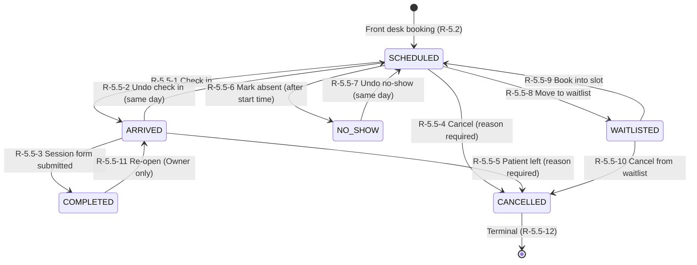
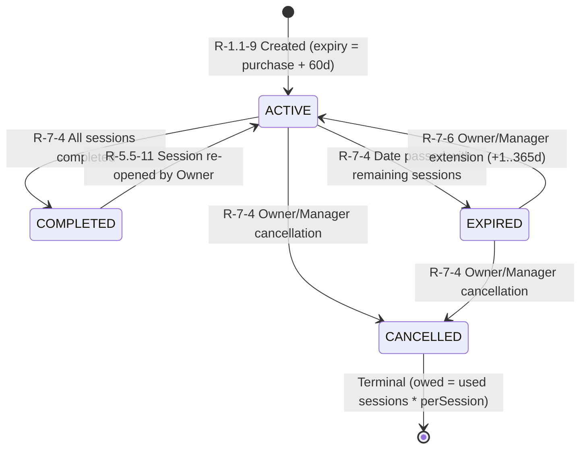
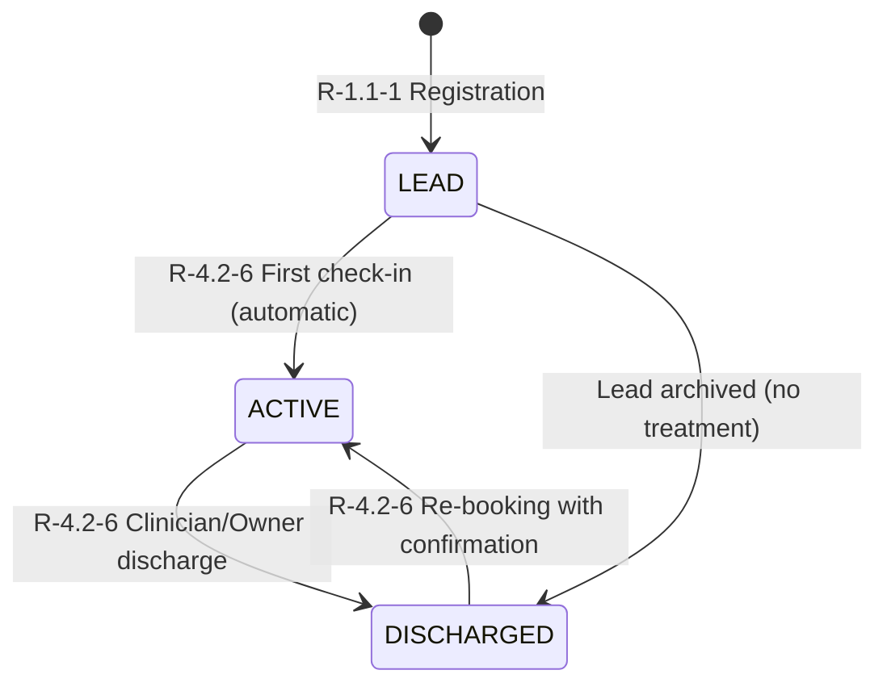
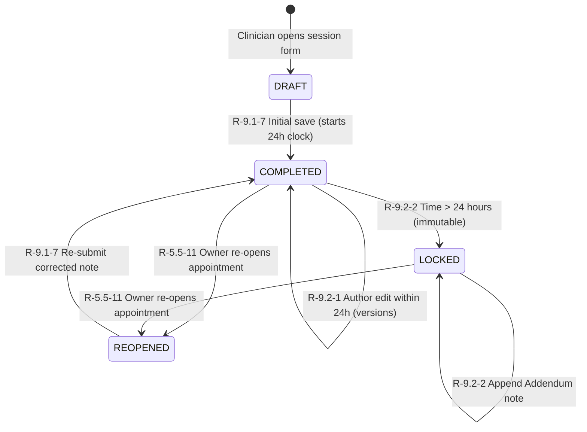
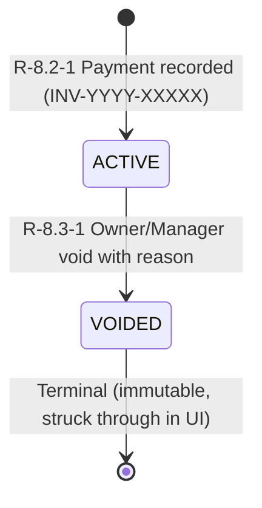
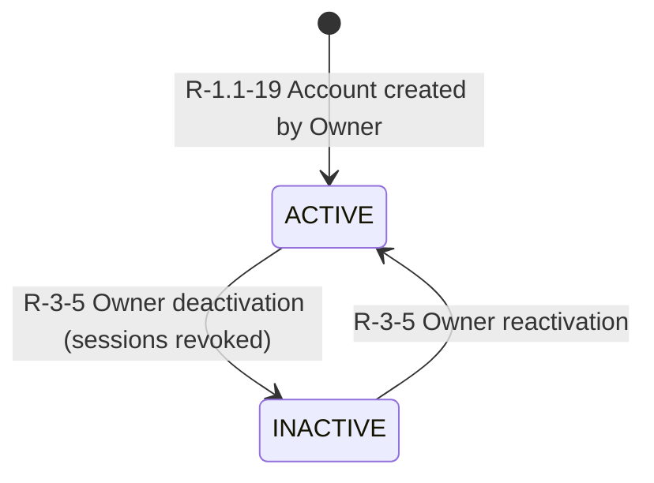
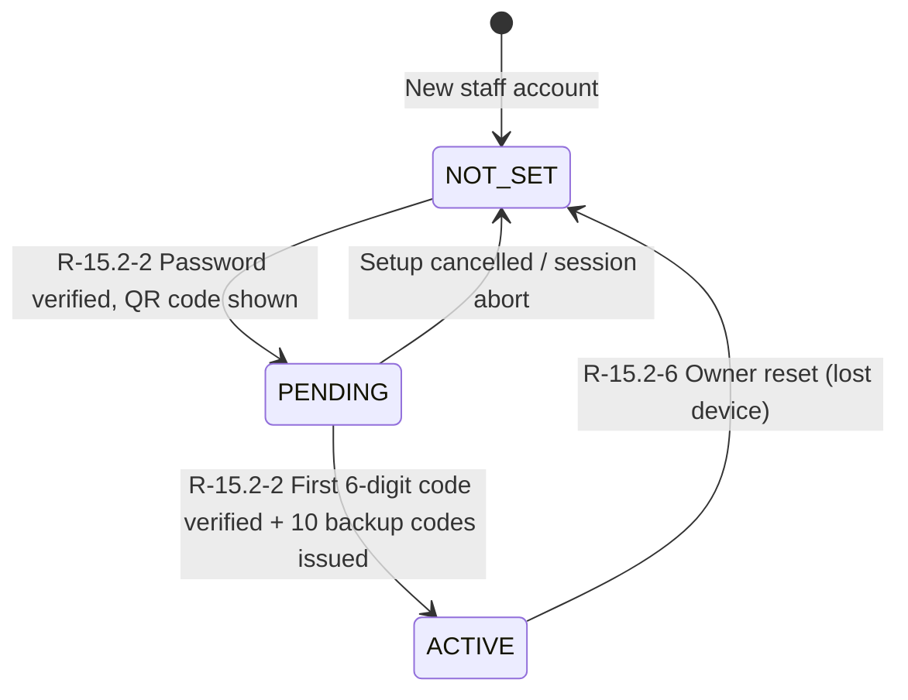

# Masaar Clinic System — Domain State Machines Specification

This document defines the official state machines, allowed state transitions, business rules, side effects, role permissions, and explicit forbidden transitions for all core entities in the Masaar Clinic System.

- **Specification Reference:** [docs/FEATURES-v2.2.md](file:///F:/Claude%20CRM/docs/FEATURES-v2.2.md) (§5.5, §7, §9.2, §8.2, §8.3, §3, §15.2, §4.1, §4.2)
- **Rules Catalog Reference:** [docs/design/rules-index.md](file:///F:/Claude%20CRM/docs/design/rules-index.md)
- **Glossary Reference:** [docs/design/glossary.md](file:///F:/Claude%20CRM/docs/design/glossary.md)
- **Permissions Reference:** [docs/design/permissions.md](file:///F:/Claude%20CRM/docs/design/permissions.md) & [src/domain/permissions.ts](file:///F:/Claude%20CRM/src/domain/permissions.ts)
- **Architecture Decisions:** 
  - [DEC-003](file:///F:/Claude%20CRM/docs/design/decisions.md) (Zero hard deletes; business records deactivated, voided, or cancelled)
  - [DEC-005](file:///F:/Claude%20CRM/docs/design/decisions.md) (Calculated values are never stored in the database)
  - [DEC-008](file:///F:/Claude%20CRM/docs/design/decisions.md) (Waitlist releases bed and clinician slot, but holds package session)
  - [DEC-016](file:///F:/Claude%20CRM/docs/design/decisions.md) (24-hour note edit window measured from `completedAt`)
  - [DEC-018](file:///F:/Claude%20CRM/docs/design/decisions.md) (Dual-phase late arrival detection and notification)
  - [DEC-023](file:///F:/Claude%20CRM/docs/design/decisions.md) (Cancelled package balance formula: owed = completed sessions × per-session value)
- **Code Implementations:** Typed pure data files in [src/domain/status/*.ts](file:///F:/Claude%20CRM/src/domain/status/) and [src/domain/appointmentStatus.ts](file:///F:/Claude%20CRM/src/domain/appointmentStatus.ts)

---

## Universal State Machine Governance Rules

1. **Strict Transition Whitelist ([R-5.5-12](file:///F:/Claude%20CRM/docs/FEATURES-v2.2.md)):** Any transition not explicitly defined in the allowed transitions tables below is **blocked by default**.
2. **Zero Hard Deletion ([DEC-003](file:///F:/Claude%20CRM/docs/design/decisions.md)):** Entities are never deleted from the database. Lifecycle terminations occur strictly through `CANCELLED`, `VOIDED`, `DISCHARGED`, or `INACTIVE` states.
3. **Audit Trail Completeness ([R-13-1](file:///F:/Claude%20CRM/docs/FEATURES-v2.2.md)):** Every status transition writes an immutable audit record containing: `timestamp`, `userId`, `role`, `entity`, `entityId`, `fromStatus`, `toStatus`, `reason`, and `ipAddress`.
4. **Calculated State Independence ([DEC-005](file:///F:/Claude%20CRM/docs/design/decisions.md)):** States derived from time or child counters (such as package expiration or session balances) are verified and derived at runtime, avoiding stale database flags.

---

## 1. Appointment State Machine

The Appointment state machine governs the operational flow of patient visits through scheduling, check-in, treatment completion, cancellation, no-shows, and standby waitlisting.

- **Spec Reference:** §5.5 (rules `R-5.5-1` to `R-5.5-13`), §5.2, §5.4, §6.2, §14
- **TypeScript Data:** [src/domain/status/appointment.ts](file:///F:/Claude%20CRM/src/domain/status/appointment.ts) & [src/domain/appointmentStatus.ts](file:///F:/Claude%20CRM/src/domain/appointmentStatus.ts)

### 1.1 Status Definitions

| Status | English Label | Arabic Label | Description | Terminal? |
|---|---|---|---|:---:|
| `SCHEDULED` | Scheduled | مجدول | Appointment booked for a specific clinician, bed, date and time slot. | ❌ |
| `ARRIVED` | Arrived / Checked In | حضر / تم تسجيل الدخول | Patient is physically present in the clinic reception waiting area. | ❌ |
| `COMPLETED` | Completed | مكتمل | Treatment delivered; SOAP/InBody clinical note submitted by treating clinician. | ❌ |
| `CANCELLED` | Cancelled | ملغي | Appointment cancelled with recorded reason. Permanent terminal state. | ✅ |
| `NO_SHOW` | No Show | لم يحضر | Patient failed to attend without prior cancellation notice. | ❌ |
| `WAITLISTED` | Waitlisted | قائمة انتظار | Standby reservation; bed/clinician slot freed, package session held. | ❌ |

*(Note on Rescheduling: Rescheduling updates the appointment's calendar date, time, and bed while preserving the `SCHEDULED` state with an audit trail and WhatsApp confirmation; it is not a terminal state).*

### 1.2 State Transition Diagram

### 1.3 Allowed Transitions Table

| ID | From | To | Allowed Roles | Reason Req.? | Time Limit | Conditions & Side Effects | Rule IDs |
|:---:|:---:|:---:|---|:---:|---|---|:---:|
| **TR-APPT-01** | `SCHEDULED` | `ARRIVED` | Receptionist, Manager, Owner | ❌ | On or after start time | Stores `arrivedAt`; calculates `lateMinutes` if arrival > start time; notifies clinician ([R-14-1](file:///F:/Claude%20CRM/docs/FEATURES-v2.2.md), [R-14-2](file:///F:/Claude%20CRM/docs/FEATURES-v2.2.md)); auto-activates patient if `LEAD` ([R-4.2-6](file:///F:/Claude%20CRM/docs/FEATURES-v2.2.md)). | R-5.5-1 R-1.1-5 R-4.2-6 |
| **TR-APPT-02** | `ARRIVED` | `SCHEDULED` | Receptionist, Manager, Owner | ✅ | Same calendar day only | Reverses mistaken check-in; clears `arrivedAt` and `lateMinutes`; notifies assigned clinician. | R-5.5-2 R-6-2 |
| **TR-APPT-03** | `ARRIVED` | `COMPLETED` | Assigned Clinician, Owner | ❌ | During or after start time | Clinician submits completion form ([R-9.1-7](file:///F:/Claude%20CRM/docs/FEATURES-v2.2.md)); consumes 1 package session if linked; calculates clinician commission ([R-11-1](file:///F:/Claude%20CRM/docs/FEATURES-v2.2.md)); starts 24h note edit countdown ([DEC-016](file:///F:/Claude%20CRM/docs/design/decisions.md)). | R-5.5-3 R-1.1-7 R-9.1-7 R-11-1 |
| **TR-APPT-04** | `SCHEDULED` | `CANCELLED` | Receptionist, Manager, Owner, Clinician (own) | ✅ | Prior to session start | Clinicians cancel own appointments only ([R-1.1-4](file:///F:/Claude%20CRM/docs/FEATURES-v2.2.md)); frees bed and clinician slot; **no package session deducted** ([R-5.5-13](file:///F:/Claude%20CRM/docs/FEATURES-v2.2.md)); status is permanently terminal. | R-5.5-4 R-1.1-4 R-5.5-12 R-5.5-13 |
| **TR-APPT-05** | `ARRIVED` | `CANCELLED` | Receptionist, Manager, Owner | ✅ | Same day while in arrived | Patient left clinic before treatment began; frees bed/clinician; **no package session deducted** ([R-5.5-13](file:///F:/Claude%20CRM/docs/FEATURES-v2.2.md)); notifies clinician ([R-14-3](file:///F:/Claude%20CRM/docs/FEATURES-v2.2.md)). | R-5.5-5 R-5.5-12 R-5.5-13 R-14-3 |
| **TR-APPT-06** | `SCHEDULED` | `NO_SHOW` | Receptionist, Manager, Owner, Clinician (own) | ✅ | Only on or after start time | Frees bed for walk-ins; **no package session deducted** ([R-5.5-13](file:///F:/Claude%20CRM/docs/FEATURES-v2.2.md)); updates clinician attendance metrics ([R-12-5](file:///F:/Claude%20CRM/docs/FEATURES-v2.2.md), [R-12-6](file:///F:/Claude%20CRM/docs/FEATURES-v2.2.md)). | R-5.5-6 R-1.1-6 R-5.5-13 |
| **TR-APPT-07** | `NO_SHOW` | `SCHEDULED` | Receptionist, Manager, Owner, Clinician (own) | ✅ | Same calendar day only | Reverses mistaken absence; restores appointment to `SCHEDULED`; clears absence from metrics; re-validates bed. | R-5.5-7 R-1.1-6 |
| **TR-APPT-08** | `SCHEDULED` | `WAITLISTED` | Receptionist, Manager, Owner | ✅ | Prior to/on date | Retains record; frees bed and clinician slots; **retains package session hold** against `availableSessions` ([DEC-008](file:///F:/Claude%20CRM/docs/design/decisions.md), [R-5.5-8](file:///F:/Claude%20CRM/docs/FEATURES-v2.2.md)). | R-5.5-8 R-1.1-4 DEC-008 |
| **TR-APPT-09** | `WAITLISTED` | `SCHEDULED` | Receptionist, Manager, Owner | ❌ | While package valid | Full collision checks re-run as a new booking (clinician hours, bed availability, closures); assigns confirmed slot. | R-5.5-9 R-1.1-4 R-5.2-1 |
| **TR-APPT-10** | `WAITLISTED` | `CANCELLED` | Receptionist, Manager, Owner | ✅ | Any time on waitlist | Releases held package session back to available package sessions ([R-5.5-10](file:///F:/Claude%20CRM/docs/FEATURES-v2.2.md)); terminal. | R-5.5-10 R-1.1-4 R-5.5-12 |
| **TR-APPT-11** | `COMPLETED` | `ARRIVED` | Owner ONLY | ✅ | Discretionary owner action | Restores consumed package session to patient package ([R-5.5-11](file:///F:/Claude%20CRM/docs/FEATURES-v2.2.md)); reverses clinician commission calculation; re-opens session for correction. | R-5.5-11 R-1.1-8 R-13-1 |

### 1.4 Cancellation & No-Show Reason Categories ([R-5.5-13](file:///F:/Claude%20CRM/docs/FEATURES-v2.2.md))

Every transition to `CANCELLED` or `NO_SHOW` requires selecting one of the standard categories:
1. `PATIENT_REQUEST` (طلب المريض)
2. `ILLNESS` (ظرف صحي / مرض)
3. `TRANSPORT` (مواصلات / عائق مروري)
4. `EMERGENCY` (ظرف طارئ)
5. `NO_CONTACT` (تعذر التواصل مع المريض)
6. `CLINIC_INITIATED` (إلغاء من طرف العيادة / الطبيب غير متاح)
7. `OTHER` (سبب آخر — يتطلب كتابة توضيح نصي إلزامي)

### 1.5 Explicit Forbidden Transitions

| From | To | Reason & Business Justification | Enforcing Rules |
|---|---|---|:---:|
| `CANCELLED` | *Any status* | `CANCELLED` is strictly final ([R-5.5-12](file:///F:/Claude%20CRM/docs/FEATURES-v2.2.md)). Patients must book a new appointment. | R-5.5-12 |
| `SCHEDULED` | `COMPLETED` | Sessions cannot be completed without patient checking in to `ARRIVED` first ([R-5.5-3](file:///F:/Claude%20CRM/docs/FEATURES-v2.2.md)). | R-5.5-3, R-5.5-12 |
| `COMPLETED` | `SCHEDULED` | Cannot reset completed visit to scheduled directly; Owner must re-open to `ARRIVED` first ([R-5.5-11](file:///F:/Claude%20CRM/docs/FEATURES-v2.2.md)). | R-5.5-11, R-5.5-12 |
| `COMPLETED` | `CANCELLED` | Clinical treatments delivered cannot be cancelled directly; requires Owner re-opening first. | R-5.5-11, R-5.5-12 |
| `COMPLETED` | `NO_SHOW` | Completed clinical session proves patient attended. Marking no-show is impossible. | R-5.5-12 |
| `COMPLETED` | `WAITLISTED` | Completed session records cannot be put on standby. | R-5.5-12 |
| `NO_SHOW` | `ARRIVED` | Direct check-in from no-show is blocked. Must undo to `SCHEDULED` first, then check in. | R-5.5-7, R-5.5-12 |
| `NO_SHOW` | `COMPLETED` | Cannot deliver treatment to a patient recorded as absent without restoring to `SCHEDULED` and `ARRIVED`. | R-5.5-3, R-5.5-7 |
| `NO_SHOW` | `CANCELLED` | Cannot cancel absent patient; record already reflects no-show. | R-5.5-7, R-5.5-12 |
| `NO_SHOW` | `WAITLISTED` | Cannot move absent record directly to waitlist. | R-5.5-12 |
| `WAITLISTED` | `ARRIVED` | Waitlisted patients do not have a confirmed bed or slot; must be scheduled first ([R-5.5-9](file:///F:/Claude%20CRM/docs/FEATURES-v2.2.md)). | R-5.5-9, R-5.5-12 |
| `WAITLISTED` | `COMPLETED` | Cannot deliver session without scheduling and arrival. | R-5.5-3, R-5.5-9 |
| `WAITLISTED` | `NO_SHOW` | No-show cannot occur without a committed calendar time slot. | R-5.5-12 |
| `ARRIVED` | `NO_SHOW` | Patient is physically in the clinic. If patient leaves, use `ARRIVED -> CANCELLED` ([R-5.5-5](file:///F:/Claude%20CRM/docs/FEATURES-v2.2.md)). | R-5.5-5, R-5.5-12 |
| `ARRIVED` | `WAITLISTED` | Patient is already in the clinic waiting room. | R-5.5-12 |

---

## 2. Package State Machine

The Package state machine governs multi-session treatment packages (Physiotherapy or Nutrition courses, [DEC-009](file:///F:/Claude%20CRM/docs/design/decisions.md)), session consumption, expiration, administrative validity extensions, and cancellations.

- **Spec Reference:** §7 (rules `R-7-1` to `R-7-8`), §8.1 (`R-8.1-3`), §8.3 (`R-8.3-2`), §2 (`R-2-5`, `R-2-6`)
- **TypeScript Data:** [src/domain/status/package.ts](file:///F:/Claude%20CRM/src/domain/status/package.ts)

### 2.1 Status Definitions

| Status | English Label | Arabic Label | Description | Terminal? |
|---|---|---|---|:---:|
| `ACTIVE` | Active | نشط | Package is within validity date (`today <= expiryDate`) and has available sessions. | ❌ |
| `COMPLETED` | Completed | مكتمل | All package sessions have been delivered (`completedSessions == totalSessions`). | ❌ |
| `EXPIRED` | Expired | منتهي الصلاحية | Validity period elapsed (`today > expiryDate`) with unused sessions; remaining sessions forfeited. | ❌ |
| `CANCELLED` | Cancelled | ملغي | Cancelled by Owner/Manager; financial owed amount adjusted to completed sessions. | ✅ |

### 2.2 State Transition Diagram

### 2.3 Allowed Transitions Table

| ID | From | To | Allowed Roles | Reason Req.? | Time Limit / Trigger | Conditions & Side Effects | Rule IDs |
|:---:|:---:|:---:|---|:---:|---|---|:---:|
| **TR-PKG-01** | `ACTIVE` | `COMPLETED` | Assigned Clinician, Owner | ❌ | Automatic upon last session completion | Triggered when `completedSessions == totalSessions`; remaining available sessions become 0; prevents further bookings. | R-7-4 R-9.1-7 |
| **TR-PKG-02** | `ACTIVE` | `EXPIRED` | System / Automatic | ❌ | Triggered when `today > expiryDate` | Remaining unused sessions are permanently **forfeited** ([R-7-4](file:///F:/Claude%20CRM/docs/FEATURES-v2.2.md)); booking future dates blocked ([R-7-8](file:///F:/Claude%20CRM/docs/FEATURES-v2.2.md)); **unpaid balance remains strictly owed** ([R-7-5](file:///F:/Claude%20CRM/docs/FEATURES-v2.2.md)). | R-7-4 R-7-5 R-7-8 |
| **TR-PKG-03** | `EXPIRED` | `ACTIVE` | Owner, Manager | ✅ | Range: 1 to 365 days | Owner/Manager extends package ([R-7-6](file:///F:/Claude%20CRM/docs/FEATURES-v2.2.md)); `expiryDate` updated to `oldExpiry + N days`; restores previously forfeited sessions to `ACTIVE` available status; audited. | R-7-6 R-1.1-10 R-13-1 |
| **TR-PKG-04** | `ACTIVE` | `CANCELLED` | Owner, Manager | ✅ | Any time prior to full consumption | Recalculates liability: $\text{owed} = \text{completedSessions} \times \text{perSessionValue}$ ([R-8.1-3](file:///F:/Claude%20CRM/docs/FEATURES-v2.2.md), [DEC-023](file:///F:/Claude%20CRM/docs/design/decisions.md)); frees future reserved sessions; permits financial refund if paid > owed ([R-8.3-2](file:///F:/Claude%20CRM/docs/FEATURES-v2.2.md)); terminal. | R-7-4 R-1.1-10 R-8.1-3 R-8.3-2 |
| **TR-PKG-05** | `EXPIRED` | `CANCELLED` | Owner, Manager | ✅ | Post-expiration administrative settlement | Recalculates liability to used sessions; permits exceptional Owner refund ([R-8.3-2](file:///F:/Claude%20CRM/docs/FEATURES-v2.2.md)) or balance write-off ([R-7-5](file:///F:/Claude%20CRM/docs/FEATURES-v2.2.md)); terminal. | R-7-4 R-7-5 R-8.1-3 |
| **TR-PKG-06** | `COMPLETED` | `ACTIVE` | Owner | ✅ | Automatic upon Owner appointment re-open | Owner re-opens a completed appointment ([R-5.5-11](file:///F:/Claude%20CRM/docs/FEATURES-v2.2.md)); restores 1 session to package; if `today <= expiryDate`, package status returns to `ACTIVE` (or `EXPIRED` if past date). | R-5.5-11 R-7-4 R-1.1-8 |

### 2.4 Explicit Forbidden Transitions

| From | To | Reason & Business Justification | Enforcing Rules |
|---|---|---|:---:|
| `CANCELLED` | `ACTIVE` | Cancelled packages are permanently terminated. A new package must be created. | R-7-4 |
| `CANCELLED` | `COMPLETED` | Cannot complete a cancelled package. | R-7-4 |
| `CANCELLED` | `EXPIRED` | Cannot expire an already cancelled package. | R-7-4 |
| `COMPLETED` | `EXPIRED` | Completed packages have zero unconsumed sessions, so no sessions exist to forfeit. | R-7-4 |

---

## 3. Patient State Machine

The Patient state machine tracks patient relationship progression from initial administrative lead registration to active care and discharge.

- **Spec Reference:** §4.1 (`R-4.1-19`), §4.2 (`R-4.2-6`), §1.1 (`R-1.1-1`)
- **TypeScript Data:** [src/domain/status/patient.ts](file:///F:/Claude%20CRM/src/domain/status/patient.ts)

### 3.1 Status Definitions

| Status | English Label | Arabic Label | Description | Terminal? |
|---|---|---|---|:---:|
| `LEAD` | Lead / Registered | عميل محتمل / مسجل جديد | Profile registered; patient has not yet attended their first appointment. | ❌ |
| `ACTIVE` | Active | نشط | Patient has attended at least one clinic appointment and is receiving active care. | ❌ |
| `DISCHARGED` | Discharged | تم إنهاء العلاج / تخريج | Treatment plan concluded; file archived without active bookings. | ❌ |

### 3.2 State Transition Diagram

### 3.3 Allowed Transitions Table

| ID | From | To | Allowed Roles | Reason Req.? | Trigger & Conditions | Side Effects | Rule IDs |
|:---:|:---:|:---:|---|:---:|---|---|:---:|
| **TR-PAT-01** | `LEAD` | `ACTIVE` | Receptionist, Manager, Owner | ❌ | Automatic upon first check-in | Patient attends their first appointment and check-in is logged; sets `firstVisitAt` timestamp; status becomes `ACTIVE` ([R-4.2-6](file:///F:/Claude%20CRM/docs/FEATURES-v2.2.md)). | R-4.1-19 R-4.2-6 R-5.5-1 |
| **TR-PAT-02** | `ACTIVE` | `DISCHARGED` | Physiotherapist, Nutritionist, Owner | ✅ | Conclusion of care | Clinician or Owner marks patient discharged ([R-4.2-6](file:///F:/Claude%20CRM/docs/FEATURES-v2.2.md)); requires clinical discharge note / outcome evaluation; clears recurring schedule. | R-4.1-19 R-4.2-6 |
| **TR-PAT-03** | `DISCHARGED` | `ACTIVE` | Receptionist, Manager, Owner | ✅ | New booking created | Receptionist books new appointment or package for discharged patient; displays confirmation prompt; restores `ACTIVE` status ([R-4.2-6](file:///F:/Claude%20CRM/docs/FEATURES-v2.2.md)). | R-4.1-19 R-4.2-6 |
| **TR-PAT-04** | `LEAD` | `DISCHARGED` | Owner, Manager | ✅ | Administrative archive | Archiving uncontacted or inactive lead who declined treatment; audited. | R-4.1-19 R-13-1 |

### 3.4 Explicit Forbidden Transitions

| From | To | Reason & Business Justification | Enforcing Rules |
|---|---|---|:---:|
| `ACTIVE` | `LEAD` | Active patients have documented clinical visits and can never be reverted to a pre-visit lead. | R-4.1-19, R-4.2-6 |
| `DISCHARGED` | `LEAD` | Discharged patients have clinical treatment history and cannot be converted to a lead. | R-4.1-19, R-4.2-6 |

---

## 4. ClinicalNote State Machine

The ClinicalNote state machine enforces the 24-hour medical charting lock, version tracking, and immutable addendum governance.

- **Spec Reference:** §9.1 (`R-9.1-1` to `R-9.1-7`), §9.2 (`R-9.2-1`, `R-9.2-2`), §1.1 (`R-1.1-2`, `R-1.1-8`), [DEC-016](file:///F:/Claude%20CRM/docs/design/decisions.md)
- **TypeScript Data:** [src/domain/status/clinical-note.ts](file:///F:/Claude%20CRM/src/domain/status/clinical-note.ts)

### 4.1 Status Definitions

| Status | English Label | Arabic Label | Description | Terminal? |
|---|---|---|---|:---:|
| `DRAFT` | Draft / In Progress | مسودة / قيد التحرير | SOAP charting or InBody consultation form currently being entered. | ❌ |
| `COMPLETED` | Completed / Submitted | مكتمل / معتمد | Submitted session note; editable strictly by author for 24 hours. | ❌ |
| `LOCKED` | Locked (Immutable) | مغلق (غير قابل للتعديل) | 24-hour edit window elapsed; original text frozen; addenda only. | ✅ |
| `REOPENED` | Reopened by Owner | معاد فتحه بواسطة المالك | Session note re-opened following Owner re-opening of completed appointment. | ❌ |

### 4.2 State Transition Diagram

### 4.3 Allowed Transitions Table

| ID | From | To | Allowed Roles | Reason Req.? | Time Limit | Conditions & Side Effects | Rule IDs |
|:---:|:---:|:---:|---|:---:|---|---|:---:|
| **TR-NOTE-01** | `DRAFT` | `COMPLETED` | Assigned Clinician, Owner | ❌ | Session conclusion | Validated: $\ge 1$ S/O/A/P or treatment item filled ([R-9.1-6](file:///F:/Claude%20CRM/docs/FEATURES-v2.2.md)); sets `completedAt` timestamp; starts 24h edit window ([DEC-016](file:///F:/Claude%20CRM/docs/design/decisions.md)); marks appointment `COMPLETED`. | R-9.1-6 R-9.1-7 R-9.2-1 DEC-016 |
| **TR-NOTE-02** | `COMPLETED` | `COMPLETED` | Original Author ONLY | ❌ | $\le 24$ hours from `completedAt` | Author edits note text ([R-9.2-1](file:///F:/Claude%20CRM/docs/FEATURES-v2.2.md)); creates immutable version history snapshot (`versionNumber`, `editedAt`, `previousText`); Owner may only edit if author. | R-9.2-1 R-13-1 |
| **TR-NOTE-03** | `COMPLETED` | `LOCKED` | System / Automatic | ❌ | UTC time > `completedAt + 24h` | Sets `isLocked = true` and `lockedAt`; freezes original note text permanently; restricts future modifications strictly to Addenda. | R-9.2-1 R-9.2-2 |
| **TR-NOTE-04** | `LOCKED` | `LOCKED` | Clinician, Owner | ✅ | Any time post-lock | Author or covering clinician appends an immutable supplementary `Addendum` record; original note text remains 100% untouched. | R-9.2-2 R-13-1 |
| **TR-NOTE-05** | `COMPLETED` | `REOPENED` | Owner ONLY | ✅ | On appointment re-open | Triggered when Owner invokes re-open completed appointment ([R-5.5-11](file:///F:/Claude%20CRM/docs/FEATURES-v2.2.md)); restores package session; enables charting correction. | R-5.5-11 R-1.1-8 |
| **TR-NOTE-06** | `LOCKED` | `REOPENED` | Owner ONLY | ✅ | Exceptional audit re-open | Owner re-opens completed appointment after 24h under high audit oversight; restores appointment to `ARRIVED`; restores package session. | R-5.5-11 R-1.1-8 R-13-1 |
| **TR-NOTE-07** | `REOPENED` | `COMPLETED` | Assigned Clinician, Owner | ❌ | Post-correction submission | Re-submits corrected note; resets `completedAt` to current UTC time; restarts 24h edit countdown; consumes package session. | R-9.1-7 R-9.2-1 |

### 4.4 Explicit Forbidden Transitions

| From | To | Reason & Business Justification | Enforcing Rules |
|---|---|---|:---:|
| `LOCKED` | `COMPLETED` | Locked notes cannot be directly unlocked to `COMPLETED`; corrections must be appended as Addenda unless Owner re-opens session. | R-9.2-2 |
| `LOCKED` | `DRAFT` | Locked notes cannot revert to draft. | R-9.2-2 |
| `COMPLETED` | `DRAFT` | Submitted notes cannot be reverted to unsubmitted drafts; edits must be versioned. | R-9.2-1 |

---

## 5. Receipt State Machine

The Receipt state machine manages payment receipts, annual sequence numbering, cash shift attribution, and irreversible voiding governance.

- **Spec Reference:** §8.2 (`R-8.2-1` to `R-8.2-4`), §8.3 (`R-8.3-1` to `R-8.3-3`), §1.1 (`R-1.1-11`, `R-1.1-12`), [DEC-017](file:///F:/Claude%20CRM/docs/design/decisions.md)
- **TypeScript Data:** [src/domain/status/receipt.ts](file:///F:/Claude%20CRM/src/domain/status/receipt.ts)

### 5.1 Status Definitions

| Status | English Label | Arabic Label | Description | Terminal? |
|---|---|---|---|:---:|
| `ACTIVE` | Active / Valid | نشط / ساري | Valid payment receipt; credited towards patient charge balance and cash drawer. | ❌ |
| `VOIDED` | Voided | ملغي / باطل | Receipt voided due to error; visible struck through; excluded from financial totals. | ✅ |

### 5.2 State Transition Diagram

### 5.3 Allowed Transitions Table

| ID | From | To | Allowed Roles | Reason Req.? | Time Limit / Conditions | Side Effects | Rule IDs |
|:---:|:---:|:---:|---|:---:|---|---|:---:|
| **TR-RCP-01** | `ACTIVE` | `VOIDED` | Owner, Manager ONLY | ✅ | Post-issuance correction | Receptionist strictly blocked ([R-1.1-12](file:///F:/Claude%20CRM/docs/FEATURES-v2.2.md)); stores `voidedAt`, `voidedByUserId`, and mandatory reason ([R-8.3-1](file:///F:/Claude%20CRM/docs/FEATURES-v2.2.md)); receipt remains visible struck through in UI; excluded from collections and cash closings; restores outstanding balance ([R-8.1-3](file:///F:/Claude%20CRM/docs/FEATURES-v2.2.md)); audited. | R-8.3-1 R-1.1-12 R-8.1-3 R-8.4-3 |

### 5.4 Explicit Forbidden Transitions

| From | To | Reason & Business Justification | Enforcing Rules |
|---|---|---|:---:|
| `VOIDED` | `ACTIVE` | Voided receipts can never be un-voided. A new payment receipt must be issued if needed. | R-8.3-1, DEC-003 |

---

## 6. Staff State Machine

The Staff state machine manages employee lifecycle, system access, session revocation, and scheduling availability.

- **Spec Reference:** §3 (`R-3-1`, `R-3-5`), §1.1 (`R-1.1-19`), §15.1 (`R-15.1-5`), [DEC-003](file:///F:/Claude%20CRM/docs/design/decisions.md)
- **TypeScript Data:** [src/domain/status/staff.ts](file:///F:/Claude%20CRM/src/domain/status/staff.ts)

### 6.1 Status Definitions

| Status | English Label | Arabic Label | Description | Terminal? |
|---|---|---|---|:---:|
| `ACTIVE` | Active | نشط | Staff member account active; permitted to log in and eligible for booking appointments. | ❌ |
| `INACTIVE` | Inactive / Deactivated | معطل / غير نشط | Account deactivated; login blocked; removed from scheduling; historical data fully preserved. | ❌ |

### 6.2 State Transition Diagram

### 6.3 Allowed Transitions Table

| ID | From | To | Allowed Roles | Reason Req.? | Trigger & Conditions | Side Effects | Rule IDs |
|:---:|:---:|:---:|---|:---:|---|---|:---:|
| **TR-STF-01** | `ACTIVE` | `INACTIVE` | Owner ONLY | ✅ | Immediate Owner action | Sets `isActive = false` ([R-3-5](file:///F:/Claude%20CRM/docs/FEATURES-v2.2.md)); immediately terminates all active login sessions on next server request ([R-15.1-5](file:///F:/Claude%20CRM/docs/FEATURES-v2.2.md)); revokes trusted devices ([R-15.2-4](file:///F:/Claude%20CRM/docs/FEATURES-v2.2.md)); removes clinician from booking lists; preserves all historical notes/receipts intact; audited. | R-3-5 R-1.1-19 R-15.1-5 R-15.2-4 |
| **TR-STF-02** | `INACTIVE` | `ACTIVE` | Owner ONLY | ✅ | Discretionary Owner action | Sets `isActive = true`; restores login capabilities; restores clinician visibility in appointment booking dropdowns; audited. | R-3-5 R-1.1-19 R-13-1 |

### 6.4 Explicit Forbidden Transitions

| From | To | Reason & Business Justification | Enforcing Rules |
|---|---|---|:---:|
| `ACTIVE` | `INACTIVE` | Owner is strictly forbidden from deactivating their own active account to prevent administrative lockout. | R-1.1-19, R-15.1-5 |

---

## 7. OTP Enrollment State Machine

The OTP Enrollment state machine manages two-step verification (Authenticator TOTP, [DEC-007](file:///F:/Claude%20CRM/docs/design/decisions.md)), emergency backup codes, and administrative resets.

- **Spec Reference:** §15.2 (`R-15.2-1` to `R-15.2-7`), §1.1 (`R-1.1-19`), [DEC-007](file:///F:/Claude%20CRM/docs/design/decisions.md)
- **TypeScript Data:** [src/domain/status/otp-enrollment.ts](file:///F:/Claude%20CRM/src/domain/status/otp-enrollment.ts)

### 7.1 Status Definitions

| Status | English Label | Arabic Label | Description | Terminal? |
|---|---|---|---|:---:|
| `NOT_SET` | Not Set / Unenrolled | غير مفعل / لم يتم الإعداد | User has not yet set up two-factor authentication (new user or post Owner reset). | ❌ |
| `PENDING` | Pending Verification | قيد التحقق والتأكيد | QR code generated; awaiting first valid 6-digit verification code. | ❌ |
| `ACTIVE` | Active / Enforced | مفعل / ساري | Two-step verification active and enforced for every login. | ❌ |

### 7.2 State Transition Diagram

### 7.3 Allowed Transitions Table

| ID | From | To | Allowed Roles | Reason Req.? | Trigger & Conditions | Side Effects | Rule IDs |
|:---:|:---:|:---:|---|:---:|---|---|:---:|
| **TR-OTP-01** | `NOT_SET` | `PENDING` | Any Staff User | ❌ | First login with password | Generates encrypted TOTP secret key ([R-15.2-7](file:///F:/Claude%20CRM/docs/FEATURES-v2.2.md)); renders QR code on enrollment screen ([R-15.2-2](file:///F:/Claude%20CRM/docs/FEATURES-v2.2.md)); audits setup start. | R-15.2-2 R-15.2-7 R-15.4-3 |
| **TR-OTP-02** | `PENDING` | `ACTIVE` | Any Staff User | ❌ | Within 30s code window | User enters valid 6-digit code matching secret ([R-15.2-2](file:///F:/Claude%20CRM/docs/FEATURES-v2.2.md)); activates TOTP; generates and displays 10 hashed backup codes (shown once); completes login. | R-15.2-2 R-15.1-4 R-15.4-3 |
| **TR-OTP-03** | `PENDING` | `NOT_SET` | Any Staff User | ❌ | Session abort | User aborts enrollment or browser session expires before code confirmation; discards unconfirmed secret. | R-15.2-2 |
| **TR-OTP-04** | `ACTIVE` | `NOT_SET` | Owner ONLY | ✅ | Owner administrative reset | Owner resets OTP for staff member with lost phone ([R-15.2-6](file:///F:/Claude%20CRM/docs/FEATURES-v2.2.md)); clears secrets; revokes all backup codes and trusted devices ([R-15.2-4](file:///F:/Claude%20CRM/docs/FEATURES-v2.2.md)); forces re-enrollment at next login. | R-15.2-6 R-1.1-19 R-15.2-4 R-15.4-3 |

### 7.4 Explicit Forbidden Transitions

| From | To | Reason & Business Justification | Enforcing Rules |
|---|---|---|:---:|
| `NOT_SET` | `ACTIVE` | Direct activation without entering a valid confirmation code from the Authenticator app is strictly blocked. | R-15.2-2 |

---

## 8. Summary of State Machine Metrics

| Machine Name | Valid Statuses | Allowed Transitions | Explicit Forbidden Rules | Primary Spec Section |
|---|:---:|:---:|:---:|:---:|
| **Appointment** | 6 | 11 | 18 | §5.5 (`R-5.5-1` .. `R-5.5-13`) |
| **Package** | 4 | 6 | 4 | §7 (`R-7-1` .. `R-7-8`) |
| **Patient** | 3 | 4 | 2 | §4.1 (`R-4.1-19`), §4.2 (`R-4.2-6`) |
| **ClinicalNote** | 4 | 7 | 3 | §9.1, §9.2 (`R-9.2-1`, `R-9.2-2`) |
| **Receipt** | 2 | 1 | 1 | §8.2, §8.3 (`R-8.3-1`, `R-8.3-2`) |
| **Staff** | 2 | 2 | 1 | §3 (`R-3-1` .. `R-3-5`), §15.1 |
| **OtpEnrollment** | 3 | 4 | 1 | §15.2 (`R-15.2-1` .. `R-15.2-7`) |
| **TOTALS** | **24 statuses** | **35 transitions** | **30 explicit forbidden** | **Whole Spec** |

Every state transition and forbidden rule is exported as typed, frozen TypeScript data in [src/domain/status/](file:///F:/Claude%20CRM/src/domain/status/), ready to feed automated test generation in Stage 2.
